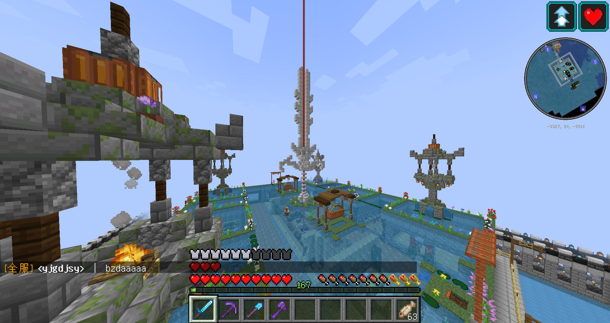
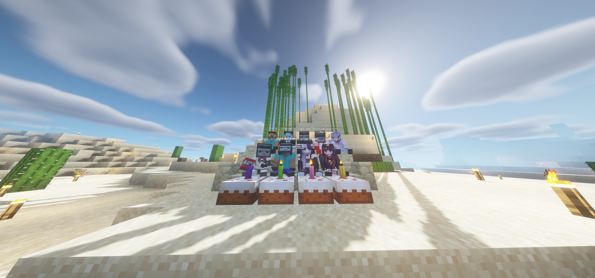

# 从零

## 熔火未熄

最开始的一周目与零周目没有多大的区别，玩家基本是从零周目留下的几位。  
随着 RedWhite 在更新中逐步加入各类插件才缓缓形成了一周目的真正雏形，一个插件生存服。  
一周目真正的雏形也就是在这一时期长出来的。红白在更新里陆续加进四样东西：地标、经济、传送、称号。加上这四样之后，一周目从“和零周目差不多的生存”变成了另一种东西 —— 一个插件生存服。

在这一切后腐竹把服务器传到了各个平台，同时也和玩家开始拍摄了第一条宣传片。遗憾的是，我们已经完全无法找到它了；没有播放量，没有日期，也没有片子本身。唯一能够确定的，是只能它存在过。  
在这段时间里，也推出了一项特殊的制度：拉新奖励。大部分人喜欢的是无限经修弓，cbw 要的是效率 X 镐子，黑猫是 255 击退棒。仅举几例，不胜枚举。  

最初的主城是这一期最重要的工程。先前文档内的描述大概是，“RedWhite的心血结晶，万恶的资本主义交易系统，全服人都会去的地方”，“pvp圣地（划掉）”，“抽取创造飞行处（再划掉）”。  
主城的树上藏过一个箱子，里面是一把建造主城时用过的小木斧、一把封存的 OP 小木剑，可能还有一把随手放的剪刀。这个彩蛋在以 Hot__doggy 为首的几名玩家登顶之后被删掉了。有人追问顶上的箱子里到底有什么东西，到最后也没能知道，因为大家都没有权限打开它。  
主城是一个通向无法获取之物的枢纽。  
主城的商店用的是 QuickShop，用来收购各种农产品和矿物。

## 草蛇灰线

QuickShop 有一个相当致命的缺陷：没有动态价格。无论卖多少，收购、卖出价格都是一样的。于是全服的经济史有了第一个红白笑话 —— Esrafv 一个晚上通过农场售卖农作物把余额加到了服务器第二，而第一？第一是红白。  
这条爆点甚至可以一直拉到一年以后。二〇二二年一月一日晚上，Xuan_xi 在公屏上抗议收购价：  
> 胡萝卜三毛南瓜六毛  

红白当场调价，调完说：  
> 不能多了，有些人要发死  

一月八日下午，欧阳清了一次经济，理由是：  
> 一晚上170万的故事知道吗  
> 他们的钱是刷的  

到三月十二日，全服总金额显示为**负两千亿**，一个人的余额是**一千九百九十九亿**。仅仅用了一年，QS 就把经济系统变成了滚木，通胀率可能比冥币还要高一点。

抽飞行也是这一时期的产物。  
主城有一个“抽取飞行处”，价目是五千元一次。这个机制的死亡率高得离谱：二〇二二年一月二十七、二十八两日，至少六个人因为“在抽飞行时不幸去世”上了公告，其中包括 wsts、Hadinxyl、A1020A、RG1628，这些数据出自笔者电脑内回收的日志。经过估计，死亡的几率应该为 95%。  

血条可突破和死亡不掉落也是这一时期出现的产物。血条可以靠技能和装备突破二十点上限，死亡不掉落让所有冒险都没有代价，当然这是废话。  
苏哥后来在归档的前言里把这几条并列写出来，结论是生存基本容易毕业。  

### 这里是Yarinaoshi的补充

当时某个周目主城收购熟猪排，5rwb一个，当时的版本更新了疣猪兽陷阱，那时候有个玩家熬夜一晚上把自己的经济从全服二十多干到全服第二还是第三（当然第一是红白调试的时候搞出来的数据）。QS魅力时刻  
为什么当时会有玩家热衷于去刷货币呢？因为当时还有很多的op武器和一些奇奇怪怪的小玩意，有玩家拿到拍卖行拍卖，当时的经济系统是很活跃的，以至于有一些比较大的交易处（seaty）  

## 上古大能？

关于这一期的人口，我们能用的只有一张照片。

摄于二〇二一年七月三十一日下午三点二十分。  
上排是 Morvens、黑猫、hmcl、Starcat、HTKMHTKM、Unicorntyan，下排是欧阳、ReporterSauce、红白、小风、ztj。

后来的人经常回忆起黄金时代，却总是想不起来一开始这里是什么样。也因此，这里的故事显得过于短促而苍白；也很难有人记得这里一开始的样子。  
