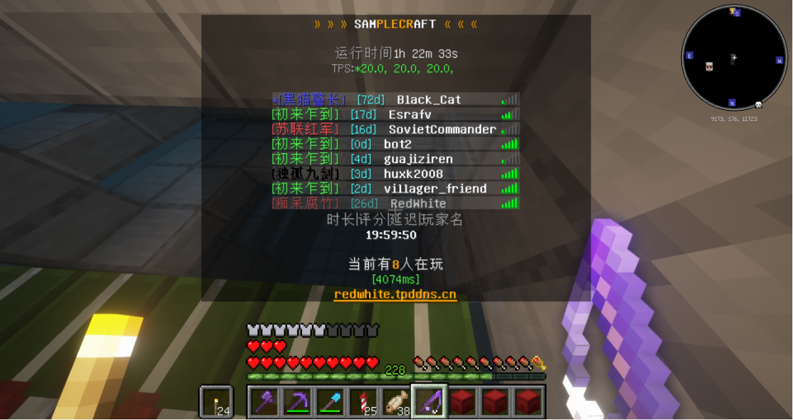
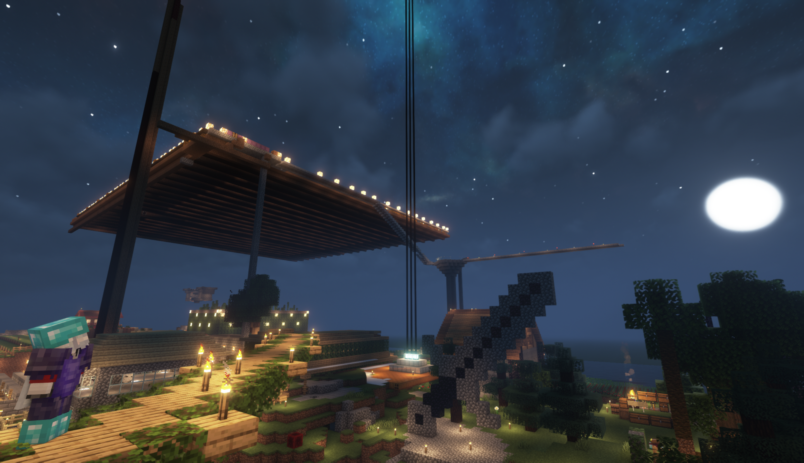

# 上升

虽然宣传片收效甚微，但是也引来了一些新玩家，伴随着他们的到来，服务器中的各个建筑群开始初现雏形。  
同时随着其中一部分特殊玩家的到来，也在服务器中铺就了一条新的道路：生电  
这对服务器的影响可谓是相当深远，尤其明显的体现在了后续的第三迭代，不过那都是后来的事了，另一位笔者应该会在之后提到。  
在这段时期，得益于生电的发展，服务器进展迅速，同时在玩家们口口相传的宣传下服务器又迎来了大量的新玩家。  
服务器就此进入了一周目的全新阶段 ———— 繁荣年代·鼎盛期。

## 生电是什么，可以吃吗

二〇二一年夏天，一批特殊玩家进了服务器；后来这群人有了具体的名称，“生电玩家”。  
生电是红石机器的另一种说法：刷铁机、刷怪塔、树场、甘蔗机、熔炉组、凋零骷髅塔，诸如此类。这些“机器”只要建成，一个玩家需要的物资就不再靠挖、靠等、靠人力收集。  

生电改变了一周目的时间感。在此之前，一个新人进服要做的事是找地方住、挖矿、慢慢攒、然后给自己没事找事干；在此之后，他可以先 warp 到农场，从公用箱子里拿一套装备，看一眼熔炉组、铁机，树机怎么工作，然后决定自己要不要也造一台。  
农场是这条路的入口，也是这一期最重要的地方：它是服务器里最古老、发展最前锋的基地，机器齐全，传送次数仅次于主城和 seaty，孕育了绝大部分新入服的玩家。  
物产过剩之后，箱子商店的意义就变了。二〇二二年一月二十二日下午，欧阳在后台算是公开声明了服务器的定位：  

> 算是原版吧  
> 加了一点点非原版的东西  
> 不影响，主要是生电  
> 箱子商店基本没用，单纯是用来解决物产过剩  
> 生电服经济就不用看了，跟玩一样  

生电是直接生产力，商店是**垃圾处理**，钱是记分牌，一个占位符而已。  

生电进入一周目的第一幕，ICAI 腾讯文档里有一段第一人称的记录（hot_doggy）：  

> 还没有听闻过『生电』这个词的我，在这里第一次见到熔炉组，并在参观过程中大战幻翼  

农场的主人是 wsts。它的名字后来没人用了，或者从一开始就不是为了让别人记住的；所有人都只叫它“农场”。再后来也没人记得农场了。

后来，这片土地上还出现了空置域。为了造机器，先把一片区域的方块全部炸掉，让这片地变成一张白纸，一个难以愈合的丑陋疮疤。hot_doggy 之前在笔者和 152 炸出的空置域边缘的坑壁上挖了一个洞住进去，“做了一个精妙的小房间，入口用石头台阶和楼梯修饰”，还有一扇笔者按了半天才终于进去的隐藏门。  
空置域本来是工业用地，最后却用来住人。黄金时代就是如此。  

生电的代价也很早就出现了。二〇二一年十二月四日晚上七点五十八分，在记录中服务器第一次在日志里发出警告：  

> TPS < 18 已打开红石抑制！  

整晚随机刻被**压到 0 至 3**，触发二十五次，恢复三十二次。后面类似的情景，只会更多，没有更少。  

## 记事

一周目跃进时期差不多是从笔者开始进入服务器，也即 2021 年 8 月开始的。  
从那时候开始便不断的有新的玩家开始进入服务器。这些新的玩家就如同着地的风滚草一般快速生根发芽，各地开花。  
当时笔者的用名是四个字母加四个数字。  

这里应该有一些截图的，可惜笔者更换了电脑，于是这些曾经被认为是垃圾的数据就再也找不回来了。  

这是笔者当时的家的**复制件**，原存档的截图已经和原存档一同不幸丢失，不过好在投影文件成功保存了下来。  
对于玩家，人多是件好事，因为这样的小地方人越多越热闹，也便有越多的乐趣。一周目，前面已经提到，和零周目是同样采用了“傻乐”的半纯生存玩法，因此对于一周目而言，人越多，服务器越好玩。  
于是就在这种情况下，笔者建立了一个基地，“黑山”。

***

黄金时代是十几座城。仅在文档内的“基地，组织与故事”一节就列了许多名字：seaty、农场、苏维埃、蒟蒻基地、黑山基地、光辉轨迹、24K基地、沙漠小镇、基金会、伽蓝神殿，另外还有一个不成形的某种树桩，以及在光辉散去之后，把它们的尸体全吃下去的大会要。  
这种形态当然是由插件决定。就和现代的城市一样，有了地标，玩家不必住在主城旁边；有了传送，去朋友家不用走路；有了独立的经济和死亡不掉落，一个基地可以完全自给自足。  
于是一个基地的门槛变得很低：找一块地，/setwarp，拉几个算比较亲近的人，就算成立了一个自己的基地。在这个服务器里面笔者是属于第一个提出类似集体组织，或者说，基地这个概念的，而玩家们觉得很新鲜也就加入进来。基地在一周目是一种新鲜事物，所以它像潮水一样涨起来，人人都效仿着创建，加入，吞并。  
基地之间的关系也就变成了一种几乎幼稚的外交关系。有人把别的基地的物资挪走，有人被别人举报管理不到位，有人在公屏上问“什么是黑山 你的工会？”。到后面，这些隔阂变得不可忽视，将所有人都开始隔离开，而隔离开让本应紧聚一团的玩家们变得冷淡而疏离；这些摩擦后来催生了“大会要”：把所有基地并成一个的乌托邦，一个只会在想象中实现的理想组织。当然它失败了，失败的原因，大概就和人类无法在有生之年内成立 UEG 一样简单：强扭的瓜不甜。  

***

一时间服务器里喧嚣扰攘，群英荟萃，豪杰并起，建立了大量的基地，其中最大的有：

- 人数最多的黑山基地
- 发展速度最快的蒟蒻基地和光辉轨迹  

随着基地的大量建立，服务器开始有了些许微妙的紧张，在此时它尚是良性的，至少其推动了服务器的进一步发展。  

海州是 air 的基地，正式名字叫 seaty。  

> air的建筑最多只占三分之一，余下的部分都是众多玩家一起建造的；seaty是大家的，大家都不在了，工程自然便停了。  
> ———— airlenter  

海州最有名的功能是~~顺东西~~。想买什么先去海州看一眼，大概率能找到，价格比主城便宜。问题是 air 不常补货，很多商店长期缺货。  

> 牛魔的次次一上就扫空了我有啥招，开创给你补。  
> ———— airlenter  

海州还有一棵巨大的杜鹃花丛，用菌光体点亮，死因是某人纵火；有一条大型冰船赛道，落成时大家都来跑过。这座基地被烧过一次、炸过一次、拆过两次，被盗的次数数不清，大概是红白阁短暂历史中最多灾的基地。炸毁那一次，CoreProtect 恰好出了 bug，回档回不全，只能手动重建。  
再往后，它也是存在最久的基地：从一周目到二周目、云霭之梦、Re:一周目、NSV，每一代都有一个新的海州。  

> 印象里的seaty真的是那种小时候幻想的玩家聚集区的样子，很多的活动都是在这边办的，还有一段时间有开设自由摊位，有点欧洲中世纪的自由交易的城镇的感觉了  
> 以及很多时候整活也是在这边，比如在这边第一次见到一百速烟花（来自那个高手如云的op时代）  
> ———— Yarinaoshi  

农场属于 wsts。属于它的时间是黄金时代的初期，到 2021 年冬天已经开始变得荒芜。  

> 随着后来wsts也不再打理，农场也就随之荒废了，也渐渐，不再有人记得这个地方。  
> ———— Ph0sphorW  

黑山曾经回来帮忙维护基础设施，但是收效甚微，地上那些苦力怕炸出来的坑一直没人填。农场旁边还有一幅 wer 没建完的地图画，没有存下来；在二〇二一年十二月二十六日下午，wer 在公屏上说“回不去农场我拿不了诶”，那时“农场”还是一个人人听得懂的地名。  

中央指挥部是苏哥建的。它的定位是共产主义基地，实际运行起来更像一个补给站：很多小基地和新玩家，一开始都是靠这里的物资或人力度过前期的。  

> 我这属实成为你的进货区是吧  
> ———— 苏哥  

很大一部分程度上一周目就是这样一个状态：强的基地给弱的基地供货，弱的基地给强的基地提供人。  

蒟蒻基地是 lry314 与 XiaoMaome_Ya 几个关系较好的朋友建的。它的设施简陋，机器的取材几乎是完全拿到什么用什么，建筑却远远高于同时期几乎所有的基地。  

> “后期由于一些私人原因分崩离析，其中huxk做到了不可或缺的推动作用。”  
> ———— Ph0sphorW  

此处私人原因很大一部分程度上是指 huxk 因为和 Xiao 感情破裂导致的于蒟蒻成员之间的疏离，间接使得气氛变得剑拔弩张，而导致蒟蒻成员相继退出服务器。  
_嗯对不起姐姐，虽然我打赌你看不到这一行，嘻嘻。_  
蒟蒻后来成了空壳，被迫加入大会要维持运行。二〇二二年一月二十七日晚上，huxk 提议把几个组织合并，LRY314 的第一反应是：  
> 我觉得，我们作为一个小蒟蒻基地怎么和你们这些大佬并称……  

当然时间会证明一切。  

黑山是这一期的主角。它由 huxk2008 主导创建，sovietcommander、airlenter、Werewolfwolfy、hour、wsts 等人资助。前期吸纳大批新成员导致发展极快，最盛时期有40余人。它长得快的原因，笔者自己解释过：笔者是服务器里第一个提出集体组织这个概念的人，玩家觉得新鲜就来了；此外就是马太效应，“强者愈强，所有的人才都往黑山靠拢”。  

尽管大部分已不可考，黑山的形状仍可以从日志里复原；二〇二一年十二月五日下午一点，huxk 在私聊里招人：“要加入黑山基地吗”（日志 12-05 13:05），接着列了五条福利：“1，储藏 2，顶级附魔台 3，小卖部 4，小农田 5，刷石机”（日志 12-05 13:08），并自称这是“我创立的隶属于苏维埃联盟的小基地”（日志 12-05 13:06）。  
一个月后，黑山已经不需要依靠谁了：一月十五日晚上它公开招五个岗位——仓库管理员、机修工、拓荒者、美工，“啥都缺”（日志 01-15 22:21）；一月十六日有人问共用仓库为什么不锁，huxk 回“共用仓库锁个屁qwq”（日志 01-16 12:37）。  
黑山的坐标簇在 x\~8250、z\~11850 一带，至于黑山新区基本已经无法确定在何处。  

黑山内部有一套越来越复杂的，可以说是“官僚”的制度。二〇二二年二月十日晚上，huxk 宣布“是时候开始黑山的级别制度了”“黑山现在人太多了”“方便管理”（日志 02-10 22:33—22:36）；二月十一日“黑山制度改革了”；二月十四日推出身份标记，要求“所有还记得自己是黑山基地的成员 请马上领取身份标记 否则无法受到保护并一律抹杀”（日志 02-14 21:07），标记的格式是“α-部门-游戏名”，部门分科技、建筑、冲锋、安保、后勤、人事、劝架；三月五日又加了一层签证与考核，进黑山要“临时黑山签证”“到黑山游览证明”，安保部门的考核是“空手不回血只靠走位无伤PVP”（日志 03-05 22:26）。  
一套基地制度在两个月里变成了发职位的狂欢。  

这套制度当然无法维持黑山。在文档中给出的结论是“后期因为无力维持管理运行解散，此时其成员已经离线约3/4”。当然笔者的日志覆盖不到解散那一天，日志只知道三月五日它还在办证，三月十九日 huxk 已经在处理别处的熊孩子。很合理，毕竟主心骨一走，整个结构也就塌了。  

光辉轨迹是 BEYOND 主导的，名字取自《光辉岁月》和《灰色轨迹》两首歌。由于扩张过速，无意间挪用了很多其他组织的东西，名声因此下跌；组织者一时兴起，没有管理，成员是一个松散的群体。  

> 由此光辉轨迹可以说是一个典型反面教材的组织。  
> ———— NOWiFiON  

它最后在软硬兼施下加入了大会要。BEYOND 本人倒是活得比组织久：三月十三日他“第一次挖到粗铁块”，三月二十日已经会建刷铁机和村民交易所，三月二十五日会做 320 熔炉组，三月二十七日因为“不要再搞凋零骷髅塔了”被永久警告。此后，日志到此中断，BEYOND 有记录的活动也就在此停止。  

Minecrft24K 则留下的是名为反叛者大楼的混凝土建筑，和一箱“神奇内测物品”。  
反叛者大楼的建成远早于上述和下述的若干个基地，彼时 24k 尚且“年轻力壮”（本人所言），所有的方块与机器都以一种紧凑而不混乱的结构互相镶嵌，集居住与生产于一身。更为令人熟知的大概是位于其地下架空层的刷铁机；在彼时还有人记得 24k 地标的时候，此处经常有人光顾。  
而 hot_doggy 所描述的“神奇内测物品”，也无从知晓到底有多少神秘了。或许保持未知就是最好的选择。  

> 24K基地，当时我也是经常去，看箱子里的内测物品跟看哆啦A梦的神奇口袋一样，靠着那些箱子里面的物品浅浅窥见内测时期的样子。当时看到一个偌大的空空的基地，以及基地里面神奇的小玩意，真的有一种考古/探险的感觉，是个新奇的体验，会在想这个基地的主人是谁，什么时候建造的，当时的服务器是什么样子，我没记错的话应该是在这个服务器看到大第一个八核还是十六核刷铁机（我去的时候已经无法运行了）。至于到了后面生电时期服务器的刷铁机比路边的野狗都要多，但是都没有第一次见到24K的刷铁机的那种感觉。  
> ———— Yarinaoshi  

沙漠小镇为 HBGL 所建造；在黑山之前，沙漠小镇基本就消失在沙漠里了。  
沙漠小镇旁边后来修了一个空中基地，主要居民是 283；那里有一间白色的现代风屋子，屋子里有温泉，有 283 的蜂场——一个模拟森林环境的玻璃顶温室，还有一座很大的蜂巢，顶部装着自动蜂蜜机和“会自杀的骨粉机”（hot_doggy所言）。蜂巢的内饰用蜂蜜块做滑道，滑道被 hour 窃取，后来又用很糟糕的方式还了回来；一位被邀请入住的新玩家当天退服，留下一片锁住了打不开的箱子。  

> 这个蜂巢还真是厄运连连。  
> ———— hot_doggy  
>
> 沙漠小镇，印象里的画风是类似于，原版沙漠村庄pro max版本。我记得当时很经常在那边pvp啊，都快成御用pvp场地了，那时候还有op弓，因为场地比较开阔就是全用弓在pvp。  
> ———— Yarinaoshi  

基金会是 QAQ121QAQ 后期建的，因为 QAQ 长期无法上线而停摆。在笔者的日志里留下过两句痕迹：一月三十一日除夕夜，QAQ 在公屏上喊“谁加入基金会啊QAQ”（日志 01-31 20:53）；二月十五日，Emotiona 到处拉人“基金会来吗x”；此后便杳无音讯。

伽蓝神殿是 ztj0410 建的，入会规则只有一条：所有成员的称号里必须带一个“神”字。ztj 淡出之后它也逐渐停摆。二月十三日，ztj 自己在公屏上反问“你到底是珈蓝圣殿的还是黑山基地的”（日志 02-13），那时两个组织的人基本已经混住在一起。

把这些基地并成一个的努力叫“大会要”。顾名思义，大会要是所有基地的集合，出现于一周目末期。  

> 因为军心涣散、没有最终目标、科技水平不对等、劳动力严重不足而难以发展，二周目启动之后自然解散。  
> ———— Ph0sphorW  

huxk 后来承认这个名字是事后加的：“实际上大会要也只是后来才加的名字，一开始它其实啥名字也没有。做这个纯粹是因为，我没招了。”二〇二二年二月至三月的全部日志里，“大会要”出现零次。  
这个组织在它存在的时候没有名字，在它有名字的时候已经不存在了。  

> 实际上还有很多的小小的聚集区还没有被记录，比如原来有个叫做不知名小镇的地方，那也是个玩家聚集区，但是忘记是几周目了，应该是21年八月九月左右的时候吧，那时候的玩家有ztj0410，Xuanxi，r_Steven，Mr_Z0406等，不知道还有没有人有印象，我在2026年8月31的时候在群里问过，似乎没有人有印象了，甚是可惜。当时我记得欧阳看到我非常猪币的种植南瓜后，施展神力（开创造）教我如何密集的自动化种植瓜类作物，以及在那边第一次笨拙的学着建造刷铁机。还依稀能记得当时的小镇的布局，依河而兴，一开始是只在河的一面建造，后面逐渐的拓展到对岸，但是很奇怪的是很久都没有人想要修一座桥。  
> ———— Yarinaoshi  
