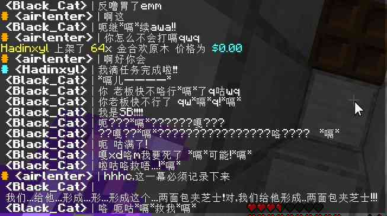

# 狂飙突进

> 天下熙熙，皆为利来；  
> 天下攘攘，皆为利往。  

十二月二十五日夜里，一周目升级了整个世界。全地图的深度被改到 -64，1.18 的地形覆盖上来，旧地图里那些挖到十一层以下的地洞全都若空游无所依。此后的两个月，一周目进入它一生中人口最多、机器最多、争吵也最多的阶段。  
同时，最为遗憾也最为值得庆幸的，这是一周目唯一能逐日还原的一段：笔者的客户端日志从十二月四日开始有服务器记录，一直记到次年三月二十七日，中间六十天，经过详细统计，一共记录了一百八十七个玩家 ID，五万七千一百六十条玩家发言。  

可统计的每日共出现的玩家数量之和是这样的：十二月初十到二十人，一月上旬掉到三到十九（期末考试），一月中下旬爬到二十以上，其中一月二十二日甚至能到二十九人，此后一直在十七到二十八之间。在二月之后，服务器每天总共登入过的玩家基本都位于二十人以上，一直到寒假结束才开始回落。玩家爆发期比想象中长，从一月下旬一直拖到三月下旬；然而，在这段时间里，服务器几乎换了一批人：三月的高点里，一半以上是当月才进服的新面孔，老人最多只在水面上露一下头便消失。

仅以人数最多的一月二十二日举例基本便可以看出黄金时代的大致的样子。  

- 在完成可行性测试之后，酿酒插件在那天早上正式实装，许多玩家都立即投入到酿酒的体验中，比如 Hour 在公屏上哀嚎“我tm炼了这么久放了那么多材料是水？？？”（日志 01-22 12:06）；  
- 另一边，红白在张罗拍摄基地作为宣传片，不断询问与指挥“现在哪个基地有人在线的”“我先拍”“黑山开拍吧”“所有机器都开开”（日志 01-22 12:37—12:54），后台，欧阳在公屏上谈服务器的玩法定位；  
- 在下午三点抓了一个开挂的，永封了 IP 与账号（xx_strongeval_xx）。  

一大群远超出设计载荷人同时在线，最直观的感觉就是，卡。以二月五日为例，15213571 在公屏上报“黑山基地很卡”“我一tp过去就无响应”“这基地我都13fps了”（日志 02-05 20:05—20:06），红白的回答是“这地方实体太多了，正常”。  

世外桃源变得喧嚣扰攘，但世外桃源仍旧是那个巴掌大的小地方。  

## 重构日

十二月二十五日晚上十点二十五分，ztj 问全地图的深度是不是都改成 -64 了，包括 1.17 的部分。第二天下午四点零五分，红白开始封禁低版本客户端以减少报告：

> “管理员 RedWhite 永久封禁了 long. 理由: 请加群，或者使用1.18客户端”（日志 12-26 16:05）  

同一天，全服开始探索新的内容：玄武岩三角洲、冰刺之地、草甸、繁茂洞穴、杜鹃树，有人问“那个循声守卫有蛋了吗”（日志 12-26 16:36）。

十二月三十一日晚上七点，菜单“消失”了。Mr_Z0406 在公屏上问“menu没了？”，huxk 答“被手残腐竹砍妹了”（日志 12-31 19:00），所有玩家临时改为使用手动命令 `/kit` 和 `/signin`。在更新文档内，这次更新版本被划为一个相当奇怪的版本号：beta1.1.1.1。菜单实际上被改为了 `/mainmenu`，这使得一众习惯了使用 `/menu` 的老玩家一时找不到入口。

但好在这些改变至少都是有方向有意义的。  

## 发条红

在这时候，服务器也开始了快速调试与发展的阶段。  

一月一日晚上八点三十二分，公屏上在聊因为轰炸末地导致 TNT 大量堆积的问题：“末地起码屯了几万个tnt 一去就崩awa”（日志 01-01 20:33），“现在改成一次性炸300个了好像”（日志 01-01 20:35）。通过后来在更新文档内的信息来看，实际上这对应了 beta 1.2.5.2的更新。  
九点五十六分，Xuan_xi 抗议收购价，红白调价，说“不能多了，有些人要发死”（日志 01-01 22:00）。  
十点十八分，TPS 掉到个位数，有人在公屏上说“好家伙 弄了两个bot，这怕不是挂机到天荒地老”（日志 01-01 22:19）。
一月二日上午十一点半起，一群人卡在“区块不显示”，反复重登。  
十二点零一分，红白在后台说“卡了，我重启下服务器”（日志 01-02 12:01）。  
晚上六点四十一分，黑猫封了 ludenghua：

> “管理员 Black_Cat 永久封禁了 ludenghua. 理由: 用1.17以上版本进服，不然会崩”  

两分钟后解封，又封了一次又解。  
同一晚，黑猫点了一首《Lost Rivers》验证封禁歌单，说“真的可以”（日志 01-02 18:43）。

一月三日中午十二点三十六分，后台对于一周目完整的插件列表被唯一一次完整打印出来。  

> AllMusic、AuctionHouse、AureliumSkills、CatSeedLogin、CoreProtect、Geyser-Spigot、Images、LangUtils、LiteSignIn、LuckPerms、LWC、Multiverse-Core、NexEngine、NyaaCore、Orebfuscator、PlaceholderAPI、PlugManX、ProtocolLib、QuickShop、ServerlistMOTD、SkinsRestorer、spark、SunLight、TrollingFreedom、Vault、ViaBackwards、ViaVersion、WorldEdit、WorldGuard、XConomy、yasui  

这是有记录范围内唯一一次能够找到的对于一周目的插件的闪帧。  
四分钟后，全服区块加载失败，有人在公屏上喊“一个区块也出不来”“插件炸完了”（日志 01-03 12:43—12:45）。  
后台先把反作弊关了，然后是那句自嘲：“反作弊一删，世界太平”（日志 01-03 12:50）。有人追问假矿怎么办，回答是“假矿关不得”（日志 01-03 12:52）。  
一月七日晚上，服务器一整天没重启，但是陷入了严重的客户端区块加载问题。八点二十七分，huxk 在公屏上骂“日他妈了个比的还没好？”，十点零七分又叹“他妈的还没重启”（日志 01-07 20:27、22:07）。九点四十一分，他说“我终于加载出来一个区块了”（日志 01-07 21:41）。  
然而即使是在如此恶劣的情况下，同一天的签到榜显示，白天已经有六个人签过到。**那时候，热忱还是能够阻挡这样的不可抗力的。**  
一月八日上午十一点二十分起，广播开始播 **“服务器每小时定时重启一次，请注意保存物品”**，一直播到十二点四十分。  
下午四点三十八分，欧阳开始清经济：“清经济去了”“只清除前几名”“一晚上170万的故事知道吗”“他们的钱是刷的”（日志 01-08 16:38—17:06）。  
红白用后台账号上线，说“下下个礼拜回来”“tps直接到小数，这已经不是机器卡服的问题了”“主要是内存不够了，然后在压缩”。  
晚上七点五十八分，黑猫报“15292ms 这延迟起飞了”，一分钟后改口“20658ms 破纪录”。  
十点三十九分，欧阳说“服务器被我搞炸了”“后台全炸了”“我重启一下”（日志 01-08 22:39）。
一月九日下午五点，红白在后台答疑：“这个到不是内存的原因”“等我回来马上加”“14天左右了差不多（放假）”（日志 01-09 16:59—17:10），发了一份《RWP更新摘要》的文档链接。有人问区块到底怎么回事，他说“这个暂时保密”“现在只是打了个补丁暂时堵上”（日志 01-09 17:09）。尽管如此，我们现在也无从得知到底打了什么补丁。  
晚上七点零三分，ShakingShots 在 Hour2 家门口放了几十颗龙蛋，Hour2 在公屏上喊“黑猫！有人搞我家”“封了！”（日志 01-09 19:18），黑猫在一分钟内永封该账号、封了 IP、回档了那片区域：“我把它做的都回档了”“除了你这 他做的所有事归零”（日志 01-09 19:22）。  

更新换代往往带着阵痛，但这是黄金时代的开始；喧嚣扰攘并不影响那是一段非常美好的时光。

## 史上最大贪污犯

一月十九日晚上七点，欧阳开始处罚并没收 hour 的下界合金：“他起码送了2组合金块”“他家机器一个都不是他自己造的”“巨额财产来源不明”“他只破坏过28个残骸”“这必BAN”（日志 01-19 18:59—19:04）。air 颇戏谑地说：“没经过hour2的同意可以私自偷拿”。  
九点零九分，欧阳永封了 hour，一分钟后又解封；九点十二分欧阳顶替 Hour 上线，第一句是“哟，遗产还挺多”，随即清理他的遗产，现场用屏障替换了七百零二个方块；九点十九分三十九秒，控制台再次永封了 hour。  
红白的表态是三句：“我问他了”“干 的 漂 亮”“他就不应该解”（日志 01-19 19:09—19:20）。

## 闲暇

一月二十二日是峰值日。那天中午十二点零七分，后台有人在公屏上说话，huxk 问“红白？”，对方答“我是wer”“我是帮腐竹写官网”“我用的是腐竹的服务器啊”（日志 01-22 12:07）。  
下午三点零五分，后台换成了欧阳，谈了一段服务器定位：  

> “算是原版吧”  
> “加了一点点非原版的东西”  
> “不影响，主要是生电”  
> “末地都开发的差不多了”  
> “箱子商店基本没用，单纯是用来解决物产过剩”  
> “生电服经济就不用看了，跟玩一样”（日志 01-22 15:05—15:10）  

三点十六分，红白下了最后通牒，随后永封了 IP 1.203.173.140 与账号 xx_strongeval_xx，理由分别是“开挂不听劝”与“开挂”（日志 01-22 15:18）。

那天下午三点五十六分，笔者的客户端意外地留下一张截图。  
  
> 当时只道是寻常。  

一月二十三日是这一期最乱也最完整的一天。在早上，红白添加了酿酒插件。  
中午开始全服都进入了醉酒状态，RG1628 满口“*嗝*”“咯”，Hadinxyl 要酒，Sky_Star_Dust 喊“力量8是什么鬼啊！！”（日志 01-23 13:26—13:40），欧阳给出换算“一桶牛奶减16%醉酒”。  
在之后，esr 只用半天时间破解了整个酿酒酒谱。  
  
> 经典永流传  

## 意外

一点三十八分，广播“恭喜wer获得管理权限”，红白补一句“其实准确来说，were有物理机权限”，欧阳追问“远控你也给他了？”“你心够大的”（日志 01-23 13:38）。  
两点三十五分，服务器重载，玩家批量重连，红白说“回档了×”“我先把那几个插件关掉”“我删下文件先”“地图的文件，出生点的”（日志 01-23 14:35—14:40）。  
本来这只是一次出生点重置。红白想重置出生点，用了一份很早的备份覆盖 00 区块，检查的时候正好漏掉了 yjg。yjgdjsy 的房子在 00 区块里，被旧备份抹平了。晚上九点零九分，红白自己交代：“今天我想重置出生点来着”“结果没想到备份是好早之前的”“然后他的房子也在00区块内”“我检查的时候漏掉了”“回档掉了”“co只能方块上的更改”“不行，undo全撤销了”“只能一点一点”（日志 01-23 21:09—21:57）。  
huxk 当场转了五万过去安抚（日志 01-23 21:12），yjgdjsy 一度说“我人生也没什么遗憾了”，最后自己收束成一句“这样的结局挺好的awa”。两个人从九点四十三分起用 CoreProtect 逐点查坐标，x 334—339、y 57—61、z 292—301，一格一格往回贴。  

## 除夕

一月二十五日晚上九点十五分，Arnold_Rynux 意外地被一枚烟花炸死，始作俑者欧阳在公告补了三条：“只是套了几百个烟火之星而已”“一发130血”“我是ouyangyuanyi”（日志 01-25 21:15—21:16）。  
同一时段，yjgdjsy 在公屏上问了两遍“新年活动是啥ouyang”，没有人回答。彼时，没人觉得新年活动是一件必须要做的事。

一月二十六日晚上八点十四分，全体掉线。随后四个新人涌进来，后台兴奋地刷“新人？！”“奇迹！”“我服进新人了！”（日志 01-26 20:15）。  
八点三十二分，air 用 CoreProtect 查到 ChenZhipeng 在 x -46399、y 71、z -46261 处破坏铁块，huxk 说“偷了至少50个铁块”，air 补“不止”“将近两组”（日志 01-26 20:33），八点三十三分十八秒永封，理由写的是“进群963406844找管理说明情况”。  

一月二十七日晚上十点二十三分，红白提议加领地系统：“xdm 重启下，我加个领地系统”，随后澄清“不是res”“redprotect”（日志 01-27 22:23）。LRY314 当场反对：“领地加了就是不信任，就和其他生存服一样了……”（日志 01-27 22:24），Mr_Z0406 补一句“都是自己人，加啥领地”。三十二秒后红白收手：“既然说不加那我就懒得加了awa”，再过半分钟，“听你们的”（日志 01-27 22:24）。  
这是一周目最重要的一次否决：一个能让熊孩子问题减轻一半的插件，被“自己人”这三个字挡了回去。

同一晚十点十三分，huxk 提出联合：“我在想要不要我们联合（（（”“我和qt商量了下 他打算把基金会和黑山合并”（日志 01-27 22:13—22:14）。这是“大会要”最早的雏形，比它被命名早了至少一个月。

一月二十八日晚上八点四十一分起，许多玩家纷纷倒在抽飞行的前线。ludenghua、RG1628、wsts、Hadinxyl、A1020A 接连“在抽飞行时不幸去世”，Hour2 在公屏上总结“10分钟等来的就是这个”（日志 01-28 20:58）。  

九点起，蒟蒻基地的树场冲突爆发：LRY 私聊说“xiaomaome用橡木（我告诉她过，不能用橡木）把机器顶坏了”（日志 01-28 20:56），随后在公屏上与 huxk 对线。十点五十九分，huxk 情绪失控，连发“我现在很冷静”“不用劝我”“可以的话我现在就可以权限转移”“基地事务全权交给yjg负责：）”（日志 01-28 20:59—21:00）。十七分钟后他私聊 LRY 认错：“先前我的话确实是一时气盛说出来的”（日志 01-28 21:17）。九点二十分，LRY 托 huxk 转达了一段道歉：“Xiao，很抱歉早上骂你还威胁封号，我现在明白同学情比游戏更重要……请你回来吧”（日志 01-28 21:20）。红白在后台的处理意见只有一句：“有标准就是非熊不回档”（日志 01-28 21:26）。

一月二十九日晚上七点四十五分，Hot__doggy 上架了“16x 新年快乐 价格为 $0.00”（日志 01-29 19:45），连喊四遍“有谁想要新年快乐吗”。xoain 回“这不是还没新年吗”，又故意说“快到2023年了祝大家2023年新年快乐”（日志 01-29 19:48—19:49）。  

同一晚，末地刷沙机被拆，CBW 的理由是“服务器不需要那么多黑曜石”（日志 01-29 20:01）。私聊里，CBW 拒绝了 huxk 索要自动开矿端的要求，定性是“这个东西 本质上是挂”“但是你不要在服务器开”（日志 01-29 19:49—19:50）。

一月三十日晚上九点零三分，有人在公屏上报了一个地标名：“warp chunjie”“wsts上面造”（日志 01-30 21:03）。这是春节活动唯一一处硬证据：农场上面有一块叫春节的地。那天晚上 yjgdjsy 问“黑山发春节礼物吗”，huxk 回“你搞? awa”“送石头(”（日志 01-30 21:18—21:19），事情就停在这里，日志里没有任何实际发放的记录。

一月三十一日除夕。晚上九点十五分，Sky_Star_Dust 在公屏上报“\<Red Banner> 成功仿制红包”（日志 01-31 21:15），XiaoMaome_ya 随即上架“1x 红包￥ 价格为 $8.88”，当场卖给 Hour2。九点四十四分，air 走到那个用方块摆出来的“新年快乐”跟前，连问两句“新年快乐这里是什么，，，”“空的”（日志 01-31 21:44）。十点二十一分，短暂获得权限的 XiaoMaome_ya 反手禁言了 huxk：“管理员禁言了huxk2008 5min 理由:好好反思pwq”（日志 01-31 22:21）。十一点二十四分，LRY 在公屏上喊“新年地图上缺你和SOvie”“yoinon 和 huxk2008 也没有”，苏哥回：“没有就没有吧，说明我还没到需要署我名的地步，无所谓的”（日志 01-31 23:26）。

二月一日，一个叫 15213571 的人第一次进服。他第一天就问了三个问题：“话说服务器没有领地这玩意吗”“被不被熊全靠自觉呗(”“1年多没有怎么多限制的服务器 还没出现工业化吗cwc”（日志 02-01 14:19—14:20），然后补一句“感觉这出生地我在逛2b2t”（日志 02-01 14:22）。晚上九点，红白亲自查他的挂：后台连发“挂关掉”“硫酸铜和152”“要我截图吗”“你用挂端就不行”“改了东西就算”“第一次警告”“第二次直接ban，没的解的”“包括偷东西，熊”（日志 02-01 21:09—21:12），被问是谁时答“redwhite”。十点三十五分，152 追问刷沙机为什么不能再造，huxk 只答“paper特性”，然而刷沙机屡次损坏，气急败坏之下说出“我不干了”“谁爱干谁敢”（日志 02-01 22:35）。  

## 高原的十二天

二月二日晚上，一个新号 Emotiona 进了黑山。huxk 在私聊里交代“实际上是hour的第三个号 不准伸张出去”（日志 02-02 20:36），Emotiona 自己求“emm别暴我身份”“我想做个普普通通的玩家qwq”。八点五十八分，他在公屏上讲了自己被封的原因：“我哥给我op没撤销然后我和esr拿了几个很厉害的东西 后面我哥又给我op欧阳发现了然后顺藤摸瓜看到了我和esr干的事”“欧阳以为是我偷op”“其实是我哥用我号天天给我上op 有时候也忘记撤销了”（日志 02-02 20:58—20:59）。这解释了半个月前那场封禁，也解释了红白为什么在二月五日说“esr我让我弟上”“我给我弟了”（日志 02-05 20:52）。

二月三日晚上九点五十四分，Emotiona 在公屏上说“不，我现在是redwhite”“在调试群组服”（日志 02-03 21:54）。十点半，红白上线，有人喊“腐竹！！！！！我知道你肯定会上线来给我回档awa”，红白回“非熊不回档的哦”（日志 02-03 22:30）。十点四十三分，他给 huxk 下了一条指令：“hu”“服务器更新下”“改一下分布”“多谢啦”（日志 02-03 22:43），huxk 回“什么分布xxx”。  
二月四日晚上九点三十九分，红白现场配置起床战争：“卧槽”“好了”“配置好了”“就是4v4v4v4”“起床战争”“我把hot借走一下”“一个一个来”（日志 02-04 21:39—21:58），并教所有人打 `./server game`。十点十分，他自评：“这服务器拉了”“我们的附属服务器”“垃圾死了”，随即安抚“大家好好生存啊”“那个是用来解闷的”（日志 02-04 22:10—22:13）。十点三十六分，他把新 IP 直接打在公屏上：“124.222.25.34”。  
二月五日，群组服开始出问题。下午四点零九分，客户端收到完整的 Velocity 报文：“You are already connected to this server!”“Kicked whilst connecting to game: Connection throttled!”“You are currently connected to main. You may connect to the following servers at this time: main, game”（日志 02-05 16:09）。四点三十八分，红白在起床战争里抓到 huxk 违规飞行，后台连问“hu你怎么下来的”“最好解释一下”“你那里来的权限、？？”（日志 02-05 16:38—16:39），最后只训了一句“以后别这样干了”“很破坏游戏的”“但是你下去了起码不应该乱挖东西”（日志 02-05 16:43—16:44）。  
八点零二分，他禁言 huxk 二十九秒，理由“3条信息”。此处的信息指的是和 Xiaomaome_ya 在私聊中的*私人*信息。  

二月七日晚上七点二十九分，称号没了。七点三十一分，wer 给出诊断：“luckyperms玩家data清空了”“有的只剩下一个uuid”（日志 02-07 19:31）。在文档中明确描述了这是把 LuckPerms 与 CoreProtect 迁到 MySQL 的代价，引发了许多链式反应：称号与聊天前缀全部丢失，air 的 tp 与 warn 权限没了（“好家伙我变普通人了qwq”），全服的家和地标失效（“home和warp都无了”），HBGL 花一万买的飞行作废（“我飞行没了... 1w 打水漂了”）。  

晚上十点二十五分，一个叫 Araish 的人在公屏上说“拿到了TNT，这就去埋'礼物'（doge）”（日志 02-07 20:33），两小时后 yjg 的新家被炸。红白查完记录，连下两次永久封禁，先写“判定为熊”，再写“TNT轰炸建筑”，最后一句是“这种没得解的”（日志 02-07 22:27）。

二月九日晚上九点十九分，ztj0410 在公屏上问：“好奇现在还有多少人知道seaty”（日志 02-09 21:19）。没有人正面回答。这是黄金时代开始褪色的第一句台词，说这话的人是伽蓝神殿的创始人，他自己也快不玩了。

二月十日晚上十点三十一分，新人 Xing_chen_dd 问“什么是黑山 你的工会？”，红白回“什么乱七八糟的工会”（日志 02-10 22:34）。同一晚，huxk 宣布“是时候开始黑山的级别制度了”“黑山现在人太多了”“方便管理”（日志 02-10 22:33—22:36）。二月十一日，制度改革落地，hmcl 一上线就说“woc黑山好大”，然后反复请求“我也要进黑山awa”。晚上九点三十七分，CBW 说了一句预言式的话：“未来的服务器最终组织”“黑山基地xxxxx”（日志 02-11 21:37）。

二月十三日，红白最后一次上线。  
上午十一点三十七分起，huxk 在带新人：`./register`、`./kit new`、`./rtp`、`./signin click`，一套流程十分钟走完。红白在旁边补了两句，“欢迎新人”（日志 02-13 11:51:05），“新手包会自动领的应该”（11:51:45）。  
十二点零四分到十二点零八分，他反复退出又加入，五次，像是线路或客户端在折腾。十二点十六分，huxk 在公屏上打“tps.....”。十二点十八分二十八秒，红白问：“tps？！？”（12:18:28），十六秒后“掉了？”，五秒后“阿西”，十三秒后“掉了一瞬间的事”。十二点十九分十九秒，他打出在这个服务器上最重要的一句话：

> “等我下次放假换地毯端”

十二点十九分二十九秒，“直接顶非”。十秒后，“这先忍一忍”。八秒后，“有些机器确实厉害”。五秒后，一个 `:P`。  
十二点二十分整，“我先收拾了”。四秒后，“我也是下午去”。三秒后，又一个 `:P`。十二点二十三分四十三秒，日志记下“RedWhite退出了游戏”。  
此后，全部语料里再没有一条“RedWhite加入了游戏”。他的名字还留在网页地图的地址里，留在 CoreProtect 的历史记录里，留在别人说的话里，但那个账号没有再来过。他留下的最后一句技术判断是换服务端核心，最后一句生活安排是“我也是下午去”。下午他要去哪里，日志不知道；二月十三日之后他去了哪里，这份档案也不知道。大家都心知肚明他去上学了，却不会有人想到他可能就这样不回来了。  
后来 Carpet 变成了 pure 的前身，在往后 pure 变成了二周目的 RedT。简单的一个小的决定，却让整个服务器开始转向。  

> 立春天，风渐暖，伊人一去不复返。  
