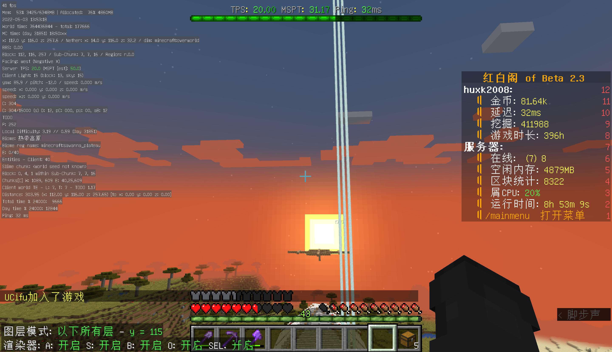
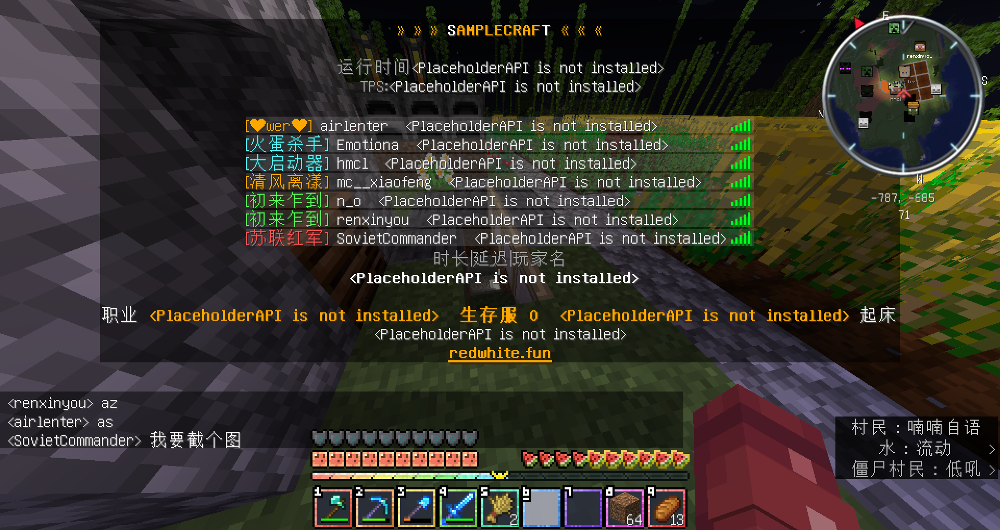
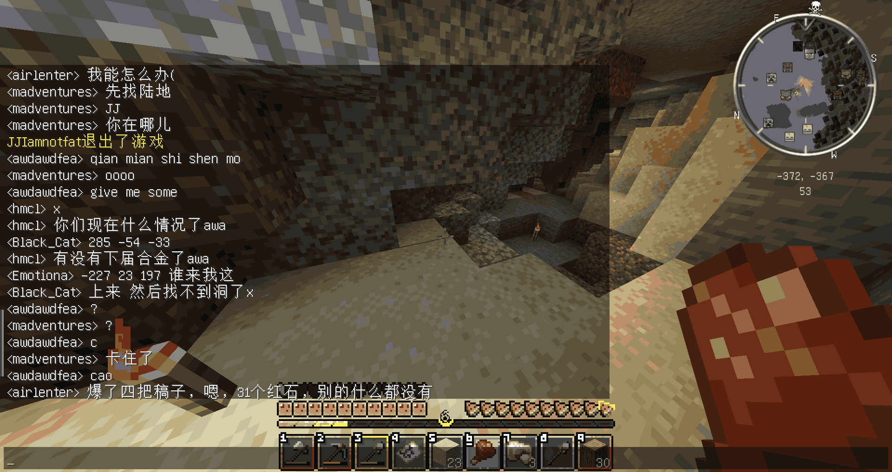
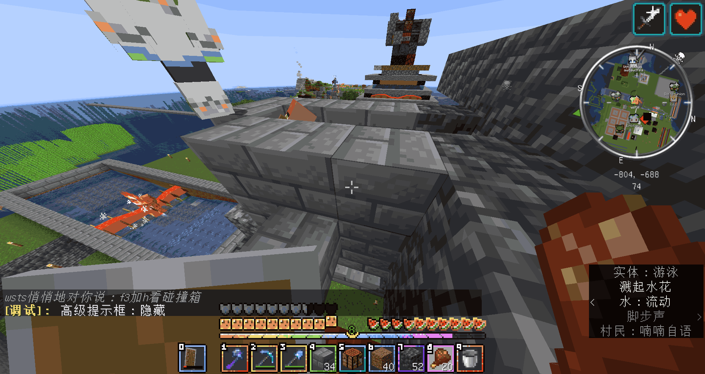
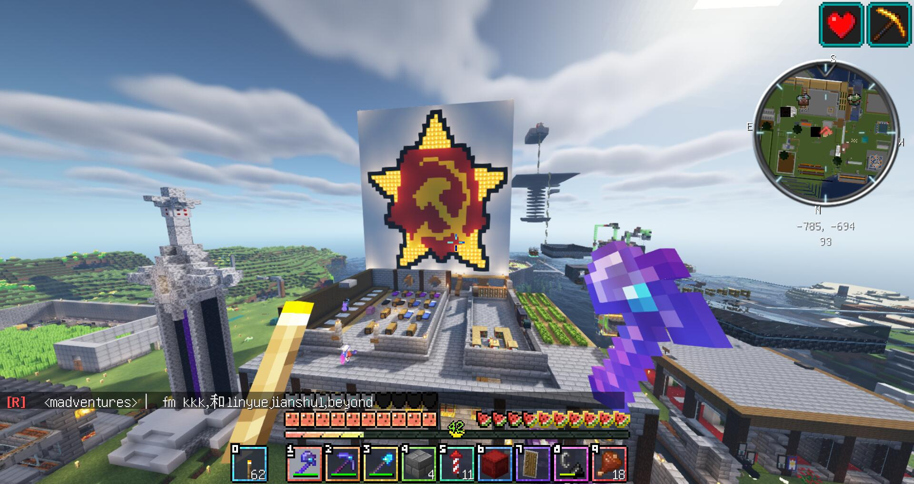

# 乌托邦

红白并没有坐以待毙，而是尝试走两条新的路线来救活这个服务器。没有证据可以表明这是为了救活，但从留下的文件来看，大概率是的。  

pure 选择了把 main 上所有方便的东西全部关掉：没有地标，没有传送，没有经济，死亡掉落。  

> “没有名字，但是这是大家齐心协力、人人出力、团结互助、积极向上、充满希望、接近共产主义的多人生存基地。”
> ———— SovietCommander

关掉插件之后，人反而住到了一起。苏哥在归档前言里解释过这个反差：一周目因为地标系统，会存在各种大型基地；二周目因为短暂，“那些没事干的老玩家都聚集在了一起，所以二周目只有一个基地，一个所有人在一起的基地”。有了自由的传送，玩家就会散开；没有了传送，玩家也就只在一片固定的地方行动。某种意义上，pure 变成了后来的二周目。  

rand 选择了另一种方法。红白从彼时尚未停机的 MCBBS 上下载了一个“秋笙大陆一键开服包”，部署在一台云服务器上，rand 就这么开起来了。它选择了用大量常用的 RPG 插件来丰富玩法，玩的是 RPG 快餐。固定常驻只有 air，mc__xiaofeng，huxk 和 hot_doggy 几个人，在雪原上建了一个基地之后，就再也没有之后了。再后来，rand 只剩笔者一个人，变成一个空荡荡的试验场。

当然毫无疑问，main 处于启动状态。  

。  

此图应当摄于大会要石英金字塔。  
五月十三日的另一张截图里，白色平台上摆着几排木长凳，四个人并排坐着，背后是一座彩虹羊毛塔和一片浮空的建筑；这是大会要唯一一张有记录的合照。  

## Pure

pure 的新生很不顺利。三月二十五日晚上十点十六分，后台第一次试“server pure”，系统回“指定的服务器 pure 不存在”。三月二十六日晚上九点五十三分再试，还是不存在。十点零六分五十九秒，客户端第一次连上去，报的是“无法连接至 pure：您的服务器版本不匹配”；十点十分五十四秒复现一次。十点十二分，有人死亡重进，被甩进登录服，系统要求 `/reg`，注册完显示“未知的红白阁令牌”“抱歉，您没有使用此令牌（_他甚至是机翻的_）的权限，请联系管理员”（日志 03-26 22:12—22:13）。

三月二十七日下午五点三十四分，红白在后台说“我在看那个跨服聊天的插件”“Chat Manager”（日志 03-27 17:34），说明这是“将 main 和 pure 的聊天进行了互通”的施工。四分钟后，客户端收到“您已被踢出 pure：发送内部服务器连接错误”，一群人被弹回主服。air 说“pure开荒组集体掉线”，hmcl 说“相信各位都是子服来的”“腐竹在迁移数据”，mc__xiaofeng 说“子服已经通关了 就差复活末影龙了”“鞘翅拿到了”（日志 03-27 17:38—17:40）。  
由于笔者忙于建设大会要，并没有进入 pure 进行查看；也因此，三月二十六日的记录就此丢失。
一个刚开档的服务器，有人甚至还没有进入服务器，而开荒组已经在说通关了。  

pure 的真正模样，由于笔者并没有存下太多照片，也只能进行拼凑。开荒期的照片记载于 ICAI 腾讯文档内的有四张，配文是“为生存而战”“建设初期的窘迫”“后来变成了最接近共产主义的一集”，最后一张被标为“最接近鼎盛时期的一张”。  

  
  
  
  

> “我拿着一把石斧，独自从黑夜里走到了基地。”  
> “居然没有死欸，明明中间干了那么多惊险的事情”
> “我仍然热忱于做没有用的事情”  
> ———— hot_doggy
热狗子在 pure 里抄了一个很精致的装饰性农场，和苏哥一起造了一个钓鱼台，在基地旁边的山坡里打洞。  

## Rand

rand 甚至无法拼凑出一个完整的样子。只能知道，它只是一个一键开服包，红白在云服务器上把它点起来，几个人进去自嗨。  
air 与 mc_xiaofeng 在雪原上建基地，精英怪打上来，只好把基地从地面架空。hot_doggy 本来想住进去，因为mc_xiaofeng 不让他放果树，迁走了。他写：“那段时间我上线就进这个子服诶，居然完全忽略掉我。”后面补了一句“我将愤怒（并不”。

rand 里可能唯一说得上是原创的东西是酿酒。酿酒当然在 main 里面出现过，但真正开始独立自主的研究，却是在 rand。
根据热狗子的回忆，热狗子喜欢华而不实的东西，但 huxk 希望酒的提示和原版物品一样，不该搞特殊。两个人为此产生过小小的困扰；实际上笔者都记不得这一方面的事情。而第一种使用了非常规的材料的配方，碎晶花酿，是热狗子提的点子，具体是什么时候出现的，热狗子却说完全记不得。  
后来的周目甚至都没有在这套基础上变动多少，除了在 rand，三周目进行过大规模的增删改，之后甚至没有进行过非常仔细的排查。它们流到了后面的每一个周目：三周目、四周目、五周目、六周目的酒谱里都能找到它们的影子。  
> “大概以后的每一项新技术，都带了点rand的影子吧；每一瓶新酿出来的酒，会有不停息冷冬的凛香吧。”  

## 在乌托邦之外

主服在慢慢空下去。三月二十五日晚上十点十五分，经济榜前十被打印出来：第一名一千九百九十九亿，第二名四千三百万，第三名三百万，第五名六十二万。同一天晚上十点整，huxk 在海州感慨“三个组织已经覆灭了?”，air 回“海州一开始就没有组织”（日志 03-25 22:00—22:01）。  
三月二十七日晚上七点四十六分，BEYOND 被永久警告“不要再搞凋零骷髅塔了”。同一天，服务器还在广播“服务器的网页地图 redwhitemap.vaiwan.com”，然而更新摘要上，BlueMap 已经删了，删掉的是一个 _150G的“小文件”_。  

在这之后，笔者以相当稚嫩的笔调写下了这篇曾经不被重视现在弥足珍贵的短篇小说。
  
  
可惜的是，这篇文章已经湮没于互联网的浪潮之中，只剩下一些微渺的痕迹。  
  

即使没有人在意，我们昔日的世界也在一点一点褪色。  
