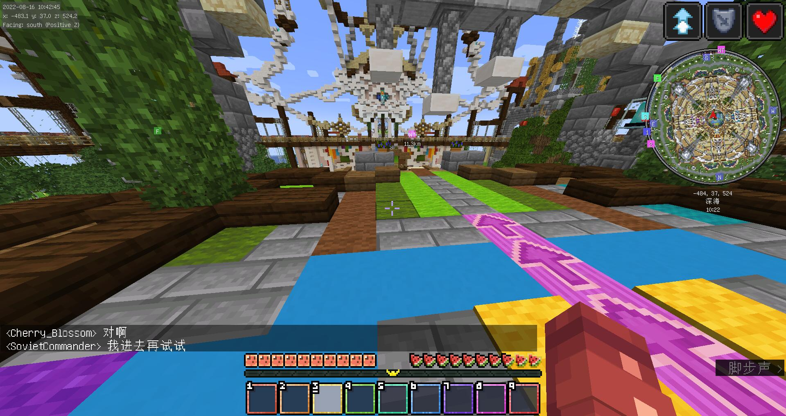
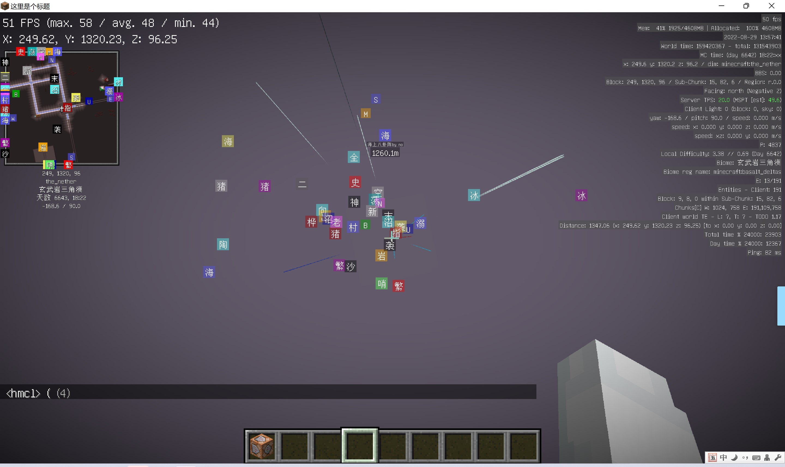

# 尘中废墟

二周目的开场应该是红白正式退出所有群聊。在 8 月 10 日之前，一周目理所当然已经死了：代理腐竹 Werewolfwolfy 在 2022 年春节前后崩溃辞职、降级为管理；3 月 19 日下午的整蛊事件清空了玩家 ludenghua 的背包，处理结果是 WerewolfwolfyXD 权限全清、airlenter 降为协管，而事件的直接导致者 huxk 只是被批评教育。  
到了 8 月 13 日，RedWhite 离开。很久之后，那个孩子终于发出了属于自己的质问，第一次将质疑红白“去考 46 级”的说法摆上了台面：

> “你觉得哪个腐竹会用这个理由直接组建新的管理层的？”  

然而两年之前这些质疑尚且不存在时，那个孩子笃信红白有朝一日会回归，而后，只能继续前进。

## 影中

实际上在红白彻底离开之前，其已经在玩家群体内开始招收新的一代管理员了；然而这种选取方式几乎和抽奖无异。换言之，红白已经彻底黔驴技穷，再无力培养和交接一个新的有足够能力的管理团队作为接班人；他所能想到的，就是尽他所能，寻找到足够有责任心，足够有经验，足够有能力的新管理层。  
于是就在这种情况下，哪怕是上述曾经因为整蛊事件而被处罚的若干位管理员也重新被任职，笔者也不例外。这些新的管理，有的是来自于前一代玩家群体，有些则是来自民间。  
后来这些名称可能会频繁出现在那些文档中，我们不妨就在这里列出这些新的管理员的名称：`SovietCommander`, `white_phosphor`, `Irene_`, `littleboluo`, `airlenter`, `werewolfwolfy`, `clearblue_water`, `sky_star_dust` 以及 `ouyangyuanyi`。  
然而在红白正式离开之前，委任的新的服主却出现了两种不同的口径；在 cbw 的会议中，苏哥是代理服主，然而在更新文档中，欧阳是代理服主；结果到后面，cbw 又变成了服主，而 huxk 则选择在那么多代理服主中间承担了绝大部分服主的责任。但在实际上，cbw 仍旧手握管理群与内外群的群主权限，苏哥仅仅只是作为玩家在进行游玩，欧阳甚至连管理层里面有什么人都不知道。  
仅仅只是这些只言片语也能想象出来，二周目是何等混乱而无序的一个世界。  

在 cbw，苏哥以及欧阳相继陷入无响应状态之后，huxk 认为应该有一个人前往前台进行正常的稳定与维护工作，而这个人也只能是 huxk。原因显而易见，“因为所有人都不干活啊”。  
在随后，huxk 便向 cbw 申请了内外群管理员权限，并发布了一篇公告作为红白退出服务器的正式声明：  

> 我们敬爱的老服主，红白，因为操劳过度，离开了服务器。  
> （余下内容截图缺失）  

而在这篇正式申明之后，大量玩家开始相继退出服务器群聊，也有相当一部分玩家开始私信向笔者了解情况。笔者印象深刻的是一位叫作 Ruoling 的玩家私下里与笔者的聊天：  

> 小管理么  
> 以后我可能就不在这玩了  
> **服主都走了**  

一个由服主所支撑起来的服务器，哪怕有一位继任者上前愿意上去补天，也很难将这里恢复成原本的样子，更何况是维持原先的样貌不变。  
于是二周目开门的第一关，就是大量的老玩家流失。  

## 流沙

开服首周是二周目唯一一次大批老玩家涌入的高峰期。  

> 来自苏哥  

从未损坏的 velocity 代理日志来看，2022 年 8 月 13 日同时在线达 13 人，**这也是二周目全期的最高同时在线记录**。8 月 22 日单日 redt 连接 112 次、login 连接 249 次。8 月上旬日均 15 至 21 个不同账号登入。  
在这期间，兴奋的老玩家们就和初次来到 pure 一样，开荒，建立前哨，制造机器，杀龙，征服末地，然后无事可做。更加现实的问题是，服务器大多都是学生，一旦开学，那么在线人数将会断崖式下跌。  
于是开服的热度只撑了不到三周。9 月 1 日峰值 3 人，9 月 12 日峰值 2 人，9 月 13 日峰值只剩 1 人。9 月 13 日那天的日志里只有一行 login 连接：有一个人进来了，但是想想，退出了 login。  
十月的国庆果然有一次回潮：10 月 1 日峰值 5 人、14 个账号；10 月 4 日 login 73 次、redt 59 次；10 月 22 日出现了一个异常日，login 子服 78 次连接而 redt 仅 19 次。redt 彼时相当不稳定，经常出现崩溃重启。十一月的零星活动里，11 月 5 日峰值 6 人、17 个账号，也是整个月唯一的高峰。  

二周目现存未损坏最早的玩家聊天记录，只有一行，是在 2022 年 10 月 26 日的客户端数据：  

> [16:07:50] \<IRene_> 这个是告白）  

我们甚至无法推知上下文。但从这一天起，这个服务器仅存的日志开始留下人的痕迹。此后到 2023 年 11 月 11 日，一共 74 天有聊天记录，累计 20477 条，出自 49 个不同账号。这 74 天，外加没有任何聊天记录的其它基本无意义的日志，就是本卷后半部分的仅存的全部材料。  

## 灰线

二周目总共有衰败过两次，时间跨度上这两次衰败占了二周目绝大部分的时间。  
九月没有人进服，没有人可以责怪。服务器刚搬上云端，生电这个玩法看起来很新奇，白名单机制刚建立；人却没有来。原因业已就在上面说明：8 月 10 日到 8 月 23 日的这一波涌入，本质上是“听说红白阁开了新服，来看看”。看完就走，因为看完了也没什么可做的：该建的，该做的，该看的，都已经看完了，余下的只有无聊和空虚，还不如不玩或者去玩别的整合包。  
后来之所以热闹，是因为那时服务器刚刚换代到 1.20，地形重新加载，樱花、红树林、考古、锻造模板全是新的，全物品要重拆重建；更重要的是，生电的桎梏正在被逐步瓦解。**二周目真正的新玩法从来只有一批，也就是后来更换为 leaves 端放弃生电的时候**。

## 光辉

8 月 10 日十点整，同时在线人数达到了 10；这是 RedT 一生里的最高水位，从那以后，没有任何一天超过这个数字。同一天，21 个不同账号在这台机器上留下过登入记录。  
那这十个老玩家里有没有人意识到这是顶点？大概没有。对 8 月 13 日上线的那些人来说，这只是一次再普通不过的重逢：当然不是那个世界，出生点也不是那个出生点，一切都是新的，一切看起来都“很好玩”。有人第一次被 `Connection throttled! Please wait before reconnecting.` 挡在门外，在 QQ 群里问了一句“怎么进不去”，然后等十秒，再进。尚未经过调校的连接设置阻挡不住老玩家们对新事物的好奇。  
而真正重要的事发生在游戏之外。同样是这一天，那个孩子在两年后给红白阁写下的死亡日期是 2022.8.13。在十个人同时在线、服务器状况最好的那一天，主事者再后来心里已经认定这个服务器死了。  

> 摄于 8 月 29 日。  

## 搬迁

目前没有任何日志和聊天记录可以推定大致的决定转移时间，因此，笔者只能进行大致的回忆。  
大致是在九月份，笔者在与红白沟通之后得知云服务器租期将会在不久后到期；届时，服务器将会陷入一轮新的危机；物理服务器也丢失之后，那么刚刚从解体中挺过来的服务器将会彻底断线，从此不再存在。因此，笔者选择了在存档体积最小且最容易迁移的时候，自行购置了物理机，并进行了迁移。  
在购置物理机时，这台物理机的参数非常符合笔者的最大可支配额度。机箱，主板，内存，电源基本全部都是廉价件，CPU 是从笔者的舅父处进行回收的，硬盘是额外购置外加从其它地方免费获得的；然而仅仅只是这些，大大小小加起来也花费了 1700 元，但是这是笔者唯一能够拿出的东西，为的只是不让云服务器高昂的每年将近 3000 元的租费拖垮所有人几乎全部是学生的管理层。  
当然放在云端这套东西是能跑的，但是原因上面也已经提到了，一来长痛不如短痛，二来没有资金。十一月十七日，Velocity 日志记录下在云端的最后一天，随后服务器迁往本地，即笔者自己家的主机，配置换为 64G 内存。  

十一月的最后两周，服务器的日志开始变稀。11 月 15 日 1 次进服，11 月 16 日 2 次，11 月 17 日峰值 2 人、4 个账号。  
11 月 17 日之后，Velocity 日志中断；在更新日志中，这个版本被写作一个四不像的版本号 `Local.Relese 3.1.0.0`，内存 64G。  
从这一刻起，红白阁的服务器住在某个孩子家中的客厅里。此后一年半里所有关于卡顿、重启、电费、风扇声的对话，都从这个看起来无足轻重的决定开始。  
