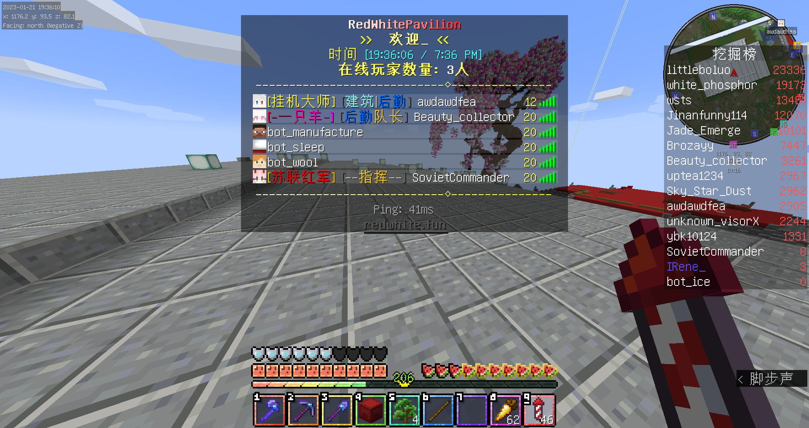
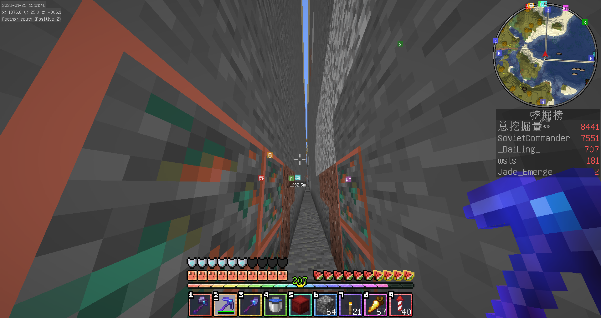
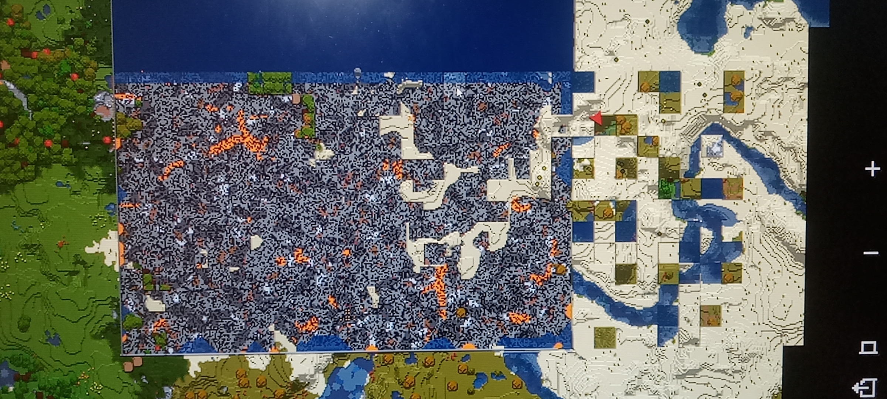

# 冷却

> 没有人的文明毫无意义。  
> ———— 《流浪地球》  

如果把二周目当作一个政权——我知道这听起来很像小孩子过家家——那么这中间一长段的低谷，就是它的守成期，只是没有任何人可供守。甚至这一长段无聊到让人发疯打开日志看一眼都是他妈的投影粘贴记录，没有任何事件、没有任何冲突、没有任何对话。  
那这七个月里可能就有人要问了，说 huxk 和菠萝在哪发财呢。往下看应该就知道了。  

## 没有人的春节

那个春节没有任何人进入过服务器，除了笔者和 hmcl。以下这张合照中，只有两个人是真人。  
  
> 我无话可说。  

以下的截图是在这个期间的，凑合看看吧。  

  
> 来自苏哥  

  
> 来自苏哥  

> 来自群聊截图，好像坏档了  

## 死寂的七个月和留下来的名字

2022 年 11 月至 2023 年 6 月，可考的进服记录加起来只有零星的几十条。绝大多数日子，**服务器没有记录到任何一次玩家进入**。  
按月看：

- 2022 年 11 月 23 日 2 次、11 月 27 日 0 次、12 月 18 日 1 次；  
- 2023 年 1 月 1 日 1 次、3 月 7 日 1 次、3 月 28 日 0 次；  
- 4 月 18 日 1 次、5 月 3 日 1 次、5 月 8 日 1 次、5 月 23 日 1 次。  

可查证的确实有人的日子，全部集中在上篇中提到的那 79 天：2023 年 3 月 25—26 日、4 月 16 日、4 月 22 日、5 月 13 日、5 月 20—21 日、5 月 27—28 日、6 月 9—12 日、6 月 17—19 日。这些日子像大退潮涨潮之后被分割成好几片的礁石，彼此几乎不相干。  

而留下来的人**却是管理员占据多数**。  
SovietCommander 自 2022 年 9 月 12 日起断断续续在线，是二周目唯一贯穿全程的名字。IRene\_ 自 10 月 26 日起，ybk10124 自 10 月 25 日起，还有 Beauty_collector，都在名单上。littleboluo 自 2023 年 4 月 16 日起频繁出现，后来成了二周目*最重要的人*。  
littleboluo 从 5 月起开始与 huxk 频繁出现摩擦。5 月 21 日上午的那段对话大致如下：

> [11:10:02] `<littleboluo>` 又卡死了  
> [11:14:21] `<littleboluo>` mspt不稳定  
> [11:14:34] `<white_phosphor>` 村名运算本来就是最吃cpu的  
> [11:14:49] `<littleboluo>` 之前都很稳定的  
> [11:14:58] `<littleboluo>` 你一上线就不稳定了  
> [11:15:14] `<white_phosphor>` 啊对对对都是我的问题  
> [11:16:10] `<littleboluo>` cpu是啥  
> [11:16:30] `<white_phosphor>` e5 2666 v3  
> [11:17:24] `<littleboluo>` 看看能不能给你搞个i7  
> [11:17:38] `<white_phosphor>` 消费级cpu不可能的  
> [11:18:00] `<white_phosphor>` 稳定性是服务器运行的根本  
> [11:18:25] `<white_phosphor>` 重启重启实际上真的很烦的  

然而事实真的如此吗？  
众所周知 Minecraft 是一个吃单核的游戏，而 fabric 不像 forge 有在静态阶段给服务端文件插桩进行过简单的修复，会在运行时阶段只对原版的代码进行注入和变换。而后来的 benchmark 与对源代码的研究，只需要不到五普朗克时间就完全可以得出 fabric 的性能在不加入各种优化模组的情况下能被 paper 爆甩两条街，甚至在加入模组之后也大概率是如此。  
然而生电追求的是“近似原版的体验”，这在这种情况下和菠萝大量粘贴的机器同时运行一叠加，Boom，服务端马上就会开始哀嚎大量爆 cpu。原版服务端哪怕在只加载 5-6 个玩家的情况下都有可能崩溃，这是菠萝可能从来没考虑过的问题。如果要彻底解决这个问题，那么只能在添加优化模组的基础上增强硬件性能，或者是彻底放弃这一路线，转而实现“在 paper 的情境下尽可能模拟生电的模式”。  
那么好，为什么不换硬件呢？  
关于那句“稳定性是服务器运行的根本”，需要补一层当时没有写在聊天框里的背景。实际上**不换 CPU 的真实原因就是没钱**：这台机器本来就是自家主机的剩余配置，换一套消费级平台的钱没有人出。“稳定性”那句话是在聊天框里孩子给自己找的一个体面说法，也是他后来自己都不再坚持觉得可笑的一个说法。  
更麻烦的是那个愿意出钱的人。littleboluo 在 5 月 21 日提出的“看看能不能给你搞个i7”，以及后来 8 月 20 日那句“要不你出钱给服务器换5900”，指向的都是一个基本不介入服务器运行维护的玩家捐硬件。不选择这条路线，理由并非不需要，事实上任何一个带着完整硬件**无偿捐赠**的人来都会选择无理由六分投直接拿下；一旦其介入硬件，他就有理由索要更多的东西：机器是谁的、配置怎么改、什么时候重启、谁有权碰物理机。**在一个权限已经集中在少数人手里的服务器上，引入一个完全无法预测的变量，等于把服务器仅有的，也是最后的控制权直接扔进下水道。**  
于是二周目的硬件问题就这么挂了一整年：性能不够，钱不够，而唯一可能补上钱的人，代价是在无法摆到明面上的情况下让渡控制权。这件事在聊天记录里留下的痕迹只有一句“消费级cpu不可能的”；实际上在 qq 群里，也同样爆发过很多次类似的争论，但是同样没有结果。  

在此之外，那份几乎从来没人看的更新摘要里其实铺满了很多不为人所知的东西。  
以下内容摘自文档《服务器更新摘要》：  

- “迁移服务器至本地（我家的主机），更换配置为64GRAM”  
- “修复了由于 tencentCDB（腾讯云数据库）无法连接导致无法进行数据同步的问题，更换 luckperms 数据库存储方式为 MariaDB”  
- “采用邮箱来申请白名单（因为 mirai 无法登陆 qq）”“写了个简单的邮箱验证”  
- “增加了 creative，testpaper，testserver，cardboard，highpur 等子服务器，最大性能利用 cpu 算力”  
- “接入 cqhttpbot”“升级了 mcsm”  
- “最后就是经典保留项目 lg 和服务器数据归档（保留节目）”  

然后是下一阶段的目标：“使 redt 设计性能达到 30 人，最大性能达到 50 人”“把 redwhite 叫回来(不可能)”。  
除了一直在推进升级，那个天真的孩子仍旧在等待着一个不会回来的人有一天推开门回来。  

## 一言堂？

二周目是如何治理的，可以从一句话里看出来。文档里保存着 huxk 的原话：

> “他妈的，每次开发文档都是我来写，你们没有一个会帮我的？（恼 -white_phosphor/huxk”  
> “还有，他妈的能不能不要让我凑那么多字数？很累欸 一点也不累，太轻松了”  

并不众所周知的是，二周目的文档、插件、配置文件、子服、白名单系统，几乎全出自一人之手。P4 后来在档案站里写：“一个挂着投票的名义以低的离谱的效率运作的管理层……花了半个月时间就为了升级存档吵了无数次架投了无数次票，最后还是我一票直接强制通过的。”又说管理层是“一群连 yml 都写不明白的管理”。  
尽管上述这些话写于 2024 年，但在 2023 年上半年那些服务器里没有人的深夜里，这种管理的制度已经成为主要管理方式，并且，**也是唯一的管理方式了**。

稍加推理便不难得出，实际上一周目和二周目的管理方式根本上没有特别大的区别。  
无论是一周目，二周目，本质上都是“技术治理”。这一段里所有能上桌的决策，都是由 `white_phosphor` 在后台做的：换数据库、加子服、写邮箱验证、接 cqhttpbot、升级 mcsm。没有投票，没有公告，没有议程；**实际上，投票和公告即使写了也不会有人认真看**；玩家要做的只有两件事：上线，玩。

但是**发出声音最大**的，是“神权治理”。七月之后，一路由 `littleboluo` 所主导进行粘贴的工程把整个主基地翻了个全新：全物品、世吞、猪灵交易、刷沙收集、出生点、工业区。而支撑这场浩大的无中生有的，是一个绝大多数人、甚至到清算之后都有很多人不知道的数字：**遗留下来可计算的日志内，菠萝所操作共 451112 条，其中 96.79% 是往世界中写入方块**。在这其中，`/fill` 336333 条、`/setblock` 98480 条、WorldEdit 类 1760 条，其余所有指令，包括切换游戏模式与进行传送加起来不到 3.2%。  
如果需要具体数字，那么 `littleboluo` 名下所有的方块操作达到了 **431133** 条，占到所有日志指令操作中的 98.8%。这两个数字，不是用来衡量对世界的建设贡献多大，而是体现对世界长期的破坏有多大。  
如果上述仍旧不够明确，那么，**`littleboluo` 的 431133 条里有 422192 条，仅按照宽松匹配，是投影打印机自动灌进世界的方块**，其名下长于 200 条的连续写入段共 122 个，承担了全部写入量的 98.4%；最长的一段是 8 月 9 日 17:45:26 起的 **65 秒 59121 条**，每秒 909 条。  
而在先前甚嚣尘上的，其它管理也同样有进行神权的说法便不攻自破：真正在做运维与决定的两个人，方块写入占比是全服最低的：`white_phosphor` 2108 条指令里只有 160 条是写入（7.59%），他的构成是 `/tps`、`/co i`、`/spark`、`/give`、`/tp`；`Jade_Emerge` 1308 条里只有 75 条（5.73%），构成是菜单、变量、称号、签到、酿酒配置。  
以上信息来自更换 leaves 核心之后仅存的可恢复日志。  

因此实际上我们完全可以得出这样一个结论：真正负责了服务器绝大部分维护的人，反而其对服务器的操作是最小的。二周目管理结构上最为匪夷所思，也最为令人大惑不解的错差就出现在这里：**实际正在做决定的人、处理其它事务的人、打印一堆机器的人，是三个人，而且他们之间根本不存在一套完整的维护与开发规范**。7 月 21 日，墓碑时长由一个人随口决定，7 月 22 日一条 `/ban` 由另一个人当场敲下，同一时段第三个人正在让打印机以每秒九百个方块的速度改写出生点，三件事甚至能够出现在同一个时间段。  
我想——原谅我实在要穿过画面来说——如果在这种情况下，在一个管理层拥有将近十人，并且绝大部分成员在所谓公投做决定时完全不在线，后面甚至还有一个人完全给自己增添麻烦的情况下，换做是你，你还会抱着那套所谓民主的制度在那边指着我说，“欸你这个人怎么这么坏怎么这么喜欢搞一言堂”吗？到底是出于什么幻觉，能够让人指着我说我在搞“无意义的斗争”，在搞“一言堂”？难道要等到大难临头危难当前了，你们才会突然全部醒过来然后开始一场名为公投实则为骂战且一点实际作用都没有的口水仗吗？  
原谅我即使等到时候翻篇还会如此光火。抱歉。  

## 卡顿

再把目光拉回到上面说过的五月二十一号吧。  
5 月 21 日上午十一点，`littleboluo` 说“又卡死了”。`white_phosphor` 让他去看 spark。然后就是上面引过的那一段：`littleboluo` 说“你一上线就不稳定了”，`white_phosphor` 回“啊对对对都是我的问题”。两人都清楚这话不完全对，也都清楚这话不是完全不能成立；那时候服务器上几乎只有他们两个人，任何变量都只能是彼此。  
接着话题滑到了 CPU。`littleboluo` 问“cpu是啥”，`white_phosphor` 报了型号 E5-2666 v3。`littleboluo` 说“看看能不能给你搞个i7”，`white_phosphor` 回“消费级cpu不可能的”“消费级不能做到稳定”“稳定性是服务器运行的根本”“不然你想啊 十天半个月死机一次”“重启重启实际上真的很烦的”。  
`littleboluo` 那句“看看能不能给你搞个i7”，字面是技术建议，再看起来是一次捐赠提议。二周目的服务器跑在一台自购的家用主机上，电费网费都有人自己扛；五月起，全服唯一一个愿意往这台机器里投钱的人，就是那个天天喊着卡的人。但为什么不呢？我们已经在上面得到过答案了：**如果让菠萝介入硬件捐助，他会进一步索要更多权限，届时将会更加麻烦。**  
硬件是服务器里最后一层还没有被切割的东西。唯一的，不能被所谓的“议会制度”分割的最为关键的要素。机器是谁的、什么时候重启、配置怎么调、谁能碰控制台。玩家可以贡献方块、贡献设计、贡献时间，这些都在世界里，谁走谁留都不影响服务器明天还能不能开机；就算你爆了，决定臭鸡炸炸炸把所有东西都扬飞，不影响明天太阳升起来服务器恢复正常状态。可一旦有人出钱买了 CPU，他就有权力问“这钱花在哪”“什么时候能回本”“为什么这台机器由你一个人管”，而这些问题没有一个是能靠技术回答的。  
钱在这一周目里始终是个不能放上台面的话题。`white_phosphor` 在 7 月 17 日晚上说过一句“总有有钱人氪金的”，8 月 20 日 `littleboluo` 又提了一次“要不你出钱给服务器换5900”，`Jade_Emerge` 接的是“这边建议vhu几百块钱换个服务器”。  
暂且不提几百块钱能不能买下一台服务器，实际状态是，捐赠入口挂在公告里（`地址https://afdian.net/@rwpserver`），至于至今所得到的捐赠款，可能还没有笔者破解校园跑三天所得到的赞助金多。  

## 逛给一个人看的墓地

6 月 19 日上午八点。`white_phosphor` 和一个后来再没出现过的玩家 `unknown_visorX` 在服里。  

> [08:19:15] `<white_phosphor>` 皮肤正常了  
> [08:19:22] `<white_phosphor>` 还是自设看着舒服  
> [08:19:50] `<unknown_visorX>` 我们去哪里？  
> [08:19:59] `<white_phosphor>` 随意  
> [08:20:30] `<unknown_visorX>` 核心区怎么样？  
> [08:20:53] `<unknown_visorX>` 对  
> [08:21:08] `<white_phosphor>` 看谁先到  
> [08:21:09] `<white_phosphor>` 3  
> [08:21:12] `<white_phosphor>` 1  
> [08:22:48] `<unknown_visorX>` 我还以为我们迁都了  
> [08:22:53] `<white_phosphor>` 来看看信仰  

然后他把人领到一尊雕像前，让人猜是谁：“首先他是德国人”“然后他名字是五个字”；对方猜爱因斯坦、猜恩里克费米、猜列宁，他公布答案：“卡尔马克思”，接着补一句“没想到吧”“惊不惊喜意不意外”。  
这一段读起来轻快，甚至有点滑稽。但是实际上现在再看，反而有些悲凉。  
这里有一整套被精心建造、被认真对待、被当作“信仰”的东西：核心区、雕像、基地、睡觉机兼全物品。而站在它前面听讲解的，只有一个后来再没上线的人。  
