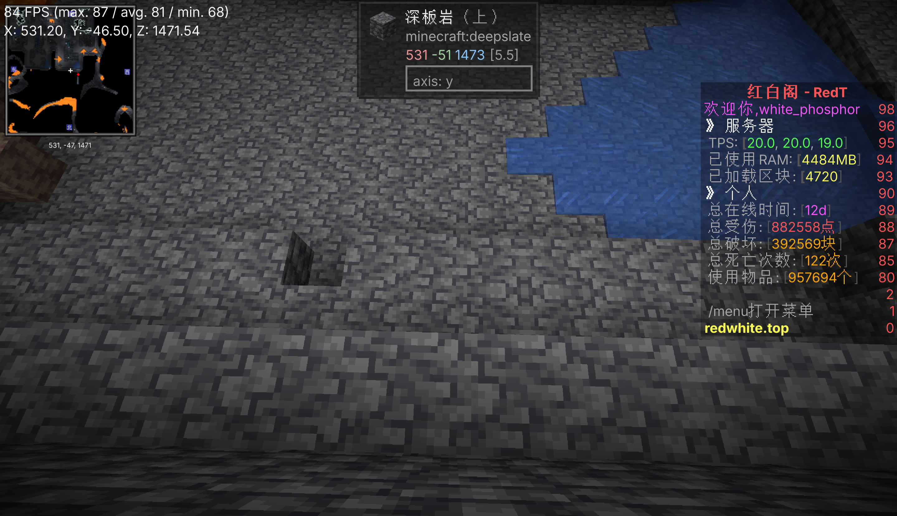
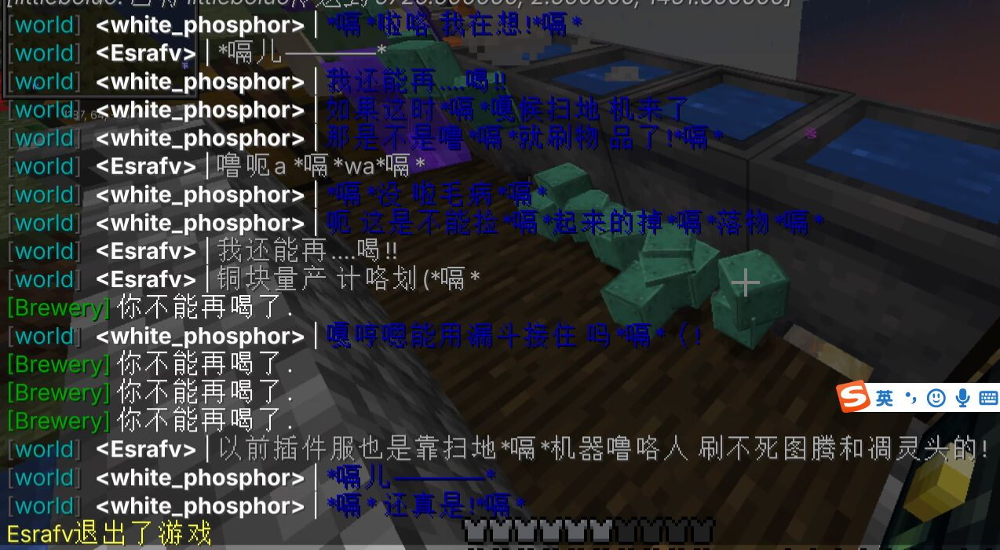

# 回光返照

> 江南忆，最忆是杭州：山寺月中寻桂子，郡亭枕上看潮头。何日更重游？  
> ———— 《忆江南》  

不可置否，二周目当然也有自己的黄金时代。在第二年暑假的四十二天里，统共收集了六十余万字节的聊天原文；七月合计 12410 条，八月合计 6017 条。当然这些人有新面孔，但还是老玩家居多；到后面，他们也不是因为什么原因离开的，纯粹只是因为，开学了。  
不得不承认的是，红白阁的绝大部分玩家都是学生。而这一个结构就决定了这个服务器必定只会在节假日的时候人多起来。  

  
> 末地的万叶  

## 升级

此前因为停留在 1.16.5 版本，许多优化模组都无法正常进行安装，导致服务器异常卡顿。huxk 此前已经在管理群内发布过多次说明，但是每一次都被菠萝因为“机器大量损坏”“空置域会更难炸”为由逼停。  
7 月 16 日，huxk 在内群开展全玩家公投，共同决定是否要升级版本；结果是除去菠萝以外基本全部通过。菠萝此时仍旧在坚持上述理由以阻止服务器更新，但在越来越激烈的争论乃至上升到玩家群体对于该事件的争吵后，菠萝被迫同意了升级版本。此外，QAZ 在群中反复发布反串言论，使得群内积怨进一步上升；最终，huxk 决定推进升级。  
晚上十点四十五分，服务器第一次以 `Starting minecraft server version 1.19.3` 启动，二十二点四十七分又起一次，二十二点五十一分又起一次。四次重启都是 1.19.3。次日早上九点五十一分，第一行 `Starting minecraft server version 1.20.1` 出现。此后一直到二周目结束，1.20.1 一共启动了 149 次。  
1.20 带来了樱花木、红树林、考古陶片、锻造模板这一整套新内容，也带走了 1.19 时代的许多生电手段；`littleboluo` 后来在 8 月 16 日发言：“但是1.20没有更新抑制了哈哈哈哈”“呜呜呜呜呜”。  
然而这么说实际上不准确。目前就笔者所能够查到的资料而言，针对 1.20.1 的许多机器早就已经进行了适配，而在之后，更多种类的抑制也替代了相对简单的 CCE 更新抑制；于是我们可以简单地得出一个结论：菠萝只是纯粹不想更新，因为留在这个版本很舒服。怎么个舒服法，因为很多机器都不需要更新，尽管要修要新建也只是打印机一个按键的事。  
7 月 16 日那天服务器上只有三个进服次数，账号一个。7 月 17 日，这个数字上涨到 46 次进服、18 个玩家；7 月 18 日 76 次、19 人；7 月 19 日 61 次、17 人；7 月 20 日 62 次、21 人；7 月 21 日 79 次、25 人；7 月 22 日 82 次、18 人。这七天是二周目唯一一次出现玩家在线数量大幅度复苏的时候。  

7 月 17 日全服聊天 1376 条，7 月 18 日 2538 条，7 月 19 日 2573 条，7 月 21 日 2674 条，是整个二周目除了开服时期以外聊天数量最多的时候。  
发言最多的是 `neko__LY`，13 天 5053 条，全期第一；紧随其后的是 `Jade_Emerge` 3054 条、`littleboluo` 2795 条、`white_phosphor` 2682 条。`neko__LY` 的话里大半是类似于“喵”“qwq”“【”的无意义消息，还有连成片的 `aaaaaaaaaaaa`。  

> 截图  

## 但是，在正常之外

前文说过，七月建起来的东西几乎全是打印机的产物。我们现在可以仔细统计一下到底打印了什么东西。  
按方块种类统计，全期写入最多的几样是 `air` 188384 次、`slime_block` 29667 次、`gray_concrete` 21316 次、`white_stained_glass` 15504 次、`observer` 13331 次、`bedrock` 13310 次、`smooth_quartz` 12867 次、`redstone_wire` 11248 次。  
那么就算再怎么不懂红石的人看到这些东西也马上能知道，菠萝肯定在粘贴机器；然而令人蒙古的是，哪怕是到后来这些事实摆在菠萝面前，他也坚称，这些粘贴都是为了修机器，而不是在贴机器。似乎他并没有意识到无论是修还是粘贴，其本质还是滥权。  
将近四成的写入是 **`air`**。这个动作的意味就非常明显了，把一整片地全部扬掉，然后用自己的东西日一声糊上去。几乎不需要做什么，服务器的 netty 在那几秒被阻塞到几乎饱和，全服务器停摆，然后变魔术一样一栋新的建筑或者新的机器就好了。  
然后需要注意的是 `bedrock`，13310 次。基岩除了用 b33 破没有任何办法；当它成规模出现在写入日志里，通常意味着这台机器需要冲的效率之大甚至需要把空置域的其他地方变成空白才能保持一个为了漂亮而漂亮的纸面数字。事实也是如此：比如那个开了一次机之后就再也没人去管的“最高效率”史莱姆农场；令人蒙古的是，这些机器没有哪怕一台是菠萝自己设计的。  
当然读写这些数据的时候菠萝不会觉得这是什么特别大的事情，**负责给他擦屁股的是管理团队和整个存档**。每一次上万方块的灌入，都要改写成百上千个区块的方块数据、写进 region 文件、触发区块重新渲染与光照重算；被拆掉、被改掉、被回填的旧记录不会消失，它们会写入 region，然后写入 CoreProtect 的数据库里，更不要提先前比 CoreProtect 要孱弱的多的 ledger。这就是为什么 9 月中旬出现那样一幕：9 月 5 日到 9 月 16 日，服务器上几乎没有玩家，日志里除 `Can't keep up!` 外几乎为空，掉刻每小时数百次；9 月 16 日一天之内，CoreProtect 抛出 **86209 次** `SQLITE_IOERR_WRITE: I/O error in the VFS layer while trying to write to a file on disk`。同样的，存档里那个 `ledger-2023-3-3.sqlite` 的备份是 0 字节，因为这样的写入甚至已经在机缘巧合之下把文件头都彻底破坏了。  
如果上述只是其对存档造成的影响，那么我们不妨看一看他到底贴了什么：

- **世吞**：7 月 20 日 15:36 `littleboluo` 说“世吞完工！”，15:40 说“世吞，启动！”，18:19 说“喜报”“世吞寄了”。  
- **猪灵交易**：7 月 25 日 12:52“猪灵交易完工”，12:53“200个猪灵”。同一天上午 11:19，“工业区的经验熔炉停用了”。  
- **刷沙收集**：8 月 20 日 `littleboluo` 在做。  
- **全物品仓库**：坐标约 `1245, 208, -775`，由 `littleboluo` 主导，曾被扫地插件与玩家取用反复折腾。老一代的全物品在 7 月 17—18 日被拆掉，8 月上旬新一代全物品建起来，8 月 20 日之后“现在全物品是能真真正正的无人运行了”。  

从上文不难看出菠萝所粘贴的几乎构成了生电服唯一玩法的，且全部玩家所共享进度的东西：机器。  
如果不明白这意味着什么，相当于上帝给你扔了可控核聚变发电站下来，但是你不仅不知道怎么修，你也不知道应该用什么态度什么行为去面对这台简直超出当前发展等级的东西。换言之，菠萝以一己之力把整个生电服务器的死亡时钟拨到了十二点，而玩家甚至都没有任何准备去面对它，自然选择用脚玩。  
即使菠萝本人不会承认这些，事实就是如此。  

## 旧面孔，新面孔

7 月 19 日 21:33，`white_phosphor` 在聊天框里打了三个感叹号：“air!!!”。`airlenter` 回来了，但是时间不长，他后来自己说“也就两周吧”。他在服里被领着找东西，“哦死光了忘了”“还在找我东西”；他问“点歌还在吗”，然后“我输个music search给我卡退了”。最后他说：

> 我觉得守着我的海州假装我是个世外高人挺好的  

`neko__LY` 接“小隐隐于野，大隐隐于市”。

7 月 21 日 20:48，`Jade_Emerge` 在聊天框里说“woc苏哥”，`SovietCommander` 回“好久不见”。

新面孔的来源则是各种各样。可能是因为 at 全体，也可能是因为看到了宣传视频或者招服玩界面。不论如何，新人的确是井喷式的涌现了。  
8 月 21 日，`NOWiFiON` 带 `lbd` 认路，一路介绍“这块是基地”“前任腐竹”“这个人叫红白”“这些一般是公共建筑”“这里面工业区”“这个是史莱姆的空置域”“这边是农业区”“这是苏维埃”“也叫指挥中心”“这块建在海上的叫seaty”“sea city”“这是废弃的”。  
这应该是最完整也最详细的二周目的老带新记录，而它出自一个当月才学会用 `!!here` 的老玩家之口。他要向另一个更新的人解释这个服务器，只能指着那些比他更老的东西解释。更有意思的是其中一句：“我们是”“共产主义”“除了私人的房子的东西”“像全物品的都可以拿”。二周目实际上说白了就是一个公用缸子大家拿，和现实的区别是这个缸子根本没有任何可以穷尽的时候。  
8 月 16 日下午三点四十八分，`littleboluo` 在带一个新人认路：

> [15:48:06] `<littleboluo>` 哇  
> [15:48:24] `<littleboluo>` sir,this way  
> [15:49:06] `<littleboluo>` 来我这  
> [15:50:30] `<littleboluo>` 设置重生点  
> [15:51:09] `<littleboluo>` 这是全物品  
> [15:51:34] `<littleboluo>` 把东西丢到这个水池里  
> [15:51:47] `<littleboluo>` 他就会自动分类了  
> [15:51:54] `<lindli>` 我会用  

这个人是 `lindli`，此后活跃 14 天。同一段对话里还有一句关键的话：`littleboluo` 问“有生电基础是吗？”，`lindli` 答“嗯”。二周目八月的招人标准，已经从“谁会玩 Minecraft”移到了“谁懂生电”；尽管在所有的对外宣称中，“这是一个和谐友爱包容欢迎普通玩家的服务器”。  

> ~~所以是什么时候你服从生存服变成生电服为主呢？~~  
> ———— Yarinaoshi  

带路的路线是：全物品 → 末地黑曜石机 → 刷沙机（“不过坏了”）→ 末地工业区（“基本就是报废的装填”“状态”）→ 工业区 → 史莱姆空置域 → 农业区 → 守卫者与猪灵交易 → 刷怪塔“炮”“用来当伪和平的开关”。`lindli` 说“延迟好大”，`littleboluo` 答“正常”“服务器日常卡顿”。  

## 酿酒复归

7 月 19 日到 20 日最热闹的东西是酿酒。  
鉴于升级到 1.20.1 之后，进入了 leaves 的支持范围，笔者便将 leaves 替换了原先低效率的 fabric，于是便有了酿酒。关于 leaves，笔者至今仍旧在 leaves documentation team 里，并且与 core developer 关系仍旧良好。  
`Brewery v3.1.1` 出现在服务器插件表里，并且配合了 `TrMenu` 做的菜单。`Jade_Emerge` 一边写菜单一边研究酿酒：“边写menu边酿红酒”；`neko__LY` 在酒馆里当掌柜，“绿茶绿茶”“来4盒子红酒”“速来！4盒”；`ybk10124` 研究陈酿时间，“所以红酒放的越久，酒精越高吗”“我放了33年”。`white_phosphor` 自己也下场：“有生之年居然看到了tier3”；7 月 19 日他被灌了几口，开始在聊天里打嗝：“哇塞蜂蜜 可以酿蜜酒!*嗝*”。  

  
> 酿酒。

这是二周目唯一一次**由玩家自己创造玩法**的时期：配方、品质、星级、陈酿时间，把“五个星”当成目标去熬一分钟。这个想法非常不错，但是二周目已经病入膏肓，无力回天了。  
8 月之后，酒馆冷了下来。7 月 21 日深夜 `neko__LY` 还在说“我爱酿酒”“酿酒爱我”，此后再没人提起这件事。二周目的玩法创新，只持续了大约十天。  

## leaves

7 月 17 日，下午三点十六分，服务器已经更换内核为 leaves。  
（如果你不知道什么是 leaves 的话，你可以点击[这个链接](https://github.com/LeavesMC/Leaves)，然后你需要知道的是它是一个基于 paper 的分支服务端，致力于在 paper 中最大化复原原版中的“生电”特性。笔者早在先前就已经了解了这一服务端，并且在非常早的时候为 leaves 编写过更新文档。）  
`white_phosphor` 在聊天框里说“1”，再说“1”，“正常了”，“\[i]”，“好嘞”。他在测聊天配色。前一天他和 `Jade_Emerge` 折腾了一整天的 `TrChat` 与 `sunlight` 的 chat-module 冲突。  
同一时刻，`Jade_Emerge` 在另外的地方干另一件事：他在下午三点二十三分打出“鉴定完毕”“五个无法损坏”，又贴出一个 GitHub 头像的图片链接，说“直接给地图是吧”。他在做物品展示的测试，测试对象是服务器里那些带 NBT 的东西。  
整个原本基于 fabric 的世界正在快速迁移到 leaves，于是便有了更多能够操作的玩法。

然后消息来了。15:27:17，`littleboluo` 冒出一句“话说”；15:27:31，“有办法加创世神吗”。15:27:42，`white_phosphor` 回“我找找办法”，紧接着一句“还有现在是真几把快”“我靠”。  
在此后，服务器的 tps 基本没有彻底下过 17，哪怕是被大量读写搞到掉刻，也比此前任何时候要强；但是这一点被轻飘飘带过忽略了。  
那一天结束的时候，46 次进服、18 个玩家账号、聊天 1376 条。  

## 拆掉旧世界

7 月 18 日上午九点零五分，`Jade_Emerge` 在聊天框里说“我在拆迁”。  
二十分钟后，`neko__LY` 问“拆哪里？”，他答“全物品(”“旧的”。这一天，他们拆掉了二周目最主要的一处公共建筑，是尚未完成的自主研发的十六进制编码全物品。  
拆的过程几乎是流水账：13:50“还要拆东西吗”，14:32“不拆了”“再拆我要垫了”，14:39“拆完了？”“拆完了”，14:46“光速拆迁”，14:50“拆出来的”→“丢全物品”，15:12“刷花机拆吗”，结果是“算了不拆了”，20:19“我先来拆一下我下午标志要拆的东西”，20:48“其实我还不知道要不要拆掉这牌坊x”。  
这一天还有一段更早的对话，说明他们做的是搬迁。8:49，`Jade_Emerge` 说“因为之前都加载过了”，建议“建议地狱跑”“然后建议五百格以上飞行”；9:03，他发出新全物品的坐标 `xaero-waypoint:全物品:全:1245:208:-775`。他们找到了一片新地形，要搬家。  
而这次拆迁的目标其实很简单，是因为 `neko__LY` 想找樱花林。8:46，她问“红石服加扫地插件了？”；8:55 有人说“这樱花林不算大”；9:04，`neko__LY` 说“所以”“有带樱花的东西吗qwq”。1.20 带来了樱花，整个服务器的第一波探索的冲动，是“我要去看樱花”。  
*如果你不知道为什么的话，这两位在当时是情侣。*

7 月 20 日晚上六点十九分。服务器刚熬过一个下午。  
十五点三十五分，`littleboluo` 在聊天框里打出“世吞完工！”；十五点四十分，“世吞，启动！”。二十分钟后，`Jade_Emerge` 在问“头颅的base64值怎么获得”，“aaa”，“好卡”，“还有一小时交作业”。  
十六点十七分，`littleboluo` 忽然问：“不至于吧”“世吞这么卡？”；十六点二十一分，“等人少再开了只能”。  
十六点三十一分，“计时器又失灵了”，他说，然后自嘲一句“服务器卡顿检测器（确信）”。十六点三十三分，“闲来无事”“开个世吞”。  
那一秒钟，陪他玩的人全炸了：`neko__LY` 发了一屏 `aaaaaaaa`，`Jade_Emerge` 跟着发，`2830484880` 跟着发，然后有人说“人活着哪有不疯的”。  
十八点十九分，`littleboluo` 说：“喜报”“世吞寄了”。“你猜回到啥时候了？”“回到世吞运行的时候了。”  
这一夜后来的内容全部是处理回档：十九点十六分，“这里的箱子呢？？？？”；`Jade_Emerge` 答“回档了”。有人刚酿好的咖啡不见了，仓库也被卷进去了。  
菠萝是否知道世界吞噬者运行的后果呢？明显是知道的。他是否知道世界吞噬者会让整个服务器，哪怕是配置极佳的服务器也会出现严重卡顿呢？明显也是知道的。但是令笔者实在无法理解的是，为什么明明知道有人的情况下他还是想开呢？笔者想来想去，可能只有一种解释：他认为她在玩什么和别的玩家无关吧；换句话他不认为自己是个需要承担责任的管理，只是一个能够肆意妄为的玩家。  

## 阴霾

七月二十一日，类似于一周目整蛊事件的事情又一次重演了。  
20:43:55，后台记录 `bot_mending died`。20:49:00，`[Server thread/INFO]: SovietCommander fell from a high place`。苏哥从高处摔了下来。他在聊天里说“wori”“我东西啊”“正在赶路”，`littleboluo` 说“有墓碑”。  
20:54:36，他问“墓碑呢”。20:55:27，“你们确定有墓碑吗”。  
20:56:33，`littleboluo` 宣布“重启了啊”。20:58:06，他公布了规则：“墓碑一分钟之后消失。” `NOWiFiON` 追问“之前不是30分钟？”，`littleboluo` 答“改了”，又说“我待会改成30”。`Jade_Emerge` 在旁边补了一句：“确定设成这玩意？”“又不是有tp权限”。  
此上操作笔者由于彼时在干别的事情一概不知，后来也是在 qq 群里看到这一条消息才知道。  
20:59:35，苏哥彻底爆发：

> `<SovietCommander>` 东西都没了，我不玩了  

21:52:42，苏哥第二次摔下来。21:53:06，`littleboluo` 说“给你回背包”。21:54:09，“你啥时候上线的？”，21:54:41，苏哥答“半小时前？大概”。  
21:55 之后，服务器进入了一段漫长的打闹：`/ban`、`/mute`、`kill` 在后台和聊天里交错，基本是针对菠萝一个人的。21:58:36，`littleboluo` 说“墓碑也没了”；`white_phosphor` 接了一句隔开的字：“这  下  完  了”。  
21:59:10，`white_phosphor` 开始劝酒以转移苏哥的注意力：“苏哥!”“伏特加”“吨吨吨”。21:59:46，苏哥回：“咕喝*嗝*嘎*嗝*多了”。  
22:02:01，苏哥说：“这下彻底完了，留下的潜影盒是个空的。”  
22:06:27，后台记录 `SovietCommander drowned`。他掉进水里了。  
22:45:40，他在亲自测试之后得出：“你这墓碑哪有半小时，要不是我亲自测试我就信了。”`Jade_Emerge` 只好说“墓碑时间你得问菠萝”。  
然而事实上没人知道他到底改成了个什么数值。  
23:01:49，苏哥在说完一句话之后草草下线：

> `<SovietCommander>` 听我的 别信墓碑

这件事情在 qq 群聊内没有留下痕迹。笔者也只能根据日志进行恢复；但是很明显，这也是苏哥第一次对这个服务器存在的合理性产生怀疑。往后这种时候只会越来越多，也只会越来越让他觉得整个延续的服务器越来越幼稚，越来越无药可救。  

## 空洞

7 月 22 日。`QAZ_Vicious` 在那天早上就已经被警告了：12:25:08，服务端日志记录：`QAZ_Vicious issued server command: /op`；12:25:13，`/op QAZ_Vicious`。他在聊天框里也承认了：“早上我开了。”十二点二十六分 `Jade_Emerge` 发出了 `/ban QAZ_Vicious`，十二点二十六分二十二秒 `/deop QAZ_Vicious`。  
然后他回来了。十六点三十一分起，他在聊天框里一路自陈：“1.20能复制物品吗”，`littleboluo` 回“能”“但不教你”，“这是paper”“还真不好找”；紧接着那段“我拿出!!op + gamemode 1，阁下又该如何应对”的对话；“早上我/seed过了”；“早知道早上就改lp了，手速慢了”。  
十六点五十六分，他说“我觉得”“有必要把现在的地狱交通拆一下”；十六点五十九分，“我拆现在得地狱中心了嗷”“没人说，我现在就拆了”。十八点十三分，“能送点tnt不”“再送点打火石”；十八点十六分，“疯狂tnt轰炸”；十八点二十，“疯狂炸服，大喜”。十八点三十四分，“当面创造是吧”；十八点五十五分，“boluo再不上线”“就开炸”。  
值得注意的是此时没有任何人。  
十九点二十三分，`Jade_Emerge` 在服务端后台敲下 `/ban QAZ_Vicious`；两点后补上理由：“炸服？让你炸,炸完三秒回档。”  
此后当然少不了在 QQ 群中拷打质问的时候，但很明显 QAZ 知道自己干过什么，在嘴硬了两句之后气急败坏发了三句话就退群了。  
当然由于造成的损失非常之小，这件事基本上也没有任何影响。  

*鉴于其本人想不起来这件事，笔者就帮其大记忆恢复术一下吧。啦啦啦。*  

> 这是我们的落日。  
