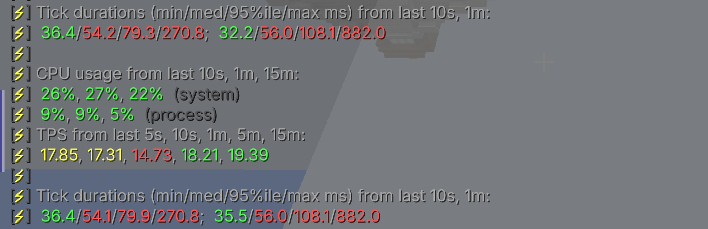
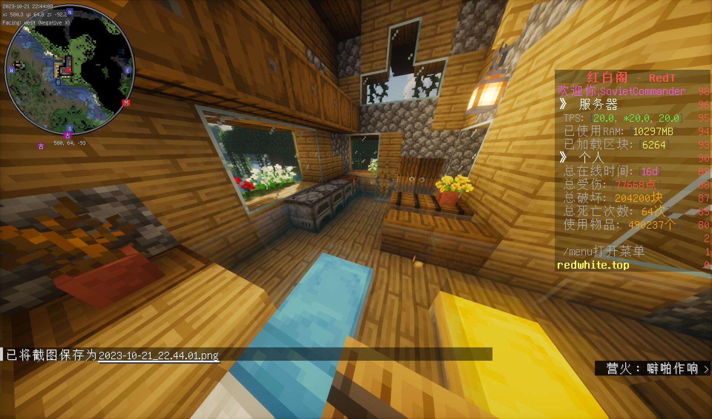
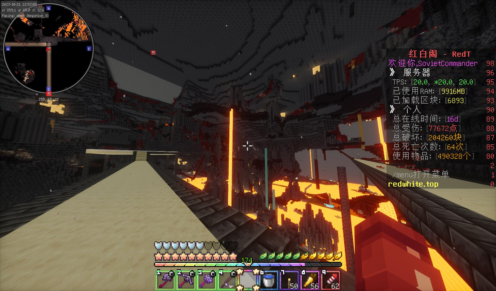

# 坠落

> Winter is coming.  
> 凛冬将至。  
> ———— 《权力的游戏》  

8 月 20 日，`white_phosphor` 在刷沙收集的工地上说“我明天就返校了（”。  
8 月 29 日之后，日活从每天二十个号掉到每天三到八个。  
二周目真正的热寂与秋季学期同步，这一点无须过度解释。这个服务器的所有人都在上学，包括那个唯一能修服务器的笔者。  
或者不是上学的问题，是因为没人想玩了。  

## 缺口

8 月 23 日是最后的顶点：71 次进服、18 个账号。在此之前，8 月 20 日有 44 次进服、25 个独立玩家。  
8 月 24 日 41 次、17 人；8 月 25 日 19 次、13 人；  
8 月 27 日 13 次、8 人；8 月 28 日 11 次、8 人；  
8 月 29 日 14 次、7 人；8 月 30 日 2 次、1 人。

九月的日子分成三类。  
第一类是“有人来的周末”：9 月 1 日 22 次进服、9 人；9 月 9 日 21 次、7 人；  
9 月 23 日 15 次、9 人；9 月 29 日 23 次、8 人。  
第二类是“一个人”：9 月 6 日、7 日、8 日各 1 次进服、1 人；  
9 月 18 日、20 日、21 日各 1 次、1 人；9 月 26 日 1 次、1 人。  
第三类是“零”：9 月 28 日 0 次。

十月比九月好一点，但好得不多。  
10 月 13 日 34 次、14 人；10 月 14 日 22 次、15 人；  
10 月 15 日 48 次、11 人；10 月 21 日 29 次、16 人；  
10 月 22 日 22 次、11 人。  
然后 10 月 23 日 6 次、5 人，10 月 24 日 3 次、3 人，10 月 26 日 2 次、1 人。  
10 月 8 日 0 次。

## Can't keep up

  

`Can't keep up!` 在有记录日志内全年出现了总共 20176 次。  
最集中的一个月是九月：9 月 5 日 816 次、9 月 6 日 955 次、  
9 月 7 日 1192 次、9 月 8 日 1444 次、  
9 月 9 日 473 次、9 月 11 日 322 次、  
9 月 12 日 1519 次、9 月 13 日 1575 次、  
9 月 14 日 1429 次、9 月 16 日 845 次。

九月五日至十六日这十二天，`Can't keep up!` 合计约 11740 次，占全年 20176 次的五成八。也就是说，开学后的这两周，为仅存档案内的大部分卡顿贡献了将近 50%。  
原因上文提到过，数据库炸了。9 月 16 日，服务端日志达到约 120 万行。其中约 120 万行来自 `Thread-16` 转储的 CoreProtect SQLite 异常：  

> org.sqlite.SQLiteException: [SQLITE_IOERR_WRITE] I/O error in the VFS layer while trying to write to a file on disk  

同一份存档里的 `ledger-database-file/ledger-2023-3-3.sqlite` 是 0 字节。Ledger 孱弱的数据库和写入方法已经把文件头给冲了个稀巴烂，由 CoreProtect 这个只是结实一些的草台班子接替，而 CoreProtect 的 SQLite 库终于在不断的粘贴下报警了。

## 遗裔

9 月的常驻名单很短：`littleboluo`、`Jinanfunny114`、`lindli`、`wsts`、`QuickBat`、`lbd`、`Mr_Z0406`。  
`littleboluo` 在 2023 年 4 月 16 日至 11 月 10 日间活跃 50 天，`white_phosphor` 36 天，`wsts` 24 天，`Beauty_collector` 21 天。  

`littleboluo` 仍在继续粘贴投影。9 月 10 日他在聊天里说“全新升级的袭击塔”，“有新的刷沙收集了”。9 月 23 日 `Mr_Z0406` 上线，问“周末都没人吗”，`littleboluo` 回“是这样的”；接着是“最近服务器里面在搞啥项目？”“新的采矿机”，然后 `QuickBat` 说自己“好无聊”，`littleboluo` 说“那就来造采矿机吧！”。`QuickBat` 回“emmm”，最后是“没东西干啊”“看起来都建好了”。  
一个服务器唯一的玩法彻底失去了意义。

9 月 5 日凌晨五点四十二分，`airlenter` 和 `Jinanfunny114` 撞上了：

> [05:42:43] `<airlenter>` 我草，这阴间点都有人  
> [05:43:29] `<airlenter>` 我晚上睡不着，太无聊了就来玩会儿  
> [05:43:45] `<airlenter>` 现在玩到不用睡了  

接着 `Jinanfunny114` 说要“把末地大厅搞完”，然后两个人在凌晨五点半的服务器里刷上了“《论脚手架的必要性》”“开个挂飞上去()”这类废话。`airlenter` 还说了一句关于这个服务器历史的话：“上一个末地大厅是我和cbw负责的”“科幻风”“这次居然这么，复古”。

10 月 15 日是唯一一次回光返照：48 次进服、11 个独立玩家。那天的聊天记录只剩几条 `CoreProtect` 指令的帮助文本，是笔者在查阅 `/co` 时把用法打错了。  
10 月 21 日只剩一行：“只能选44%的专业”。  
10 月已经没有人再讨论建设什么了。

## 与此同时，管理组？

唯一能够说话的只剩下菠萝了。9 月里 `littleboluo` 仍在断断续续地开打印机：9 月 2 日 60 条、9 月 9 日 117 条、9 月 22 日 67 条、9 月 23 日 113 条；9 月 24 日 17:44 那一段又灌进 15689 条，9 月 29 日 14:04 写进 17322 条。两天加起来，是九月全部写入量的九成以上。  
`white_phosphor` 在 9 月只在 9 月 10 日打了 2 条。  
而彼时，管理组的内群也毫无信息。  

## 一个人的开始

9 月 1 日，二周目秋季学期第一天。  
那天有 22 次进服、9 个玩家，是九月最好的日子之一。而全天的聊天记录，只有一行：  

> [21:13:18] `<lindli>` !!spec  

`!!spec` 是 MCDR 的旁观指令，全期被反复敲打。这一天的聊天记录里，只有一个人在夜里九点十三分敲下了它，然后大概看了一会儿，随后便推退出了服务器。  
同一天 `littleboluo` 在后台打了 28 条非写入类指令（`/gamemode`、`/tp`、`/bot` 之类）；而 8 月 22 日与 8 月 23 日那两天，他名下的总数分别是 336 条与 328 条，其中绝大多数是打印机的方块写入，8 月 24 日又是 222 条。很明显，服务器里面能够贴的机器已经没有了。  

9 月 16 日。这一天有 11 次进服、6 个独立玩家。`littleboluo` 打了 19 条指令，没有任何可用对话。  
九月的整体气氛可以从 9 月 5 日那段凌晨的对话里看出来。清晨五点四十二分，`airlenter` 上线的第一句话是“我草，这阴间点都有人”。随后他说了一句非常直接的话：

> [05:43:29] `<airlenter>` 我晚上睡不着，太无聊了就来玩会儿  
> [05:43:45] `<airlenter>` 现在玩到不用睡了  

一个靠着人多撑起来的服务器现在需要靠无聊来招揽人。  
然后他和 `Jinanfunny114` 聊了一会儿，问“有存货吗”“我看看附近有没有丛林”，被要了“10组”丛林木树叶；他说“我仓库啥都有()”“捡了啥我都往里一丢”。接着他谈起了这个服务器的旧事：“上一个末地大厅是我和cbw负责的”“科幻风”“这次居然这么，复古”。  

当然服务端的磁盘在 9 月 16 日那一整天没有停下过。`Thread-16` 每隔几毫秒扔出一段 `org.sqlite.SQLiteException: [SQLITE_IOERR_WRITE] I/O error in the VFS layer while trying to write to a file on disk`。coreprotect 已经彻底达到了写入的极限，开始报警。  
在同一份存档目录里，`ledger-database-file/ledger-2023-3-3.sqlite` 的大小是 0 字节。前文已经说过，它已经损坏了。

9 月 23 日晚上八点十八分，`Mr_Z0406` 上线，跟 `littleboluo` 打了招呼。  

> [20:18:17] `<Mr_Z0406>` 好久不见菠萝  
> [20:18:42] `<Mr_Z0406>` 周末都没人吗  
> [20:18:47] `<littleboluo>` 是这样的  
> [20:19:25] `<Mr_Z0406>` 最近服务器里面在搞啥项目？  
> [20:19:34] `<littleboluo>` 新的采矿机  
> [20:19:55] `<QuickBat>` 好无聊  
> [20:20:11] `<littleboluo>` 那就来造采矿机吧！  
> [20:28:37] `<QuickBat>` **没东西干啊**  
> [20:28:41] `<QuickBat>` 看起来都建好了  

这一天有 15 次进服、9 个独立玩家。`littleboluo` 在这之后还开了几次打印机：9 月 23 日 113 条非写入指令之外，9 月 24 日 17:44 与 9 月 29 日 14:04 各有一段上万条的写入。他还在修东西，只是已经不知道修给谁看了。  
一个生电服务器在建成之后，对普通玩家来说就没什么可做的了；那些机器能产出的是资源，不是“玩法”；玩法已经无力回天了。菠萝既然已经把所有玩家能做的事情干了，那玩家还有干什么事情的必要吗？  

## 欢朋空座

10 月 15 日周日，48 次进服、11 个独立玩家，是十月最高的一天。  
三个月前的同一天——如果那时有记录——服务器上应该有一百多人聊过天。这天，玩家们零零星星地进来，把 `/co` 打错了，看了看帮助文本，然后下线。  
这一天之后，二周目再没有出现过十人以上的日活峰值。  

> 来自苏哥  

  
> 来自苏哥  

> 来自苏哥  

> 来自苏哥，唯一一张 wer 真人出现过的地方  
>
> 一开始我真的天真的以为服务器真的是和玩家群体构成有关，工作日人少，周末人多，因为玩家群体都是学生，这种感觉一直持续到服务器25年，后面才发现是我看问题看的太浅了，服务器早就在潜移默化中变了，如同Ship of Theseus，我也不知道，在玩家，管理组，服务器的硬件，权限一次次更换之后，到底什么时候服务器不再是我所熟悉的那个地方了。  
> ———— Yarinaoshi  
