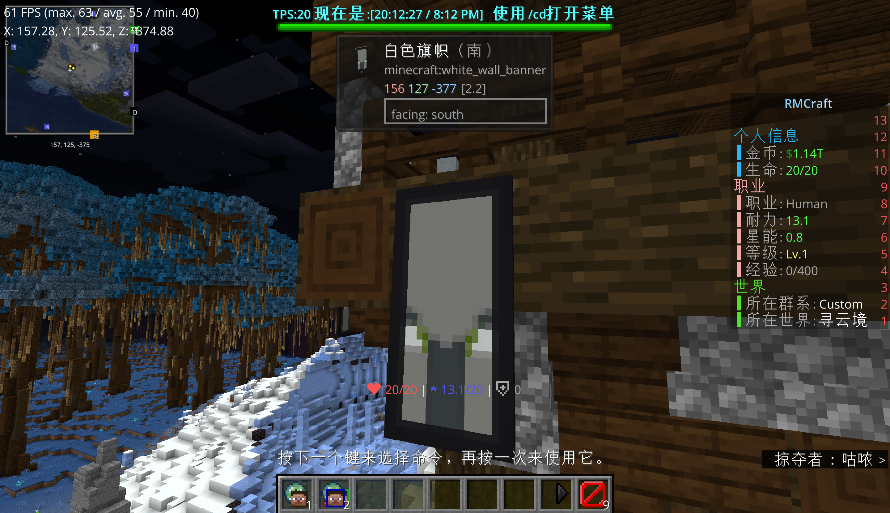
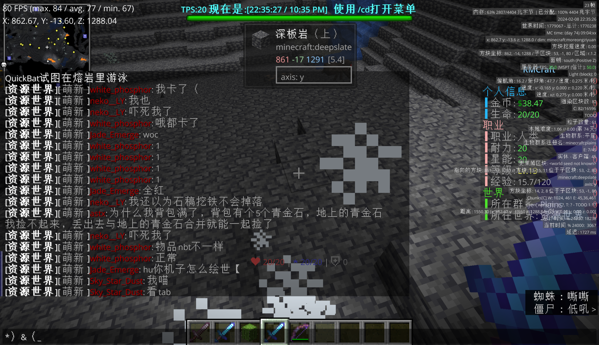

# 苍白

> Per aspera ad astra.  
> 循此苦旅，终抵群星。  

## 登台

在此之前有必要补充一下，前文所提到那“空缺的一个月”到底在干什么。  
在这一个月里，白磷选择了以最快的速度**彻底重组管理层**。我们已经在二周目里知道了菠萝的伟大事迹了，为此也就不再赘述；这次是彻底的，大刀阔斧的，对整个管理层赘余的彻底删削。  
而针对现今红白阁管理层的沉疴积弊，白磷选择了大幅度的改动；他将菠萝和若干个长期未活动的管理员踢出管理层，将留下的若干位管理员（包括 CBW，SSD，hmcl）并入新的管理层，原因是上述若干位均有一定技术水平。此前，由于“分散权力”的说明，笔者并未获得红白阁群聊的群主权限，而这个权限，在 CBW 手上。  
2 月 5 日晚上九点多，鸽子打了两个字：`huhu`。白磷回了句 `好像`。这天两人一共说了 28 句，是 2023 年 12 月以来任何一天的两倍以上——尽管 12 月一共有十天这台服务器在运行。

> [21:51:54] \<Super_Dove> huhu  
> [21:58:19] \<white_phosphor> 好像  

2 月 6 日下午，Jade_Emerge 和 Sky_Star_Dust 也进来了，当天 274 句聊天记录。2 月 7 日 341 句。到 2 月 7 日晚上十一点半，白磷在收工前最后一条消息是 `我明天加`。  

  
> 世界的一角。  

这两天里，四个人在服务端里干的活，从聊天记录里能一句句复原出来：白磷在配 MMOItems 的武器，把颜色代码 `§` 一个一个试过去（2 月 3 日到 4 日他的全部发言就是几十条颜色代码，`§rr`、`§ll`、`§bb`、`§nnn`）；鸽子在旁边改合成站、调粒子效果、拦他不要用 `§k`，说“少用静态”“一个武器最多用一个百分比加成”“否则你机子受不了”（然而实际上渲染是在客户端完成的）；Jade_Emerge 在铺地皮的核查；Sky_Star_Dust 在做矿。  
白磷说 `你信不信我昨天晚上刚刚开始学mi`，这之中 mi 是 MMOItems。鸽子回他 `做得比我好`，又补一句 `我可以下岗了`，`安心的去学blender`，`到时候学tyhppp做动画`。这尚且是两个人在一间屋子里分工干活时那种松散的、没什么信息量的对话，里面没有一句关于服务器将要去哪里；反而在这种时候，问这种话是最奇怪的。  
对一个只活了两个半月的周目来说，这两天的意义在别处：它决定了这四个月里有没有 RPG。三周目后所有的争论——该不该做 RPG、RPG 到底做完了没有、老玩家为什么受不了，都是这两天的结果。白磷后来说“我做了一个你们看来及其脑瘫的决定：放弃纯生存选择RPG”，这句话里的“决定”，就是 2 月 6 日到 7 日这两天里，好几个人对着 MMOItems 的配置文件以及其它插件做出来的；这个问题我们不妨放到后面再去讨论。  

## 毛胚

那天晚上是苏哥又一次心灰意冷的时候。大概这也是整个三周目的基调。  
那天晚上，苏哥问红石机器为什么被改了。白磷回答：

> [21:17:33] \<white_phosphor> 红石我们专门找了一个拓展来让他工作  
> [21:17:37] \<white_phosphor> 但是测试下来发现  
> [21:17:45] \<Super_Dove> tps--  
> [21:17:50] \<white_phosphor> 装上去之后不知道为什么tps一直15以下  
> [21:17:56] \<white_phosphor> 卸载又正常了  

然而实际上，要澄清的是，**从头到尾这个拓展就是不存在的**。  
尽管以现在笔者的能力而言，笔者完全有能力在添加玩法的同时兼顾以高性能替代方案实现这些内容；但是那时候笔者没有那么大的能力，也没有那么多的时间。而出于为了留住苏哥的目的，笔者当然编造了一个谎言，也就是所谓的“拓展”；然而这条信息，是通过 QQ 群进行传递的，而苏哥也在群内。  
白磷当时相信苏哥没有看到，但是笔者相信苏哥看到了。或者看不看到结果都是一样的，因为苏哥退出这个变了样子的服务器是必然的。  
紧接着鸽子补充了“备选方案”：

> [21:19:25] \<Super_Dove> 本来是还有方案B 用S开头的一个端  
> [21:19:28] \<Super_Dove> 但是他兼容性  
> [21:19:30] \<Super_Dove> 狗屎  
> [21:19:43] \<Super_Dove> 举个例子  
> [21:19:43] \<Super_Dove> 人越多优化越好  
> [21:19:50] \<Super_Dove> 人越少优化越狗屎  

然后是一段能够说明当前状态的对白。Super_Dove 发现自己根本不会用自己搬运的插件：  

> [21:25:19] \<white_phosphor> 怎么设置来着（  
> [21:25:44] \<Super_Dove> 我不到啊  
> [21:25:50] \<Super_Dove> 我不说了吗  
> [21:25:59] \<Super_Dove> 虽然这插件国内搬运是我  
> [21:26:00] \<Super_Dove> 但是  
> [21:26:03] \<Super_Dove> 我不会用(  

**一个把 Towny 汉化搬运到国内的人，在开服首夜对着自己搬运的插件说“我不会用”。**不知道这算是讽刺还是算什么。  
而服务器的定义，也是鸽子在那天晚上给的：  

> [21:15:53] \<Super_Dove> 不算是RPG  
> [21:16:01] \<Super_Dove> 主打的是生存 社交  
> [21:16:10] \<white_phosphor> 养老给你吃了？  
> [21:16:18] \<Super_Dove> 哦还有养老  

“主打的是生存 社交”；三个月后白磷在解散公告里写，双方的分歧是“放弃纯生存选择 RPG”还是“继续纯生存道路”；其实不是。  
看起来像是一个人在开服三分钟之后就说出了后来分歧的真相，很对；这个问题，我们还是留到后面去讲吧。  

## 离去

2 月 7 日晚上九点十三分四十四秒，代理端记录下 `white_phosphor` 从 lobby 转进 main。  
同一天晚上，Towny 插件里出现了两份居民档案：`white_phosphor` 和 `Super_Dove`。第二天下午，第三份、第四份、第五份接连落下来。

然后是 2 月 8 日。这一天有 1592 条聊天，19 个人，143 次连接进服。前一天是 341 条。前五天是 28 条。人数并非是缓慢增长的；**是突然全部到齐。**  
你可以从时间戳上看出来——前一天那些彼此连不上线的人，都在同一天晚上得知了同一个消息，也就是 RMS 群内公告发布正式开启服务器的公告。  
不是所有人来的时间都一样。这一天从早上八点二十九分开始：

> [08:29:23] \<Super_Dove> 正常了  
> [12:04:00] \<white_phosphor> tpa呢  
> [12:04:30] \<Super_Dove> wdf  

白磷在中午进门，鸽子架着他的 MMOItems。鸽子在十二点三十七分要一个东西：`give me op`。他们说 `新月感觉伤害低了点`、`我去极光怎么只有1血`。新月是一把武器的名字；他们在测试。_但是从开始到结束，新月始终没有被正式加入生存可获取列表。_  

  
> 凌冬，新月，魂穿三件武器正在进行测试。  

到傍晚六点半，第一个“外人”进来了。是 airlenter，一周目的老面孔，海州的建造者。  

> [18:31:19] \<airlenter> 啊？工具不能合是正常的吗  
> [19:25:47] \<white_phosphor> air有什么bug吗  
> [19:26:10] \<airlenter> 有，为什么我不是合金套()  

真正的分水岭在晚上九点后。
苏哥在晚上七点三十三分进来了。他打的第一句话是 `??不能玩红石？`。  
苏哥在三周目一共留下二十条发言，全部集中在 2 月 8 日晚上七点三十三分到九点三十三分那两个小时，加上第二天早上两条。二十条里有十九条是问句，全都指向同一件事；把它们按时间排开，读起来像一份充满了疑惑而失望的质问的工单：

> [19:33:36] \<SovietCommander> ??不能玩红石？  
> [19:35:30] \<SovietCommander> 刷石机都没法搞了……都到这种程度了  
> [19:37:40] \<SovietCommander> 这是暂时的还是永久的？  
> [20:47:25] \<SovietCommander> 讲一下，哪个是纯净生存服？  
> [20:49:00] \<SovietCommander> 家园世界也没法破坏方块啊  
> [20:51:19] \<SovietCommander> 服务器改的太离谱了  
> [20:53:20] \<SovietCommander> 所以我上哪个世界可以玩纯生存  
> [20:54:21] \<SovietCommander> 我指的是，像一周目二周目三周目那样的纯生存，  
> [20:54:21] \<SovietCommander> 不是现在这种乱七八糟的世界  
> [20:55:03] \<SovietCommander> ………………  
> [21:06:31] \<SovietCommander> woc还要重置啊  
> [21:14:15] \<SovietCommander> 所以生存服啥时候开啊  
> [21:15:40] \<SovietCommander> 我明白了，红白阁改成了RPG服是吧  
> [21:16:23] \<SovietCommander> 那红石机器怎么也给改了?  
> [21:18:40] \<SovietCommander> 我明白了，难为你们了  
> [21:31:50] \<SovietCommander> emmm资源世界的重置，会把所有的东西重置是吧  
> [21:32:46] \<SovietCommander> 最后一个问题，你们有谁看见过wsts吗  
> [21:33:39] \<SovietCommander> ……我没问题了  

十九点到二十一点，两个小时。中间二十点五十五分那串省略号之后，他停了十一分钟，回来第一句是 `woc还要重置啊`。  
二十一点十八分那句 `我明白了，难为你们了`——他把话说在了自己身上。他没有说“你们把我熟悉的东西拆了”，他说的是“难为你们了”。  
二十一点三十三分，他问最后一件事：有没有人见过 wsts。wsts 是一周目的老人。没有人回答他，或者说他已经知道答案了。他说 `……我没问题了`，然后下线。  
第二天早上八点三十九分，他又上来了。三周目里一个只逗留了十二个小时的人，第二天专门回来看了一趟：  

> [08:39:03] \<SovietCommander> 没事，我来看看他最后一眼  
> [08:39:51] \<SovietCommander> 有缘再见，有缘再见，再见  

“他”是什么，没有人问。可能是 wsts，可能是这个服务器，可能是他自己在一周目的那部分。  
苏哥在三周目的全部剧本，是二十条发言、一次探望、和一句道别；这句道别同样在群里法发过。  
在他发完这句话之后，他便退出了 RMS 的群聊。  

当晚九点十四分，鸽子在聊天框里说了一句：“领地换成了towny”。
十一分钟之后，开服的信号传达给了所有人。在接下来的四十分钟里，六个人接上了这扇门：  

| 时间 | 谁 |
| --- | --- |
| 20:47 前后 | airlenter 已在（更早，18:31 就说第一句了） |
| 22:11:16 | **neko__LY** |
| 22:43:28 | mc__xiaofeng |
| 23:21:08 | QiPao_Start |
| 23:27:48 | 789456123 |

neko__LY 进来说的第一句完整的话是 `wwww`，然后 `hi啊`，`晚上好啊各位`。第三句是 `这图我咋这么书序呢``熟悉`。  
这天夜里剩下的内容，事后回看不太像一个新周目的开始，更像一次验收。  
白磷说 `来我镇吗`。neko__LY 问 `领地要自己盖吗【思考`。有人问 `矿都不能卖咋赚钱啊()`。白磷在十二点后开始教人 `/t deposit可以去银行打钱`。neko__LY 说 `我要在这边开猫咖【？`。然后白磷问她 `名字自己取`。  
这个名字后来变成了一个虚拟国家的首都。  
到凌晨零点二十五分，neko__LY 下线了。她这一晚的发言是 17 条。  
四个小时之后，她将成为整个三周目说话最多的人。

## 寒夜极星

那天晚上九点四十九分，白磷在聊天框里打了几个字：`招人了招人了`。  
服务器是空的。他刚做完一套 RPG 武器系统，没有一个玩家。他把这句话打在只有他自己和鸽子看得见的频道里，然后开始跑图。九点半他找到一块场地，十点三十三分他说 `冰！！！！！！！！！（激动`，`原`，`冰！！`。十一点半他在那儿规划了一个镇。  
盖在那里的那块地，Towny 登记的名字是 **Polaris**，名字下面那一行公告板是 **`Per aspera......`**——“历经艰险”，阿波罗号的座右铭，众所周知的后半句是 `ad astra`，抵临群星。  
似乎他已经知道了后来会发生的事情，似乎没有。他知道后来总会有一天矗立于山巅的极星会倒塌，但是他还是满怀希望写下了那句：“Per aspera”。而在 SCSC 的公告板上，他写的是“永不忘记耻辱”，这个耻辱时至今日都不知道到底指的确切的是什么；但是当那个孩子颤抖着双手敲下这一行字的时候，他想起来先前的很多事。这一路走来怎么能不算历经艰险呢？  
然而他所能看到的，是他日夜追逐的北极星，正在没入黑暗中；他没有机会，从一开始就不能抵临群星，或者从一开始他就知道，星星不存在，那只是一个阶段性的谎言，他只是在一次又一次把这个谎言的破灭时间延后。  

  
> 三周目唯一一张合照。  
