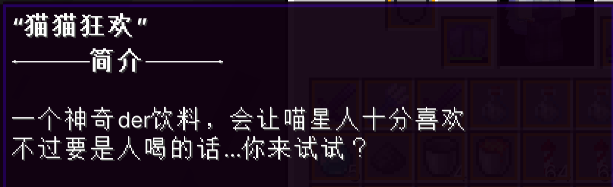
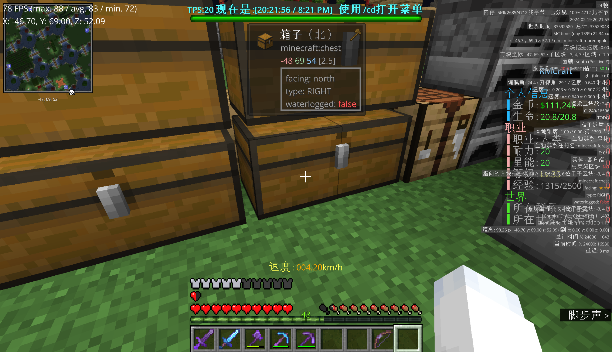

# 十一日

> 让咱们走吧，就你还有我  
> 当十一日帝国正将天空吞没  
> 宛如人形溶烂得像蛤蜊摆上早餐桌  
> ———— SCP-3999，“我于万物之中”  

2 月 10 日是除夕。  
3627 条聊天，19 个人，162 次进服。这是整周目第二高的单日。凌晨 0 点 12 分，neko__LY 打了两个字 `话说`，然后说了一夜，最后一句是 `[[[`，时标 23 点 59 分 38 秒。中间隔着一整天的 954 条。  
那天的聊天内容多数是琐事：

> [12:45:55] \<Mr_Z0406> 不懂就问，来城镇世界不都是rtp，如何找到自己之前的地皮呢？  
> [12:46:26] \<neko__LY> 我用了他说不行  
> [12:47:55] \<Jade_Emerge> 我记得是可以注册指令的【  
> [12:50:24] \<Jade_Emerge> p2 sethome  

有哭有笑有骂，有买不到东西，有卖不出去。`铜卖不了啊`、`你小子到底有多少钱【`、`hu一觉醒来变成了榜5`、`一个钻块也行`、`之前hu不是500一本吗`。  
非常小的东西在长出来。傍晚六点二十三分，neko__LY 说 `设个喵喵教？`。二十分钟后，LongBlast500 说 `建个国家？`。晚上九点四十九分，白磷自己也说 `招人了招人了`。  
那天晚上十点零二分，Mr_Z0406 说了一句 `真就全员猫娘`，Super_Dove 接 `所以大家都是猫娘`。  

  
> 洛颜提出的猫娘饮料。  

## 城镇国家与四条平行线

十一天里，人们在西边和东边的两片空地上盖起了六座城镇、三个国家。  
根据仅存的 Towny 数据是这样的：

| 城镇 | 镇长 | 建国时间 |
| --- | --- | --- |
| **Polaris** | white_phosphor | 2024-02-10 13:34 |
| **emmmm镇** | LongBlast500 | 2024-02-10 19:10 |
| **喵喵盛宴** | neko__LY | 2024-02-10 18:32 |
| **HLtown** | HLpixel | 2024-02-16 07:23 |
| **dh** | dhrghs | 2024-02-14 12:27 |
| **这里没有WiFi** | NOWiFiON | 2024-03-03 08:37 |

国家同样在 2 月 10 日到 11 日之间的几个钟头里被注册完毕：  

- **SCSC**，首都 Polaris，公告板 `永不忘却耻辱。`
- **猫柠夏语**，首都 喵喵盛宴，青色（`00ffff`）
- **hmmmm**，首都 emmmm镇，紫色（`9400d3`）

三个国家的盟友栏都填了另外两个：SCSC 的盟友是 hmmmm 和 猫柠夏语，hmmmm 的盟友是 SCSC 和 猫柠夏语，猫柠夏语的盟友是 SCSC 和 hmmmm。三个国家的敌人栏全是空的。  
在一台只活了两个月、玩家从未超过二十多人的服务器上，六个镇子分成了三个国家，三个国家结成了三边同盟，而且没有一场战争；Towny 的征服与废墟机制一次都没触发过。  

## 堆积之物

这个周目唯一可以说有留下来但是只存在于聊天记录中的东西大概也就这么几样，不妨就在这里讲讲掉吧。  

**airlenter 的仙人掌农场。** 2 月 19 日凌晨，他跟 WerewolfwolfyXD 说他这几天玩到凌晨三四点，“我天天都隔着捣鼓仙人掌，别的都没咋玩”，然后讲了这四天干了什么：

> [01:55:47] \<airlenter> 手挖了一点，大部分是挂baritone  
> [01:56:02] \<airlenter> 但建就只能手工了  
> [01:56:31] \<WerewolfwolfyXD> 又又又又是资本主义  
> [01:56:57] \<airlenter> 我22w x  

他挖空了一整块地皮，下面盖了一座自动仙人掌农场。那个农场在 2 月 19 日是服务器最赚钱的机器：主城收 0.09、玩家卖 0.15，白磷算过，“我们跑一趟他能赚6k”“我们赚4k”。他后来在 2 月 19 日下午说这机器是“让别人帮他赚钱”，“我中间商赚差价”。  
一个在一周目时代造过海州的人在三周目造了一台靠压榨仙人掌盈利的永动机。  

  
> 白磷的地皮。  

**冻海。** 2 月 19 日晚上，白磷飞了大半个地图找一个跟 airlenter 的建筑风格不冲突的地方。找了黑森林，说“有点，阴暗了x”，airlenter 说“和我的建筑风格不太搭”。后来他找到一个沿海的空地，落地就喊 `我草，这地方真风水保底`、`宝地`，然后发现旁边有个自然生成的地狱门，说“我绝对没动过”。airlenter 说：“风水宝地炸了()”“比我建的好看()”。  
最后海州并没有建成。airlenter 说“等暑假吧，我就跳槽自己来建()”。第二天他就开学了。
实际上在另一天，2 月 14 日晚上十点五十四分，airlenter 在别的场合说过一模一样的话：`等暑假吧，我就跳槽自己来建()`。  
而他在 2 月 10 日凌晨零点十二分建立海州的城镇，那天晚上七点三十五分就被问到“你seaty呢”，他答“我删了啊”。  
新时代没有 Seaty 的空间。

**美工模型。** Jade_Emerge 在 2 月 19 日下午上线新装甲，卡在“我们的美工还没画完图标”；然后 airlenter 说“其实图标也可以这么画的(”“你们美工不会偷懒”，Jade_Emerge 说 **“我觉得是她太懒了”**。  
那件紫晶套装在当天晚上实装。airlenter 是它的第一个试穿者；“hmcl赏的”，“因为那玩意我画的，他送了我一套x”。

## 小插曲

实际上对于自己建立的这个系统，白磷只能说其对于这个系统的某些部分是非常清楚的，至于这个系统的其余部分只能说知道其如何运作，并不知道其具体如何表现。  

2 月 17 日，HLpixel 在那天说：

> [22:34:22] \<HLpixel> 你没听错，我甚至懒得用剑  
> [22:34:30] \<HLpixel> 斧头附魔好搞  
> [22:35:35] \<airlenter> 17.8  
> [22:38:40] \<airlenter> 100.96()  
> [22:42:53] \<white_phosphor> 笑  

这也是三周目 air 名言的由来：`附魔不到两排的都不合格`。  
白磷在 2 月 17 日晚上 10 点 37 分才搞明白自己没有职业，所以不能加点。他选了狙击手，然后：

> [22:42:38] \<white_phosphor> 狙击  
> [22:42:43] \<white_phosphor> 本来60级  
> [22:42:47] \<white_phosphor> 选一下没了  
> [22:42:53] \<white_phosphor> 笑  
> [22:43:03] \<HLpixel> 对啊，会重置的  
> [22:43:18] \<white_phosphor> 我草蓝直接给我扣没了  
> [22:43:37] \<white_phosphor> 我没蓝让我玩牛魔  

一个管理员被自己掌控的系统清空了 60 级经验值。他在聊天框里笑了，然后继续跟 airlenter 讨论冰原的地形。  

## 无力建立的城镇

2 月 15 日是全周目活跃度最高的一天：3987 条，19 人上过线。  
那天晚上十一点整，neko__LY 在聊天里点了两个名字：

> [23:00:19] \<neko__LY> airlenter  
> [23:00:25] \<neko__LY> Seel_Vollerei  
> [23:00:36] \<neko__LY> 要不要去自立城镇【？  
> [23:00:56] \<neko__LY> 费用我出  
> [23:01:03] \<neko__LY> 但是城镇得继续归属我们国家  
> [23:01:07] \<mc__xiaofeng> 这是要分家了？  
> [23:01:12] \<neko__LY> 不是  
> [23:01:17] \<neko__LY> 肯定不是  
> [23:01:19] \<neko__LY> 我在思考  
> [23:01:21] \<airlenter> 我懒得弄  
> [23:01:24] \<neko__LY> 多个城镇聚合一起／还是单个城镇多人  
> [23:01:30] \<Seel_Vollerei> 什么殖民自治领  
> [23:02:25] \<neko__LY> 那就不分家  
> [23:02:26] \<neko__LY> awa  

四分钟。她提出让两个人出去自立门户，钱她出，但新镇子必须继续归在她的国家名下。有人问这是不是分家，她说了两次不是，然后自己把话题收了：`那就不分家`。  
“分家”这两个字，在三周目的两万八千条聊天记录里一共只出现过两次，都在这一段里，而且都是别人替她说的。  
这四分钟是整个周目最像派系浮现的一刻；但是它**没有发展成任何东西**。这段对话结束后一分钟，她就开始跟 Seel_Vollerei 炫耀镇上的村民交易价，说那批村民花了“城主大人”三万，绿宝石是“airlenter兄弟的赞助”。  
Seel_Vollerei 那句话说的是对的：`什么殖民自治领`。她提的确实是一个自治领方案。只是三周目没有，也不会，也没有机会发展到需要它的体量。  

## “臭猫”

2 月 17 日下午两点五十二分，789456123 在末地死了两次（先是被刷掉的僵尸，后来是找不到去末地的路），气头上骂了一句 `臭猫`。  
接下来四十秒是这样的：

> [14:52:23] \<789456123> 臭猫  
> [14:52:29] \<neko__LY> 木白！！！！  
> [14:52:38] \<neko__LY> 他骂我  
> [14:52:43] \<Jade_Emerge> 【】  
> [14:53:08] \<Jade_Emerge> 我总不能把他kick了罢【  
> [14:53:18] \<neko__LY> kick?  
> [14:53:23] \<Jade_Emerge> 踢出服务器  
> [14:53:31] \<neko__LY> 倒也不必  
> [14:53:38] \<neko__LY> 反正他追不上我  

一个人被骂了，第一反应是喊另一个人的名字，然后说“他骂我”。被喊的那个人是当场在场的唯一一个管理，回了一句“我总不能把他 kick 了罢”。这句话当然是玩笑话，但它真的不好笑。在这个既大又小的屋子里，这两个人认为“踢人”是一个可选项。  
如果在座读者尚且还能记得在先前周目中的描述的话，就会知道这两人实际上是情侣。  
这是三周目聊天记录里唯一一次，管理权限被当作私人关系里的筹码说出来。往后，这句话就不是一句玩笑，而是真正的，向上攀援的枝条了。  

2 月 19 日的凌晨，是这批人在三周目最后一个真正的长夜。  
从零点到凌晨两点，mc__xiaofeng 说 `润`，WerewolfwolfyXD 说 `好好好，不睡觉`。然后他和 air 两个人聊起了开学：  

> [01:35:23] \<WerewolfwolfyXD> noooooo  
> [01:35:55] \<WerewolfwolfyXD> 这个这个这个和那个，全部开学  
> [01:36:12] \<airlenter> 就晚一天而已x  
> [01:40:32] \<WerewolfwolfyXD> 一天是好多小时x  
> [01:45:10] \<WerewolfwolfyXD> times up  
> [01:45:17] \<WerewolfwolfyXD> 挂机  
> [02:06:37] \<WerewolfwolfyXD> imma going to sleep, good night, server, and gateway  

那天中午，Jade_Emerge 和 airlenter 还在调商店权限。Jade_Emerge 想给 airlenter 开大箱子商店：

> [13:59:48] \<Jade_Emerge> 没有限制箱子数量的权限节点  
> [14:00:17] \<airlenter> 但是 你没有权限创建大箱子商店  
> [14:07:14] \<airlenter> 此方法仅适用于管理()  
> [14:07:20] \<Jade_Emerge> 你们没有使用权限吗  
> [14:07:30] \<airlenter> 当然没有  
> [14:07:36] \<airlenter> 鞘翅都不能用  

一个管理为了开权限，翻了半小时 LuckPerms 文档，最后发现“这个破cmi找不到文档”，然后“为什么刚说找不到就找到了”。“权限组是个残废状态”这句话后来在聊天里出现了很多次；然而实际上，这是一件只需要解包 CMI 的 jar 文件翻一下 plugin.yml 就能找到权限节点的非常简单的事。  

那天下午四点十三分，Jade_Emerge 说 `今天人好少`。airlenter 说 `都开学了吧`。  
晚上七点五十五分，白磷进来说 `我去怎么人这么少`。晚上八点十六分，NOWiFiON 也问了同一句话，白磷回他 `开学了都`。  
只需要翻一下日历就知道，对于大部分的中学生大学生而言，**2 月 19 日是寒假最后一天。** 那天之后，这个服务器的白天就再没亮过。  
这一天之前，2 月 12 日早上八点就有人在说话，下午三点三百七十三条消息；2 月 15 日从早上七点压到深夜。这一天之后，所有留在服务器里的人的活动时间被压缩到晚上八点到十一点那三个小时。2 月 20 日 71 条消息，2 月 26 日和 27 日没有任何消息。  
这个月里没有人吵架。没有人宣告退出。只是没有人玩了；前一条将在不久的将来应验，后一条已经有人宣告退出了，只是现在暂时没有。  
