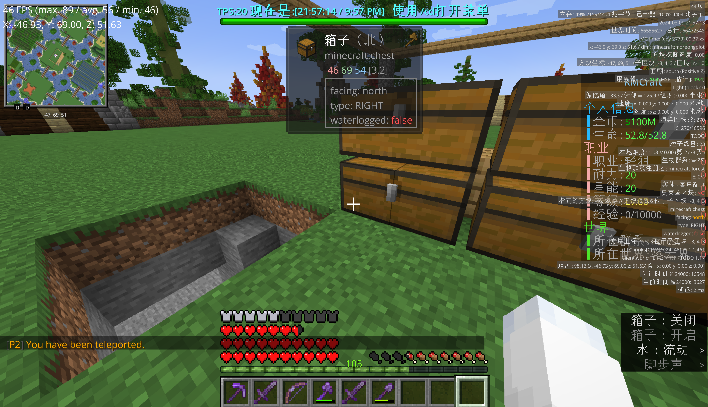
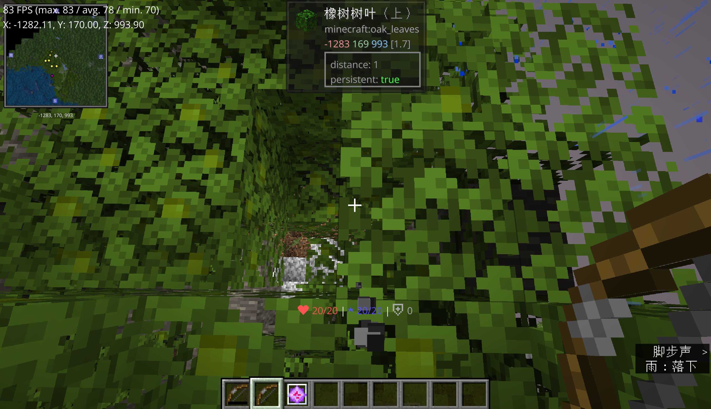

# 安息日

> “天地万物都造齐了。到第七日，神造物的工已经完毕，就在第七日歇了他一切的工，安息了。”  
> ————《创世记》  

## 沉寂

2 月 19 日聊天记录是 806 条。2 月 20 日是 71 条。  
没有人吵架，没有人宣告退出。**就是人少了。**  
剩下的人继续干活。2 月 20 日到 2 月 21 日，还在的只有五个人：white_phosphor、Jade_Emerge、airlenter、mc__xiaofeng、neko__LY。他们做的事情从“建设”变成了“修改”：修 bug、调数值、补漏掉的指令、把没写完的东西往下推进一点。  
仍旧不需要说明，根据前文，我们知道洛颜和 hmcl 的关系匪浅；而洛颜的权限是 hmcl 以“建设商店”为由临时给的，且仅通过了鸽子单方面的同意，而并没有由笔者所知。此后在完成商店修建之后， hmcl 并没有将洛颜的权限进行收回，反而将洛颜以“便于工作事务沟通”的理由拉进了管理员群聊；然而笔者所见到的，是洛颜在管理员群聊中不断发布与服务器建设并无相干的琐事，而非 hmcl 声称的“事务沟通”。  
新的旧的脸孔开始出现，而且几乎都是白磷一个人带进来的。2 月 24 日的 301 条里，有 166 条是白磷说的，75 条是 neko__LY，剩下 44 条属于一个叫 ybk10124 的新人。那天的对话是白磷教 ybk10124 怎么申请地皮：  

> [20:17:08] \<white_phosphor> now来搬砖  
> [20:17:31] \<white_phosphor> 这边全部卖一遍就是4300  
> [20:17:42] \<white_phosphor> air的仙人掌农厂  
> [20:17:47] \<white_phosphor> 四六开  

这是他最后一次以这种方式带新人。

2 月 22 日，mc__xiaofeng 在深夜问了一句 `刺客啥时候能站起来`。刺客是 RPG 职业表里的一个职业，写了一半，技能点都没有。没有人回答他。那天的 164 条里，63 条属于 Minute，67 条属于他。两个人在修熔炉组。  
2 月 23 日的全部是 69 条。第一条是 Minute 在零点整打的 `算了 搞稿子吧`。最后一条是他晚上十一点零三分打的 `晚安`。  
**“算了，搞稿子吧。”** 一个中学生在服务器里打了这句话，然后下线去写作业了。

**2 月 25 日凌晨两点二十**，airlenter 和 neko__LY 还在。他们说了 96 句，两个人在凌晨三点那一分钟里互相确认对方是在线的。  
**2 月 29 日晚上十点零二分**，airlenter 撞见 mc__xiaofeng 时说了这么一句：

> [22:02:16] \<airlenter> 我擦，还真有人  
> [22:02:39] \<airlenter> 昨晚我一个人在这玩单人游戏，没个人上线  

闰日，这个周目在这一天一共产生了三条聊天记录。
你当然可以回来，但是已经没有人了。  

## 短暂的喧闹

3 月 2 日是周六。329 条。  
3 月 3 日是周日。1368 条，10 个人。  
这是三周目最后一次像样的高峰期。那天早上八点三十六分，neko__LY 上线，用拼音一个字一个字地打，因为她输入法坏了：`qaq`、`ni`、`nengbuneng`、`bangwogemang`、`a`、`NOWiFiON?`——**能不能帮哥们**。  
上午十一点，服务器迎来了它最后一批完整的新人：789456123、Tetrixy。neko__LY 亲自当导游，带他们走了一圈：

> [11:03:00] \<neko__LY> 新手礼包  
> [11:05:34] \<789456123> 因为这不是生电服。  
> [11:09:18] \<neko__LY> 这里是铁匠铺  
> [11:10:31] \<neko__LY> 现在来说我们镇  
> [11:10:41] \<neko__LY> 看到下面的橙色字体没有  
> [11:10:57] \<neko__LY> 人和原版装备完全不建议做  
> [11:13:39] \<neko__LY> 我们镇的人活跃度是其他镇的2倍以上【【【【【【【  
> [11:15:48] \<neko__LY> 那只猫不知道谁造的  
> [11:15:51] \<neko__LY> 反正不是我【  
> [11:15:53] \<neko__LY> 对呀  

那天的气氛是好的。有个新人在铁匠铺问这问那，有个叫 Tetrixy 的发现了一只烂掉的鞘翅问能不能拿走，neko__LY 说 `估计是懒得修放着了`。三个人聊起了米哈游，`上次在o神里冲了648`、`170抽5只魈`、`我是小屁孩`。一个人说她的同桌叫她玩光遇。有人说西瓜掉地上烂了。  
晚上十点三十四分，neko__LY 跟最后那个新人 **Micro_SB** 道别：

> [22:34:39] \<Micro_SB> 蛤  
> [22:34:46] \<neko__LY> 哦不对他好像玩不了  
> [22:35:23] \<neko__LY> 你在那边过得好吗  
> [22:35:26] \<neko__LY>【指镇  
> [22:36:08] \<Micro_SB> hu给了一组钻石  
> [22:36:15] \<neko__LY> 有点抠  
> [22:37:40] \<neko__LY> 我下了啊哥们  
> [22:37:46] \<neko__LY> 祝你玩得一块  
> [22:37:48] \<neko__LY> 愉快  

**“祝你玩得愉快”。**那是三周目某一个人在服务器里说的最后一句像样的话。  

3 月 5 日，8 条。Minute 说 `hi`，mc__xiaofeng 回 `r`。  
他们讨论弓的属性：`不知道 反正很拉胯`，`我不用弓`，`666 4滴的伤害`。

3 月 6 日，23 点 16 分 55 秒，mc__xiaofeng 打了一个字符：  

> [23:16:55] \<mc__xiaofeng> 1

三周目最后一整天的全部聊天记录，就这一行。

3 月 9 日，MEMZGBL 下午四点四十七分进来，打了五句：`?`、`where`、`1`、`yourenma`、`?`。**有人吗**。没有人回答他。  
同一天晚上，white_phosphor 在 21:05:56 进服，21:28:54 到 21:34:07 **圈走 904 块地**，21:52:58 打了一个字母 `q`，下线。
**那是三周目聊天日志的最后一行。**

  
> 白磷的地皮。  

白磷到底为什么要圈地呢？  
对他来说那已经是一个只属于死人的世界了。他能够做的，就是飞上高空，看着他那个曾经爱着的世界竭尽全力挽救之后仍旧死去。  
他只花了一点时间就解除了自动圈地的限制，然后将大量的无人区划入极星的领地范围。他知道这里以后不会有人来了，也不会有人在意了；至少在这里仍旧在运行的时候，他希望，极星不会被太多的怪物所侵扰。  
他已经是这个无人世界的王了。  

  
> 摄于 24 年 6 月 22 日。  
