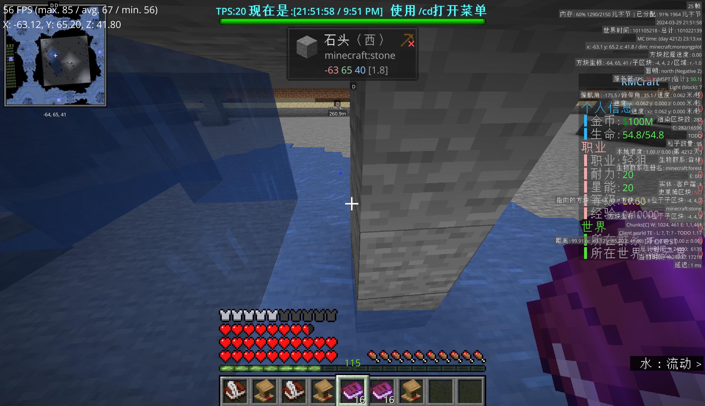
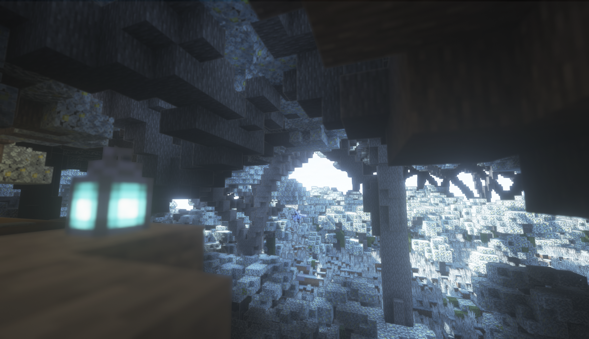

# 落幕

> Acta est fabula, plaudite.  
> 落幕，掌声起。

## 没有人的四十六天

从 3 月 10 日到 4 月 4 日，服务器还开着。代理端日志一直记到 4 月 4 日，之后日志文件本身也停了。这四十六天里，一共还有十几个人试图连进来过，大部分在 lobby 卡住，看几眼，走掉。  
白磷的连服记录一直延续到 3 月 29 日。他从 3 月 10 日以后进去做的事，聊天日志没有记录，因为没有人可以对话。  

那么这十九天里白磷到底做了什么呢？  
他在闲逛。对，他在闲逛。  
他走过尚未动工的海洲的那片暖水海洋，走过绿地鲜亮的猫柠夏语；他走过尚未完工的城堡和只建设了一半的群玉阁，登上极星的房顶看着天边日落逐渐陷入覆满苍白雪墓的山尖。他飞向天空，直到信标光柱也停止渲染，脚下那片多姿却已经不会有人光顾的大地变成一个不可识别的灰色像素点；他坠向虚空，坠向极星地底那个从未有人得知的圣堂，反复摩挲着那本早就翻过几十遍边角已经发毛的圣经。这个世界曾经有多么多姿多彩，那么现在就有多么无聊单调令人发疯。  
然后他回到主城，登上那艘自一开始就在翻修的船。那艘船里密密麻麻地站满了开发人员的偶像，在他慢慢下到舰仓时他们一齐将目光对准他；他知道那些不是真人，他只是拨开那层不存在的碰撞箱去抚摸那个“干什么”桶。那是 SSD 留下来用来实验 typewriter 的东西，只要抚摸一次就会“干什么！”叫起来，他每次摸到那个桶时都会笑。  
然后他走到主城里。这个 NPC 是简驳，那个是名字永远想不起来的铁匠，再往后那个，好像也想不起来了。那不重要。他飞到那个无人的小岛上，那里有一地的好荞麦；他减速，任凭自己落入麦浪中让自己摔得半残。对他这样在这个世界中游荡的“半神”，死亡无足轻重。浆果。很好；小麦，也很好；胡萝卜，也很好。岛上的作物就没有了。他又开始思考为什么要在这里停留。  
他开始查看那些他锻造过的武器，那些被造出来之后永远也没有被人所发掘出来过的武器。他将它们一把一把丢入大海，又一把一把将它们的存在抹去。他突然很释怀，但是不知道为什么；哪怕他只是在摧残自己曾经做过的一切也觉得很舒心。  
他感觉很累，他当然也知道为什么很累，但是他不能停下。他必须前进。为什么前进他又不是很清楚。放在往常他是会骂人的，骂这个人为什么滥权那么多，骂那个人一点没有主见只会支支吾吾，骂所有人毫无作为除了混吃等死一无是处。但是他真的很累。他已经没有力气去批评任何一个人了，再者他也知道，批评这群病入膏肓的人已经没用了。他知道为什么这么无力了，因为他就像把自己的造物丢进水里一样把自己的精力和热血东丢进了一个注定不会真正活过来还被二度摧残的尸体上。  
于是他跳进水中。他开始等待，等待有一天到来，等待有一天他能够找到理由彻底将这一切全部结束。  

  
> 没有什么能留下的。  

## 密谋

这种希冀死亡到来的祈求似乎并没有多久就应验了。  
在前文已经提到过，hmcl 违规提权将 neko_ly 拉入了管理群聊中而实质上任何东西都没有进行推进，导致白磷进一步心烦意乱开始疯狂压力所有人。这很符合白磷一贯的作风——他只在意服务器会怎么样，他不在意别人怎么想。  
但是别人很明显不会这么想。  
关于洛颜，在其它文档中大概也能窥见一二，笔者此处不对其进行评价。此前从她的视角来看，应该是“hmcl做了绝大部分事情”，而“huxk只是在乱压力人”。进而，洛颜认为白磷是只会压力他人的无能之人。在白磷在群内对其进行批评之后，可能就是那个时候，洛颜便萌生了将白磷踢出管理的想法。  
随即洛颜便开始撺掇 hmcl，开始借 hmcl 拉拢周围的一众（前）管理，通过 hmcl，n_o 等便已拉拢中立的 Sky_star_dust，ClearBlue_Water 成立了新的组织 —— 云霭之梦。几位可能一开始的想法并不相同，但由于白磷所操的手段太过激进，且 *“理念不同”*，于是一拨人便选择聚在一块“接过这个摊子”。  
云霭之梦建立的目的很简单，为了推翻现有的体制重新作为。成员已经受够了笔者长期的阴阳怪气和言语压力，遂决定脱离出去单干。  
几人一致决定将白磷开除，*光复*正式的 RWP。

## 关于理念问题…  

然而令人蒙古的这个理念问题，笔者除了在一开始说过这句话，后来基本上便不再沿用。明眼人都能看出来，白磷唯一的目的就是去除路途上所有的障碍物，恢复原本的模样。  
首先需要解答一下那个很著名的“一言堂”问题。此前在二周目中笔者已经谈到过，除去一言堂以外我们没有任何办法；如果一个管理层除去一个人之外其它人甚至无法完成完整的维护工作，那么理所当然的，这件事就应该那个会做的人去做，并且在之后那些反对笔者一家独大的呼声甚至都可以说是空穴来风：**你到底干了什么事情能让你有一种你能对我发号施令的感觉了？**  
其次就是所谓的“理念”问题了。理念问题我先前一直在强调的，是“不论以何种形式，将烂摊子解决并维持甚至做大一周目的状态”；然而普遍所保有的“理念”，本质上是“维护生电”。且不谈这个生电在红白阁官称为生存服的服务器里面定位如何，首先，生存就是生电的超集，仅从玩法上来讲，生电就是毫无出路的，它的上限就那个样子。而什么时候这个超集坍缩为了这个单一的子集，不知道。  
至于后来说的，“为什么不沟通”的问题，首先和 hmcl 和菠萝的沟通成本十分有十万分的巨大，更不要谈长期脱离服务器维护的其它玩家和管理；其次即使将所有事情摆上台面进行交流，也有很大的概率这些言语是不会被理解且接受的。笔者并没有攻击此二者语言能力的意思，但是客观而言，和这两位沟通就是非常艰难。笔者认为，任何一个与此二者进行过交谈的正常人类都会在五普朗克时间内立即得出和笔者一样的结论。  
这样一来，之前那个在第一节里面那个留下的问题就可以解答了：分歧实际上是一个为了实现目的不择手段且倾尽心血想要令其他人意识到只有投入才有结果的人，被一群无法沟通且无可救药的人磨到身心俱疲。在二周目里，这个人的代表是菠萝，在三周目里，这个人的代表是 hmcl 以及洛颜，谅笔者实在无法忍住指名道姓把这几个人的名称说出来。笔者当然理解笔者一直在找别人问题的这种说法，但是，笔者希望提出这种说法的一位先生和一位女士站到笔者的视角上来思考一下这句话正确与否。倘若是你，面对这种几乎无解的局面，你会做什么，怎么做？  
**你可以摆烂，但是总有人必须去负责，去给出一个说法；你可以在前台享受所有的光辉，但是不要忘记，所有的活到底是那个在黑暗里的谁干的。**  

## 阴燃

4 月 22 日晚间，笔者被拉入一个临时群聊。  
临时群聊中总共五位成员，分别是笔者，hmcl，n_o，Sky_star_dust，ClearBlue_Water，而组织这一行动的主谋人并没有出现。在经过并不长的寒暄之后，对方决定直接开宗明义，以“想着把这个担子接过来”的理由，要求笔者交出服务器的控制权、名称使用权和标志的使用权。  
笔者基本已经推断事情大概，因此在经过并不长的思考之后，笔者决定顺从了。  
**因为我累了。**  
而云霭之梦方决定“暂时先维持这样的一种状态不戳破”。CBW 原话大意如下：  

> 是这样  
> 这个群（指 RMS 群）到时候也会保留着  
> 你们也可以继续开  
> 我们就用回我们自己的群了

需要明确的是，**原 RWP 群聊，内群，管理群实际控制权均为云霭之梦**，这在前文中已经提到过（属于 CBW），并不进行赘述。  

## 放逐

4 月 20 日晚间（此前已经开始撰写），笔者认为实际的 RWP 已彻底不复存在，于是归档 Github 组织 RWPStudio 并发布长文【杂谈】为什么放弃RWP（复制件于[此处](B-talks.md)）。笔者在此文章中形成了在[关于理念问题]($4-acta-est-fabula.md#关于理念问题)一节中的初步观念，并予以公开。  
然而这一行为遭到了云霭之梦方的代表 hmcl 的误读，他认定，笔者这么做其实就是在蓄意挑起争斗。然而他的理由的确让笔者有些汗颜，或者说，简直已经到了一种不可理喻的程度：他认为自己的代码被吞了，非常气愤，于是认为笔者把这件事情搬上台面是不对的。  

我们不妨大胆推测一下 hmcl 是怎么想的：hmcl 认为，github organization 是 RWP 线上劳动成果的代表，然而在笔者 archive 之后又将其移出了一个已经 archive 的组织，其代码工作就这样在不知不觉中被损毁了——因为 EmailWhitelist 是一个 Private Repo。  
然而首先令人大惑不解的是，为什么 hmcl 作为该仓库原始开发者，其没有在本地进行文件留存，反而是指责笔者“吞了代码”呢？反过来，即使笔者将其移出 archive 的组织了，那么由于在名义上双方已经达成协定，笔者不再属于云霭之梦方，请问笔者将除自己之外所有的人员全部移出 organization 存在任何问题吗？再三，如果以上两者均不是有效理由，那么请问，EmailWhitelist 在第三周目中是否还在使用呢？很明显是没有的；那么请问，hmcl 是如何从一个仓库被存档这件事看出来，笔者是在将这件事情放上台面呢？**笔者甚至没有在除了管理群内的任何地方透露过 github organization 的存在。**  
于是思来想去笔者只能认为，hmcl 只是需要一个将笔者彻底进行清算的借口，而不是为自己进行正名，其所持理由于情于理几乎都没有成立的空间；然而实际上我们也无法得知 hmcl 到底是以什么脑回路进行思考的，总而言之，hmcl 认为有必要动手了。  

4 月 24 日，笔者在不到五分钟内被所有关于 RWP 的群聊移出并解除管理权限；**注意此时，内外群与管理群的群主为 CBW，但实际处理人为 hmcl。**，由此可以断定，**这件事情已经在内部进行了决定**。笔者随即开始着手撰写解散公告；关于解散公告，请参阅 [此处](A-announcement.md)。  
在这之后矛盾达到最大化，笔者和云霭之梦方发起正面冲突。在经过短暂考虑之后笔者选择了让两位代理人进行直接沟通：一位是 babato，一位是 micro_sb。由于原 QQ 聊天文本已经散佚，笔者仅能够从复原的截图中截取部分进行部分大意转述：  

- hmcl 和菠萝认为，huxk 是“明明没有必要担任那么多责任却一定要担任”，而菠萝额外地认为“想要捐钱但是他不让”。此前这两个理由已经进行过说明，笔者不再进行赘述；  
- hmcl 认为 huxk “说话太过抽象”导致“大家都不喜欢他”。事实是，除去管理组内的部分成员，经过笔者的调查，在玩家群体内基本没有对这一特征感到非常反感的玩家；  
- hmcl 认为 huxk “不接受他人的关心”。事实是，笔者的确拒绝了 hmcl 所谓的关心，但是笔者认为，hmcl 先生安慰人的水平实在太过原始且低效，并且也在无形之中从反面给笔者施加压力。且从客观而言，笔者并没有在一二周目交替之际收到任何来自于管理组成员（除彼时的 SSD 与玩家群体中的一些鼓励）的关心与鼓励。  

此后对话以一种基本僵化的状态结束。这也意味着，笔者正式结束了作为 RWP 实际服主的生涯。  
另外，三周目的服务端，从来没有移交给任何人，这些文件直到今天，才重见天日，供各位参考。  

## 清扫

在这之后，RMS 彻底关闭。鸽子发布了 RMS 解散声明，随后在笔者试图将外部群改造为 Pykefox Outsider 群的尝试失败之后解散了 RMS 外部群聊。  
就此第三迭代结束了。  

第三迭代基本上没有特别值得令笔者进行描述的内容，至于一地鸡毛的结尾，从开始的不堪回首，到现在早已心无波澜。过往的任何误会，歧义，辱骂与诋毁，现在对笔者而言基本已经没有特别值得记忆的内容。笔者也只是一次又一次翻开文档，然后尽可能完成；笔者所追求的，是完成最大限度内可还原的真实。  
笔者见证了一周目兴起到衰没，二周目每一次奋起重战，与最后三周目黔驴技穷孤注一掷走向必定的失败。笔者不能说能够对自己过往的所有经历都没有愧疚之心，但是笔者足够没有遗憾；  
**因为我的确已经足够竭尽全力了，我不会后悔。**  

  
> 再见的意思是，再也不要见。  

---

## 附录

| 日期 | 事件 |
| --- | --- |
| 2024.1.1 | RPG 服初步搭建 |
| 2024.1.6 | 正式合并成立RMS。” |
| 2024.2.5 | 开始装配服务端 |
| 2024.2.8 | 开服首日 |
| 2024.2.10 | Polaris / 喵喵盛宴 / emmmm镇 建国 |
| 2024.2.15 | 全声明周期峰值：3987 条、19 人 |
| 2024.2.19 | 开学 |
| 2024.3.2 | 329 条，一次小回暖 |
| 2024.3.3 | **最后一次回升**：1368 条、10 人 |
| 2024.3.9 | 最后一条聊天：`q` |
| 2024.4.4 | 代理端日志终止 |
| 2024.4.20 | 白磷发布《为什么放弃RWP》 |
| 2024.4.22 | 索要权限与名称使用权 |
| 2024.4.24 | 三周目终止；白磷被移出全部群聊 |
| 2024.4.25 | 解散公告《RMS将停止存在》 |
