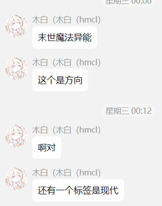

# 附录 - “中间那版”剧情

  
给我的标签，我把末世掐了。  

先简单概括一下背景：  
现代都市，大部分人有不同的异能。女主的能力是【虚妄跋】，能以灵体形态在梦境，现实和镜世界自由切换，切换条件是触碰特定物品或进行特定行为。
// 具体一点，进入梦境是接触三色堇，镜世界是接触白色鸢尾花或死亡。  
梦世界的基调是美好，镜世界会更残酷，现实则很现实。  

// 玩法我想象中是jrpg，比较合节奏，也可以利用女主的能力做解密  
   剧情量并不是很大，主要是在叙事上下功夫吧  
   后边写顺手了不小心变第二人称了，无需在意（  

然后就是大概的内容：  

## day1

先说现实，现实中女主是一名漫画家，每天就是宅家里画画，日子过的很普通，大部分的娱乐都在梦中。某天她收到了一封邮件，要求她帮忙盯着新来的邻居每天的动向，这里不会直接让你选接或不接，会在睡前触发。接受通往结局1、2，不接1、2和好。  
这里不管选择什么都是正常度过一天， 画画吃饭打游戏，直到在睡前你会听到邻居进门的声音，这里如果你去回邮件的话就是接了，直接睡觉就是不接。
睡前会看一眼聊天软件置顶的哥哥，头像是灰色也没有新消息，最后一条是“别担心，等我回来”  
睡觉后就会进入梦世界的叙事，梦世界自然是梦幻的，时间与现实相反，现实的夜晚是梦中的白天。  
梦中的她住在一个郊外的小别墅里，有着自己的花园，是一个花艺师。性格温和，这里先叫她A，女主进入梦中后大部分时间都和A呆在一起，陪A一起看花或是出去玩。这里也是两个选项，在家里或是出去，选在家结局2，出去1、2、好。  
在家的话会帮A照料花园，一起聊天，然后在梦世界入夜时醒来进入第二天。  
出去会一起去商场，进入商场的衣服店时镜子会被意外撞倒，砸到女主身上碎裂刺穿了她的心脏，让她意外进入了镜世界。进入镜世界后色调会变暗，街道上大部分是残垣断壁，只能向前探索，会在街道尽头遇到镜世界中的女主，叫她B。  
B性格冷酷，但她还是会带着你回到她家并大概向你解释镜世界的状况，镜世界中的异能比现实中强几百上千倍，这里的法规在如此力量的冲击下早就彻底荒废，完全成为了一个野蛮社会。幸运的是B的异能几乎属于最强的一批，即便在这种社会下保全自己也不成问题。  
这里如果你在A家中获取了洒水壶道具，你就可以帮她家里的盆栽浇水，B会送你一朵白色鸢尾花，好结局必要道具之一，在接收后便会触发技能被送回现实。  
若没有洒水壶则在与花盆交互时的文本变为你抚摸了花瓣，并立即被送回现实，不会获取白色鸢尾花。  
随后进入第二天，解锁梦世界的街区地图、镜世界的街区与B的房间地图。  

## day2  

醒来后会照常开启新的一天，起床后便可通过与三色堇交互进入梦世界。中午时发现没有吃的了会选择出门买菜或者点外卖（此选项仅在day1梦中选择呆在家里时出现），出门结局1、2、好，点外卖进入隐藏结局1。  
点外卖会直接进入隐藏结局1线，这时任务会变为查看电脑，在进行任务前你可以通过与日记交互自由进出梦世界。打开电脑后你可以查阅自己的照片和文件，在查看了一定数量的文件后会提示使用时间过长，该休息了，此时继续看完文件或直接关闭电脑都会进入黑屏，黑屏后达成隐藏结局1 。至此你成功错过了所有主线剧情点达成了最快的结局，此线内容主要作为主线的一点补充。  
// 如果在最初的邮件任务中选择报告了邻居回家则在结尾动画中会有一个邻居注视着你家的镜头。  
出门进入街区地图，前往超市买菜后会接取新任务前往花店，若持有白色鸢尾花则需购买花瓶，未持有则需购买白色鸢尾花与花瓶。离开花店后会在回家的路上偶遇邻居，会与其同行回家并在半路被击晕，进入梦世界。A会对你的到来表示惊讶，若早晨起床后获取了三色堇可直接使用离开梦世界。若没有携带三色堇导致无法直接回到现实，则需触摸鸢尾花进入镜世界并在与B简单交流后回到现实。你醒来时会发现自己正被背在某人背上带往小巷深处，察觉你醒来后那人将你放下，正是邻居，她会向你询问关于你是否在观察他行踪的问题，你可以选择“如实回答”，“编个理由”，“......”或打开背包使用白色鸢尾花。
若接取了邮件任务：  
如实回答后对方会要求女主不要再回复邮件，并表示如果女主需要钱她也可以给，随后获得一定钱币。对话结束后邻居离开，此时可以回家，并解锁邻居家，可在除凌晨外的所有时间段访问并与邻居对话。  
编个理由，邻居会皱眉并再次询问，若再次选择编个理由则邻居会叹息并警告你不管怎样不要再暴露她的行踪，不然她可能会用一些必要的手段。若选则其他两项则依据对应选项触发。对话结束后邻居离开，此时可以回家。  
”......“你保持沉默，她也没有说话，一段时间后邻居会叹息并警告你不管怎样不要再暴露她的行踪，不然她可能会用一些必要的手段。对话结束后邻居离开，此时可以回家。  

若未接取邮件任务：  
如实回答后对方会向你道歉并邀请你前往他家吃饭，并大致向你解释了这封邮件从何而来以及对方的目的。邻居表示自己曾有不少仇家，比如发送邮件给我的这位大概率是她的前老板，她辞职后对方一直对她的动向紧抓不放，但她要处理一些不想让那位老板知道的事情了，所以在清理自己周围的眼线。饭后邻居给了你她的联系方式，表示遇上什么麻烦可以找她帮忙。对话结束后可以回家，并解锁邻居家，可在除凌晨外的所有时间段访问并与邻居对话。好结局必要选项之一。  
编个理由，邻居会沉默片刻后疑惑，你明明没有接受为什么还要隐瞒，随后会告诉你不管怎样请不要暴露她的行踪。对话结束后邻居离开，此时可以回家，并解锁邻居家，可在中午访问并与邻居对话。  
”......“你保持沉默，她也没有说话，一段时间后邻居会告诉你不管怎样请不要暴露她的行踪。对话结束后邻居离开，此时可以回家，并解锁邻居家，可在中午访问并与邻居对话。  

无论接取邮件任务与否，使用白色鸢尾花进入镜世界会使你在现实中再次昏迷。在镜世界中B会表示如有必要她可以帮忙解决邻居，可以选择”是“或”否“，选是会立刻回到现实并发现邻居正在背你回家，此时会再次出现选项是否确认攻击。再次选是进入隐藏结局2线，进入邻居战，战斗胜利后，邻居被你杀死，你将自己锁在房间里后永远躲在了镜世界生活，你甚至不敢再去面对A。解锁隐藏结局2  
两次中任意一次选否，邻居会背你回到家后给你留下一张字条，“不管怎样请不要再暴露我的行踪” 到家后邻居离开，并解锁邻居家，可在中午访问并与邻居对话。  

选择任意选项后均会解锁出门与白色鸢尾花的交互，可随时前往街区和镜世界。回家后可完成当天内容后上床或直接上床进入梦世界。
进入梦世界后你可以向A讲述今天的经历或不讲，讲述通往结局1、好结局，不讲通往结局1、2  
若不讲则A会察觉你并不专注，于是她会带你在梦境照料花草，再次前往商场，普通的度过一天并在梦世界天黑后醒来，进入第三天。  
讲述则A会告诉你她似乎认识梦中的邻居，随后带你前往市区找到了梦中的邻居，她会告诉你她之前在一个擂台上班，后来擂台倒闭，她攒下的钱足够生活了便没再工作，现在常年在家中打游戏。你还发现她和你玩着同一款游戏（这里我想的是一个小的格斗游戏），你可以不限次数的与她pk。在离开她家后A会提议既然来了这附近就顺便去找哥哥玩吧，你们便一同前往梦中的哥哥家，也就是现实中现在成了你家的位置，邻居隔壁。  
你们敲响隔壁的门，这时连串画面闪过，你和哥哥的约定，他的离去与失踪，他的最后一句话。“别担心，等我回来。” 你一直在等，但他没回来。  
这时开门了，你见到了梦中的哥哥，和你印象中没什么不同，见你们来了他很高兴，你和A走进熟悉的房子，你有段时间没来了，你怕在这种时候见到哥哥自己会太失态。你猜得很对，刚听哥哥讲了几句你的情绪就有些控制不住了。A见状表示自己去上个厕所，将空间留给了你们二人，梦中的哥哥会带你出门走走，你们会一路走过街区，穿过郊区。  
过了不知多久，你感觉意识开始有点模糊，你快醒了。这时画面闪烁，梦中的哥哥变成现实中哥哥的样貌，他说：“对不起.....”随后女主醒来，进入第三天。解锁梦世界的住宅楼地图并解锁哥哥的房间与邻居的房间。  

## day 3  

这天你醒来的时间段为凌晨，你是被敲门声吵醒的，你观察猫眼后会发现是邻居在敲门，她会表示有人来这里逮她了，问你能不能让她进屋躲一下。（此处邻居的语气和样貌会刻意做的略显奇怪）选是通往死亡结局，否通往结局1、2，给邻居发信息通往好结局。  
这里是游戏中第一个可能致死的选项，若直接选是，对方会在你开门的瞬间杀死你，在死前你看清了那并不是邻居，大概是个异能是伪装的人吧，你没看到他真实的样貌，他为什么盯上了你？你已经不需要在意了，毕竟你死了。随后进入镜世界，这也是玩家首次通过死亡进入镜世界。你仍然可以通过与白色鸢尾花交互回到现实，但你在现实中也会变成灵体形态，因为你的身体已经死亡，由于灵体无法与门交互你回到现实中也只能待在房子里，与镜世界中的B对话后将达成死亡结局。（这个选项不会接下文黑色部分）  
选否对方会继续敲门数下，随后开始尝试破坏门锁，在门锁被破开前仍可选择给邻居发送信息，门锁被破开后会触发【模仿者】boss战，战斗失败进入死亡结局，胜利将获取“一张不知所谓的卡片”，可以向A，B，以及邻居询问卡片的作用，可以向邻居询问【模仿者】的身份。  
A会告诉你她见过邻居有一张这样的卡片，不过她也不清楚卡片的作用。然后会解锁询问梦中邻居的对话选项，梦中的邻居会告诉你这是她之前在的竞技场的员工卡，现在已经没用了，如果你想要可以送给你。获得“邻居的竞技场员工卡”  
B会告诉你这是一家黑拳馆的擂主卡，不过那个拳馆已经被她打的几乎开不下去了，在她的纸箱里可以看到一堆散落的这种卡片。  
邻居会问你是从哪里得到的这张卡片，你可以选择不说或如实回答，选择不说邻居会模糊的告诉你这是他工作地方的卡片，没什么作用。如实回答的话她会告诉你这是那人的身份卡，她认识那家伙，恐怕对方其实是冲她来的，只是想顺便解决你这个不愿配合的人。解锁询问【模仿者】身份的对话选项。  
在这里她会踌躇一下然后告诉你她以前是打擂台的，这是她的前同事，随后她会讲述一些自己在擂台的故事，当女主问到为何离开竞技场时她又会含糊其辞避开问题，这时需要持有“邻居的竞技场员工卡”并选择展示，邻居会震惊于女主的能力并决定说出完整事实。  
给邻居发信息，邻居会从楼下赶上来并直接攻击【模仿者】，玩家操控邻居进行【模仿者】boss战，（战斗失败不了，这角色纯开桂）战斗胜利后邻居会赶走【模仿者】，随后会向女主解释她以前是打擂台的，这是她的前同事被老板派来找麻烦了。在这里可以知道邻居的能力叫做【问答】，效果是问出问题必定得到答案，表现形式不限于读心，强制回答。  
邻居告诉女主，这竞技场其实是个灰色产业，她在某次擂台中意识到后不想再参与了，再加上她想离开竞技场找一个人，但是她知道太多那儿的秘密，老板不可能轻易放她离开，可偏偏她是竞技场最强，没人拦的下她。她离开后老板就一直使着各种下三滥的手段限制她的行动。现在她好不容易摸到了一点她要找的人的线索，结果又被派人来使绊子。  
随后她会表示非常抱歉把你扯了进来，她会告诉你她知道一些安全的地方，你可以去避一避。随后女主会问她在查的人是谁，她知道的线索非常有限，几乎没有帮助的衣服特点，描述模糊的面部特征。这里可以选择”就此离开“或”帮她找人“，就此离开触发隐藏结局3，邻居的死讯会在一段时间后传到你这，死因：未知。  
选择帮她找人，两人前往街区探索邻居发现的线索，一栋办公楼，邻居表示这似乎是那人工作的地方。女主会告诉邻居这也是她哥哥曾经工作的地方，邻居问是不是可以去问问她哥哥有没有见过这人，女主说“我要找的人就是哥哥“。  
两人在办公楼一直查到晚上也没找到有用的线索，没有人对邻居要找的人有印象，诡异的是，也没人对女主的哥哥有印象。
两人无功而返，暂时各自回家休息，进入梦世界。  
你在梦中再次和A前往邻居家，你问梦中的邻居是否对现实邻居描述的人有更多的印象：  
”欸，你说的不就是你哥吗？当年我和他打过一场擂台呢，他被我揍挺惨的。“  
”......哥哥？“  
你闯进隔壁的哥哥家，他正坐在沙发上看着电视，”哥，你打过擂台？“  
”啊，那个......是啊，怎么了“ 他愣了一下  
”你从没和我讲过“  
”嗯，我已经不打很久了，A是知道的，但可能没和你提起过“  
”你为什么会去打擂台？“  
”当时是为了赚>>画面闪烁>>是一点兴趣而已，怎么突然问起这个“  
”你对隔壁那个女孩有印象吗？“  
”当然，她是擂主之一，当时我好不容易挑战到她了，结果才上几分钟被打进医院躺了一周，没想到现在做邻居了“  
”......我明白了”  
女主跟几人道别后立刻前往了镜世界，她问B她的哥哥在哪里，“他死了”，不知道是怎么死的，不知道什么时候死的，她甚至没见到尸体，只有人来通知她一句“昨天你哥死了，留下的一栋房被xx他们帮收了。”  
女主又问起能不能带她去看看那家竞技场，B自然是答应了，两人来到竞技场，女主问起这里有没有辞职的擂主，老板迫于B的压力给出了几个名字，女主并不意外的听到了邻居的名字，她问老板要到了邻居现在的住址后赶了过去。  
她们在一番波折后找到了镜世界的邻居。她住在一个破旧的小楼里，看起来生活十分贫寒，女主问起她对哥哥有没有印象时，B似乎也有些紧张。
“印象？哈... 当然有，他死了，被我杀了。”  
B的眼神立马冷了下来，慢慢向前了几步。邻居还是坐在她的破床上，继续说道：“那是我的最后一场擂台，那之后我就辞职了，不，不如说我逃了。”
“我到现在都记得他是如何死去，他的尸体就那样被拖下擂台丢在一旁，下一个参赛者踩着血迹上台。”  
“我到那一刻才明白我在为怎样的地方工作，我觉得我很可怕，很可恨。”  
她抬起头看向B，眼神充满痛苦。  
“你说你是他的妹妹对吗，杀了我，为他复仇。”  
“我求你.......”  
邻居话没说完，B直接转身对着女主：“我们走吧。” 你跟着她离开，走出小楼前你转身看了一眼，你没法恨她，你只觉得她很可怜。  
但在知道了这一切后，女主也开始猜到现实中的情况了。她陪着B走回了家，一直陪着她直到醒来，进入第四天。  
解锁现实 办公楼，镜世界 竞技场，废弃居民楼。  

## day 4  

这天醒来后会解锁现实 哥哥的房间（在此之前交互会提示你现在不想进去）进入后会再次切入一段回忆，那天哥哥正在房间看着电脑，突然收到了公司的消息。他表情凝重的走出房间告诉女主公司出事了，他得过去一趟。稍作停顿后他又表示这次可能没法很快解决，还提醒女主最近不要出门。他这样说让女主十分担心，在他出门后女主又发了一条消息问他真的没问题吗，他回复“别担心，等我回来”  
这时出门的话会发现邻居站在走廊上看着风景，直接与其交互会进入结局1、2，你会告诉她你在其他两个世界的发现，她会告诉你她在寻找的人的确是被她打伤的对手，当时她的老板告诉她已经把对手送去了医院，但事后她才知道那人根本没有被送到过医院，她意识到竞技场可能根本没有救他。  

女主会带邻居前往电脑前查看哥哥的照片，邻居认出这就是她要找的人，女主也似乎明白了事情完整的过程。哥哥恐怕一直都是在靠“打黑拳”赚钱，或许是他赢得太多，某天老板要求邻居去挑战哥哥，于是邻居给哥哥发了一份挑战书。如果哥哥赢了，他成为擂主，可以拿固定的工资。如果输了则不许再参与竞技场。不允许拒绝。  
哥哥输了，他被伤的很重，邻居本想自己把他带去医院，但老板告诉她下一个对手还在等着，让她把哥哥交给他就好。邻居当时也没多想，但在一段时间后她发现了这个竞技场背后并不像看起来的那样光鲜，于是她自己偷偷去医院查了哥哥的信息，他没住过院，她回去质问老板，老板也不再掩饰，表示他确实没有救哥哥，到这时邻居已经明白他大概率已经死亡，但她还是去找他了。“对不起”  
这里会有两个选项，认定事实通往结局1，......我觉得不止是这样结局2（需要警惕值5及以上，警惕值在部分支线与事件中获取）  
认定事实，女主接受了邻居的道歉并和她一起为哥哥置办了一次简单的葬礼，葬礼结束后达成结局1。  
我觉得不止是这样，你们会前往现实的竞技场调查，借助B的力量迫使老板说出了当时的情况，他会告诉你们当时他派人把哥哥丢到竞技场后的荒地上就没再管了，当你们来到荒地时会发现一朵孤零零的三色堇开在荒地中央，但当你触碰三色堇，你并没有进入梦世界。  
但你们确实在花的位置发现了哥哥的痕迹，你让邻居向花提问：“你为什么死在这里。” 随后游戏黑屏，  
黑屏后画面切至你的房间，你在这时进入哥哥的房间会看见他的影子照在墙上，影子的中间有一个明显的空洞。这时无法下楼进入街区，但可以进入邻居家，你会发现邻居的腹部被贯穿了一个圆形的巨孔，伤口周围并没有血，而是有着一串串数据流动。达成结局2  

让我们回到与邻居交互前，女主可以在这时进入镜世界，如果你完成了镜世界的所有支线，这时B会在天台等你并触发一段特殊对话，她会告诉你她认为镜世界也是某人的梦，并告诉你一条重要的线索：“你知道吗，人死后会回到自己的梦中。”  
随后我们可以进入梦世界，如果完成了梦世界的所有支线，我们可以在天台找到“梦中的”哥哥，与他交互会发现一条新的对话选项：“哥哥。” 原本的A的哥哥也已死去，而面前这位梦中的哥哥就是现实中死去的哥哥，梦世界是属于他的梦镜，而镜世界是女主的梦境。他会为骗了女主这么久道歉，告诉女主他一直都不希望她探寻他的死亡，他更不愿看到女主为了死去的自己泡在梦里不顾现实。  
此时会有两个选项 “所以你真的不是被邻居杀死的“通往好结局，“但那真的是现实吗？”通往梦结局（需要警惕值10及以上）  
“所以你真的不是被邻居杀死的“ 哥哥背对着你坐在天台边，略作停顿后告诉你他是在被丢到店外后死去的，死后他便进入了梦世界，而A似乎把他当成了哥哥，他就依此演了下去。随后你会根据自身游戏中的行为解锁数个新对话选项，”现实中的那些影子是你的灵体在吗？“（在现实中发现3次及以上哥哥的影子），”为什么我睡觉时会进入梦世界而不是镜世界？“（持有B赠与的白色鸢尾花），”你怎么可能输在那种竞技场，邻居不会是你的对手。“（完成镜世界的全部竞技场挑战），”你这样骗A真的好吗？“（达成进度”花艺师“）  
哥哥的回答为：  
影子的确是他的灵体，所幸他死去的地方还算空旷，他的灵体活动相当自由；  
她睡觉时会进入梦世界是因为她那时根本不知道镜世界的存在，而他也在梦中引导她让她下意识地认为她应该在睡觉时进入梦世界。假如她想进入镜世界也完全没有问题，睡觉不同于媒介，它是一种方法而不是特定的钥匙；  
这个啊，可能是我没你想象的那么强？又或许是邻居确实很强，她利用【问答】的读心能力战胜了我，虽然她没下死手，但因为我不肯认输所以还是被打了个半残；  
既然你已经知道了我也不会瞒着她了，你走后我就会去找她道歉的。  
女主回到现实后再与邻居交互会出现新的选项，”我找到他了。“，女主会向邻居说明全部情况，在女主讲述完毕后两人会一同前往哥哥死去的地方，与那里的三色堇交互后游戏结束，达成好结局。  
“但那真的是现实吗？”哥哥会惊讶的转过身，”我没想到你已经调查到了这种地步......“他会告诉你，当时他的伤势确实并不致命，真正要了他命的是别的东西，他伸手指向屏幕，又收回手：”不是说你，抱歉。“女主并不知道他在指谁，疑惑的问他在和谁说话。哥哥会笑笑说不必在意，你还有什么别的问题想问吗，随后会有与好结局前相同的问题，其中”你怎么可能输在那种竞技场，邻居不会是你的对手。“（完成镜世界的全部竞技场挑战）的答案会变为 那场战斗我必然失败，我比她强，但我赢不了，你应该明白这种感觉。我毫不怀疑结局已被定下，但这正验证了我一切的猜想。其他问题的答案与好结局一致。
在女主选择结束对话后哥哥会叫住她，”既然你已经做到了这种程度，我相信靠你的能力能走的比我更远，去看看我的电脑吧，里面有我找到的最后的秘密。“获得哥哥电脑的密码。  
在女主选择回到现实时切入一段回忆，这次是哥哥视角的最后一天，哥哥在电脑前整理他收集的各种资料，这些资料看似毫无关联，但细看会发现每条都有一个共性，他们都不符合常理，哥哥翻阅着最新的几条突然注意到了其中一条，而与此同时他收到了来自邻居的挑战。”对了....对了！就是这个，’无法改变的结局‘ “  
他走出房间，出门前他突然意识到这次他可能真的会死，于是他转身叮嘱了妹妹几句，他不想牵连到她，但如果他真的死了她知道哪里能找到自己。他刚走出去没多久，女主又发来信息确认他真的没问题吗，他回复到”别担心，我一直在“。消息发出后却变成了”别担心，等我回来“，“真是越来越过分了啊...”哥哥看着屏幕，随后随手丢下手机，走向了竞技场。  
进入竞技场后会操控哥哥进行邻居boss战，当即将胜利时触发剧情杀，哥哥将被直接打至丝血，哥哥被老板的手下拖出竞技场，然后随手丢到了后面的荒地。切至哥哥第一人称视角，他躺在地上望着天空，他眼中的天空正在闪烁，一段段乱码在云层下闪过，他笑了，随后声音戛然而止，切回第三人称，哥哥的腹部出现了一个巨大的空洞，一朵三色堇兀然从中间盛放。  
随后女主在现实的天台醒来，屏幕四周会逐渐出现意义不明的乱码并向中央覆盖，玩家需要在乱码完全覆盖屏幕前打开哥哥的电脑，电脑只有桌面上的一个文件，点开后其上显示：“世界是假的”，随后女主转头望向玩家，游戏结束。达成 梦结局  

## 备注

根据 airlenter 本人所说：  

> 他们那边要过三版剧情，云梦要了一板，中间说做游戏要了一版，后面翠璃也要了一版。然后是，全部没有用上的。  
> 翠璃的在乐凝那边。云梦的他们不知道留没留，中间那个我倒是放着。  
> ———— airlenter  

本文档即为“中间”那一版。  
