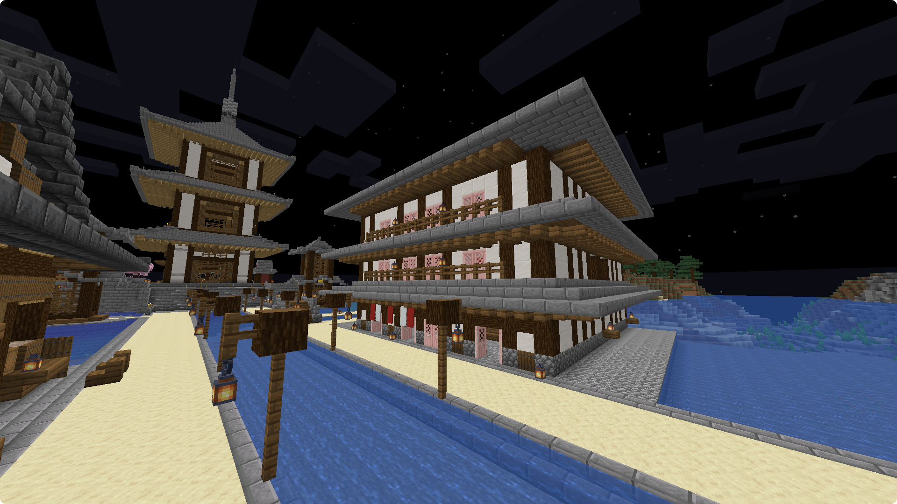
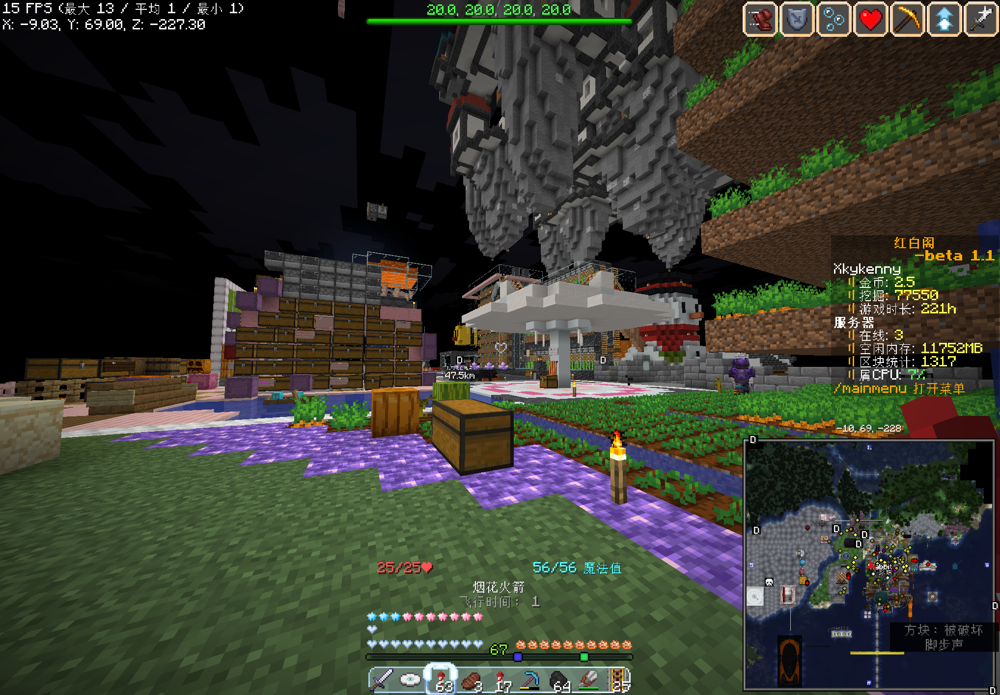

# 施工

> 人面不知何处去，桃花依旧笑春风。  
> ———— 崔护《题都城南庄》  

寒假。  
这一段的样貌和上一段完全相反；日活少了（日均 9.6），但工程进行得最多。`xiaomaomilu` 和 `WASP` 把出生点的一座小岛整个推平，重建成教堂、舞台、仓库、熔炉墙；`QAQ121QAQ` 带着四个同学建繁樱屿的前身；`Anshonley` 挂机七天升到 1012 级。  
这是一个“施工期”，所有人都在盖东西，但是没人问为什么要盖东西。  

## 纪事

一月一日，`xiaomaomilu` 和 `WASP` 在出生岛打凋零、凑信标。`Neko_Annieawa` 与 `neko___LY`、`xiaobaizi123` 在折腾“传说酒”配方。`Castorice` 第一次出现，说“哇哦，地下酒庄”。`Aurora` 被麋鹿带着学圈地、卖货、抽酒谱，自称“当黑奴来的”。  
一月二日，出生岛被整体推平，准备建教堂与舞台。`WASP` 说了一句很像他的话：“『毁灭比创造轻松多了』”。  
一月三日，云层之上。`WASP` 宣布要搬到“云层之上”“不受天气影响”建新基地。这个基地在六周目结束时仍然只有一个圆形地基。他自己承认：“我完全不会机器”“造完了地基就不知道干啥了”“维持这个状态半个月了吧”。  
一月四日，麋鹿建的角斗场第一次出现了真人对打：麋鹿对菠萝，木剑加弓、不穿甲。`xiaomaomilu` 最后给出的锐评是：“菠萝到现在才明白刚才是两个菜鸡互啄”。  

`Hydro_Slime` 在同一天说了一句话：“菠萝因为在游戏里面emo所以下线，我因为在现实里emo所以上线（）”。  

> 不知道为什么我很能理解滚滚，可能是因为我之前现实生活也不怎么如意？  
> 不论如何，这大概也是这个服务器里最深的罅隙，也就是管理员管理服务器和玩家玩服务器的出发点是完全不一样的。  
> 这是一件很悲哀的事情。  
> ———— Ph0sphorW

一月六日，`samuioto` 说出了一个令人大跌眼镜的卡顿真相：“服务器前一阵子卡是因为我把路由器和机器放一起了”“俩互相加热导致都卡”。  
一月九日，ybk 回来了。  

> 据ybk本人的回忆，他说他要成为你服最大的浆果种植户，他后来也确实做到了。  
> ———— ybk10124  

> ybk 所建立的红莓省的截图。  

一月十三日，`Anshonley` 挂机七天升到 1012 级：“1012级，爽”“挂了7天，上到1000级太费劲”“没有地毯做不到”。  
一月十六日，`agonicx330ml` 入服，是 `QAQ121QAQ` 的高中同学；QAQ 将其称为老贾。他一开口就揭穿了“Q姐”其实是男生：“他带了4个高中同学了”“你还是把他当成Q姐把”。  

> 早先我就很喜欢把 QT 叫成 QAQ 姐姐，虽然这是一句玩笑话，但没想到这个传统还真下来了。  
> ———— Ph0sphorW  

  
> 来自 kenny 的客户端。  

一月十七日，“全收集盔甲室”开工：一层 210 个盔甲架、海晶灯一层，要做 19 种模板乘 11 种晶体的全部组合。`xiaomaomilu` 报出的数字是“210个盔甲架”，被问“一还是亿”，她夸张地答“亿”。  
这个工程的总钻石需求后来被算成 129360 颗、224 组钻石块。它最终只建了两层，因为它一传送就把人“加载卡爆”踢出去。  
一月十九日，月饼的收购价从 388 调整到 128 再调整到 88。`Neko_Annieawa` 这么做的理由是：“经济体系不能崩”。  
一月二十一日，被称为小 bu 的`NewBie_Bu` 第一次出现，自称新人。
一月二十八日到三十日，三天的日志分别只有 54 行、86 行、1 行。三十日全服只有 `Brozayy` 一句因为手滑而少打斜杠的“kit dialy”。  

## 没钱了

2026 年 1 月 30 日晚上十点二十九分，samuioto 的公告里出现了这么一句：  

> “我确实没钱买新服务器了大家谅解一下...”

同一分钟，木白转发了同一条公告，在后面加了一句：

> “群里的各位老板…”

地址从域名退回了裸 IP：`123.57.217.214`。  
那天晚上群里的反应很少。kenny 说“在吗？抽个服务器存档”“好啦，没钱了”，ybk 说“月底没钱了（”，悠闲的狸花猫问“最近能玩服务器吗？寒假想多玩会儿”“现在连不上登录服务器”。  

然而 hmcl 给出的赞助码是自己的而不是 sam 的。  
尽管笔者不反对收赞助，但是一个只剩下名义的服主，与一个基本完成了绝大部分事的管理员相比，明眼人都看得出来肯定是后者更加重要。然而 hmcl 一个什么都不干的名义服主，收赞助居然先于 sam，换做笔者是 sam 可能当场就要暴起了：**你一个天天吃白饭的什么也不干就给我钱拿了几个意思？！**  

> 其实收赞助本身无可厚非，，我觉得比较搞的是，其实该收也该给物理服主吧。  
> 给他似乎并不会对服务器起到什么作用。  
> ———— airlenter

## 记事 2

一月三十一日，`Brozayy` 说：“五年了”“那时候红白还在”。他和 `LRY314`、`airlenter`、`Anshonley` 等几个人一样是这台服务器上仅存的三个能说“红白还在的时候”的人。  
二月三日，`agonicx330ml` 开始建樱花小屋。这是繁樱屿的第一块砖。  
二月九日，`Treecidental` 入服，问“还想找份工作（）”。`Hydro_Slime` 回：“我们服务器原来还有工作吗（）”。  
二月十日，`samuioto` 第一次公开讲服务器节点：“大家如果用北京那个卡的话来试试绍兴，一台服务器最多只能承载10个人左右”“北京这段时间还有qos，网速最慢的时候只有10mbps”。  

二月十二日，LRY314 第二次开始讲过去的事情。“红白阁是2020开服的”“那时候腐竹是红白”“我可以告诉你2021-2023（是）红白阁的黄金时代”。  
此后 LRY 便再也没有上线。新时代，没有容得下被折断翼的遗民的地方。  

> 此处疑似为 LRY 笔误，红白阁黄金时期应该在第一迭代相关的部分已经说过是 2021 - 2022 上半年左右。  
> 对不起。  
> ———— Ph0sphorW  

同一天木白在排查故障：“我怀疑velocity是不是太久没重启了炸了）”。他发现 tab 在线人数卡死、创造服 lp 报错、mcsm 也卡住了。  

> 我真的得问一下你们到底有没有去看过 [aikar 的 JVM 标签](https://docs.papermc.io/paper/aikars-flags/)？？？内存溢出这么简单的问题都没法解决？  
> 再不行你写个小程序检测 RAM 等到一定程度就自动 system.gc() 一下也可以的吧？真的无言了...  
> ———— Ph0sphorW  

二月十三日，`qiii` 回归，第一句就问“iun犯啥事了”。`Neko_Annieawa` 答“开挂）”。  
这是 `iun114` 最后一次被公开讨论。此后再没有人提起他，除了 `WASP` 在 2026 年 1 月 16 日那句“iun没死的时候”。
二月十四日，`Hydro_Slime` 宣布建猫咖，`Treecidental` 全程帮忙引动物、递材料。滚滚一句“我们在一起过情人节（）”大概是那天唯一一句提到情人节的内容。  
二月十五日，`Hydro_Slime` 完成了猫咖内饰。床拼沙发、铁头盔当枕头、陶罐当猫碗。`Treecidental` 称之为“属于猫的粉白宫殿”。

日子依旧平凡而忙碌地过。  
