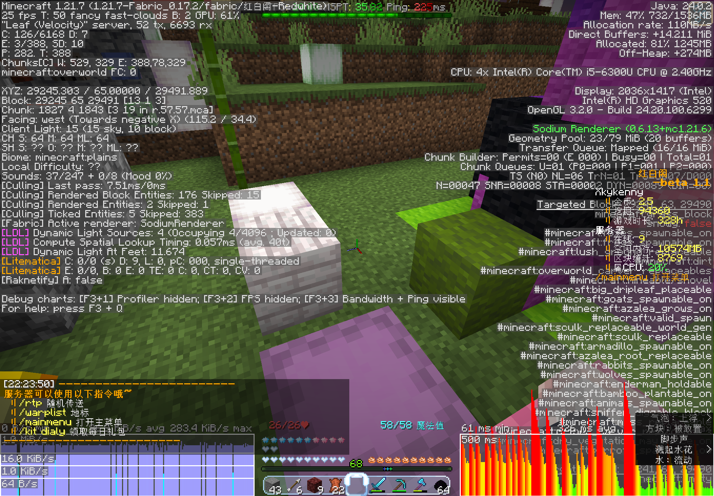

# 春节

> “故乡今夜思千里，霜鬓明朝又一年。”  
> ———— 高适《除夜作》  

十五天，日均 16.5 人次；这是五周目的日活最高点。
这一切全部围绕一个活动子服 `newyear` 展开。木白（仍旧，实际上是 air 和乐凝完成了很多工作）熬了两个大夜，在里面搭了一个新年会场：灯谜、年兽、抢红包、台球、留言岛、天空岛、决斗场、观光车。随其二月十六日十八点四十五分上线，开服就遇到了一连串 bug。  
但这一段真正的意义不在活动或者是其出现的 bug，因为**人回来了**。`LRY314`、`HAU_CN`、`bailan`、`Brozayy`、`qiii`、`yoinon`、`aichilizhi`、`HuaYu` 在这半个月里成批出现。二月十七日，二十七个账号上线，是五周目的最高峰值。  
十五天之后，这些人和他们的存档一起消失了。  

## “做不完了”

二月十六日凌晨零点零七分，除夕刚过七分钟，木白在群里说：  

> “新年活动要做不完了TAT”  

活动当天傍晚六点二十开始。他在凌晨还在和几位管理赶工。  
这场叫“马踏新春忆旧岁”的活动，公告写得很正式：灯影扑朔、限定会场、活动币兑换。原定 2 月 16 日到 18 日，两天后延长到 3 月 3 日。  
这是五周目日活最高点：2 月 17 日，27 人，比开服那周的 29 人只少两个。  
也是三周后一切归零的前夜。  
那几天群里的语气是很轻松的。QAQ 问“晚上合影活动在几点呀”，“群正太”在群里写新年祝福“全天下的宝宝们都要幸福ya”，neko 回了一个“e”。  
只是没有人知道二十一天后会发生什么。

## 除夕

18:45 分，`newyear` 子服上线。十八点四十五分到十九点二十六分之间，十四个人陆续切进去：`Jade_Emerge`、`xiaomaomilu`、`NewBie_Bu`、`QAQ121QAQ`、`anioto`、`Brozayy`、`Icy_Cola0406`、`test`、`ybk10124`、`neko___LY`、`airlenter`、`little`、`Anshonley`、`Castorice`。  
十九点二十六分三十三秒，一次重启把所有人踢了出去。十九点二十六分五十四秒，所有人又重新进入。  
木白在公屏上说：  

> “新年会场好了”“但是没完全好”  
> “tm配置文件里的id怎么全是null”  
> “熬了两天大夜熬出来的结果可要好好品检啊！（”  

许多此前未测试出来的漏洞也随之被检查出来：装备发放失败，出生点保护挡住按钮，坐不下，鞘翅秒坏。当晚在线十三到十四人，合影因为 bug 和人员原因改到明天。

## 各种活动

会场的“红灯笼”其实是蜘蛛网。空手右键取得灯谜，答对有活动币，答错直接消失。  
灯笼是由木白和 `samuioto` 手工藏在某处的。`samuioto` 说：“我藏的最阴间的几个还没人找到呢”“有些点位我压根没放灯笼”“还有一个必死的点 这个不开透不可能找到”“找到了就可以直接踢掉了。  
`neko___LY` 的评价是：“樱花树”“跟他妈视力检测一样”。

年兽场地则在樱花树旁。进入后持续发放年兽鞭炮，用鞭炮打年兽，按伤害与距离结算红包。木白在玩家游玩时反复调整平衡：“一只年兽现在是8个硬币”“离树最好站的近点 不然有可能拿不到奖励”。  
玩家迅速找到逃课方法。`littleboluo` 发“年兽逃课攻略”，`Broazyy` 接“（逃课指自己被炸死”，`WASP` 问“炸死才有奖励吗”“有奖励嗷嗷嗷嗷嗷啊”，`anioto` 说“一组鞭炮都能单刷年兽了”。  

除此之外还有抢红包。`anioto` 负责电路，曾在三月六日承认“抢红包的电路被我冲掉了”，随后修复。奖励失衡到木白自己都说：“好了现在是抢红包碾压式的比年兽多了”。`anioto` 于是“得制裁一下了”。  

二周目的天空岛被保留下来放在会场里。`Brozayy` 看见之后说：“这是一（实则应为二）周目的天空岛吗”“好眼熟”。木白答：“是的”。  
然而天空岛出自于“理念不同”的 white_phosphor 之手。  
这是五周目唯一一次把先前周目的东西原样搬进新周目给新人看。`Icy_Cola0406` 的评价是“腐竹有心了”；但实际上，hmcl 所主导推进的档案馆项目却迟迟未得到推进。  

## 高峰

二月十七日，五周目迎来了它的在线最高峰；二十七个账号，1303 行聊天记录。晚上二十一点四十前后在会场拍春节合影，约十五人。  
`HAU_CN` 出现。他是 2025 年 6 月开服第一周的老人。`bailan` 也来了，自称“限时回归”。  
木白在公屏上说：“（这个灯笼的插件昨晚写的时候差点写死（”。

二月十八日到二十八日，春节过后，重心转到 `QAQ121QAQ` 的聚落。  

  
> 来自 kenny 客户端的截图。  

二月二十七日，“移山工程”启动：把岛挖平，和冰原连成工业区。“把这片岛挖了”“和冰原连起来”。  
二月二十八日，`littleboluo` 的“终结末地计划”把末地主岛炸平，只剩下黑曜石柱。`zhenenji` 上线后懵了：“末地发生什么事了”“怎么只剩下黑曜石柱了”。`QAQ121QAQ` 与 `Anshonley` 连夜重建“小黑塔2”，苏哥改成双通道大圆盘：“我给你们搞个双口吧”。  
同一天，`zhenenji` 宣布：“我想好了，咱们就叫建设兵团农垦师”。  

只是这一切的美好并没有维持多久。  
