# 支线 - 别拿着你那个大逼 OP 武器在那乱晃了

似乎对于你服的每一个管理员而言拿到管理权限之后的第一件事就是创造一个看起来无敌爆炸雷霆夜光闪耀 24K 金至尊神锻阿姆斯特朗回旋加速喷气式阿姆斯特朗炮一样的 OP 武器，无论如何它一定带有一系列极其极其极其（Co-autored-by: gemini-4-argon）极其逆天（DAY^-1）的属性比如什么效率 32767 比如什么多重射击 255 再比如什么有了物品组件之后的神秘内容比如重力反转领域展开超级搭路什么令人感慨像素方块的硬核才是王道的武器道具或者无论什么东西，反正这个物品你唯一能够知道的就是继承自 ItemStack 并且带有各种逆天神秘属性或者带有一个令人蒙古但是看起来非常高大上的世界观（World view）或者是小（small penny）故事（[STORIA](https://music.163.com/#/song?id=36024932)）什么的。  
不过其实这也非常正常，对于管理员们而言似乎不创作不留下一些用自己的颜色沾染的东西来玷污弄脏整个世界是无法证明这个世界上是存在过你自己这个人的，又或者单纯只是想为自己的创作如同找一个健慰器（flight cup）一样找一个发泄的出口。总之出于各种理由包括中二病发作包括写作欲满溢包括吃饱了撑的没事干管理员们就会创作一些这种奇奇怪怪的东西，在那个还没有聊天生成式预训练变形金刚大型语言模型的时代充满了一种孩子气又令人悼观的童真童趣。  

> 说到这个我觉得可以弄一个档案馆逆天物品列表。  
> ———— Ph0sphorW  
>
> 那我可以占一半了。  
> ———— neko_annieawa  

哦哦乐凝女士的创造力结合物品组件的能力很强确实不假，但是很不巧你需要面对的是 airlenter，werwolfwolfy，ouyangyuanyi，redwhite，white_phosphor，pykedove 以及小故事大王 sky_star_dust（其中此人创建了包括花茶系列珊瑚酒系列以及大量带有神秘故事总之基本上都是和可爱二次元纸片人妹子谈恋爱嗯嗯啊啊然后二人幸终的故事），也只能惜败了。  
还有你拿着基伤 20 破甲 20 的末地烛到处操。！操。！操。！捅人的样子我也会写下来的，你再怎么打我操。！我我也不会停下来删除本文章不发布的。  

## 原理

不知道在座的各位女士有没有听说过一个东西叫作 [CCB 创造者](https://www.mcmod.cn/tools/cbcreator/)，如果你不知道的话那么它是一个支持你快速前往操操场所。！的工具，助力你能够通过指挥阻塞在一条命令之间创造各种类似于基伤 20 破甲 20 还带了一大堆这么操。！的小故事的末地烛物品的命令比如：  

```text

/give @p minecraft:end_rod{AttributeModifiers:[{Operation:0,Amount:2147483647,UUIDLeast:-1565495375386691464L,UUIDMost:2973914292295298851L,Slot:mainhand,AttributeName:"generic.attackDamage",Name:"generic.attackDamage"}],display:{Name:"[{\"text\":\"乐凝的滚木拉杆\",\"color\":\"blue\",\"bold\":true,\"italic\":false,\"underlined\":false,\"strikethrough\":false,\"obfuscated\":false}]",Lore:["{\"text\":\"我有破甲 20 你怕不怕。\",\"color\":\"gray\",\"bold\":false,\"italic\":true,\"underlined\":false,\"strikethrough\":false,\"obfuscated\":false}"]},Enchantments:[{id:"minecraft:mending",lvl:114s}]} 1  

```

上述命令基于一点十四版本我的手艺命令生成器进行制作。  
不难看出来实际上这个 CBC 制作器就是一部分预制件完形填空通过拼凑这些高度重复的代码然后将这些全部叠在一起创造一条雷霆无敌长的命令然后交付给管理员一次性消费之后创造出非常具有管理员特色风味的命令；然而如果这么理解的话那你大概是低估了古人的智慧，在那个没有任何物品组件的上古时代这群开动鬼脑的管理员已经在通过使用命令方块链和计分板相配合创造更加爆炸无敌爆炸酷炫桂林山水甲天下的甚至超越这一部分的内容了。在之后切换到二周目末期与三周目时有了插件的支持甚至可以通过编辑插件的 .郁闷了 文件的 DSL 然后借助不属于你的力量创造更加花里胡哨的装备武器道具什么的。  
鉴于现在是一个溜溜梅泛滥的时代我想通过这种生成器的方式进行生成会非常低效且地狱甚至不如你深度求索闪光四点一在一秒钟内生成一万个大语言模型令牌所花费的时间短。众所周知的，上述指令中的大部分 NBT 标签已经被 ojng 自己迭代操。！飞变成物品组件格式了，即使没有的话，如果你是一点十六点五矿艺版本那么你也会惊喜地发现上面的一大部分内容打进去是不可用的因为 ojng 把自己的内容全部随心所欲重命名成了别的，而如果你没有一个好的文本编辑器（题外话，其实那个时候就有微软大战代码了）那么对着聊天框里面那个残废不全的 LSP 一点一点改看着它变红又变黄结果到后面改的都不知道哪里错了将是一种堪比强健讲解石的痛苦体验。  
当然有了乐凝女士倾情使用千千大小姐在前特工时代所开发的 ItemsAddoner 之后一切都不一样了，这使得乐凝女士可以通过极其肥美的自有 DSL 通过更为格式化的形式对物品进行编辑和创造。  
虽然 ItemsAddoner（注意到不是 ItemsAdder）是一个只用了一两次就没怎么用的插件，但是乐凝女士明显对于这个插件的用法完全不限于只是用它的自定义合成表功能。当然笔者相信乐凝女士喜欢自己搓，这是后话。  

## 防御 + 444444444445000000000000000000000000000

最早的神器当然是出自一周目，当然笔者相信零周目肯定会有原神圣遗物，但是我没有任何证据。  
一周目是一个非常黄金的时代同样是牛鬼蛇神横行的时代，因为红白开放了一项制度就是只要拉入你的好伙伴形成一个小型的礼治社会说难听点就是把你的小团体拉进来你就能拿到一把神秘武器，而这些神秘物品有可能留在他们主人的手里也有可能流落到别的地方甚至可能通过某种手段被复制了，笔者曾经就通过 coreprotect 将 air 和 cbw 的各种神器全部复制了一遍但很可惜的是这些内容全部变成了滚木。  
此处笔者根据 esrafv 的客户端截图进行讲解，梦到哪里讲哪里算了，感谢他。  

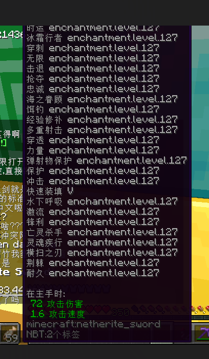  
> 拍摄于 esrafv 的客户端，2021 年 8 月 30 日。  

很明显甚至笔者都不需要进行任何描述花了一普朗克时间就猜到了这一定是欧阳茶理理执行官代理服务器所有者的手笔。  
32k 作为最为经典最为古老的神器想必我不需要任何解释，这个是弱化版也差球不多就跳过吧，但是欧阳把附魔都打上去了我暂且蒙在鼓里。可能欧阳非常喜欢把所有附魔全部打上去等到玩家观察击杀者那一把雷霆武器的时候就可以被满屏的附魔吓爆一颗高玩。  

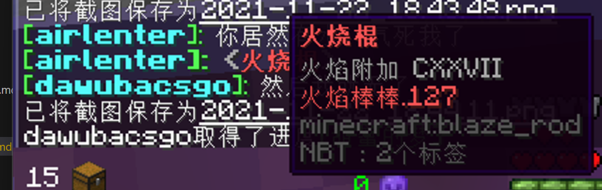  
> 黑猫的烧火棍。  

这个时候肯定有蒙古的读者就要问了说欸白磷白磷我记得附魔上限是 32767 啊怎么变成 127 了，你去问 ojng 吧，这个值后面变成一个 byte 大小了，好死不死他们没有用 unsigned 导致我们本来可以可以使用肥美的 255 级最高上限附魔被直接腰斩了一半。  
那么说回来这个烧火棍实际上是黑猫的，为什么到 air 这里了呢，据 air 本人说是黑猫邀请他到一个会员制餐厅进行进餐并且比不吃完所有食物就有惩罚，于是被黑猫用这根烧火棍拍打了肥美多汁的脸颊之后作为礼物带回来了（以上内容使用 phosphor-v1-flash-325b-instruct-distill-sonnet-5.6 生成，那些鉴 AI 的有福了）。  

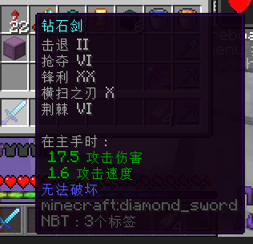  
> esrafv 的锋利 20 钻石剑。  
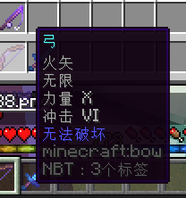  
> 力量 10 弓。  

很明显由于以上提到的制度是在太普遍了导致一周目这种神器的数量多到了和路边（roadside）一条（one of）一样多的情况。  

  
> 东风  

上面提到过欧阳创造了一系列堪比令诺贝尔本人从棺材里爬起来再开一个诺贝尔战争奖程度的神秘武器，其中这个导弹就是其中一个。  
这个核导弹的威力有多大呢，笔者有幸（或者是很不幸）吃过一发，当场死亡身上装甲全部被操。！飞的同时笔者的客户端帧率从 300+ 掉到了 5 帧以下。欧阳本人叙述此导弹飞行时间高达 1024 秒。笔者姑且愿意将这种导弹列入最为危险的内容之一因为这一内容甚至能够从物理层面摧毁被攻击者的硬件设施并逼迫他们更换新的显示计算单元和核心计算单元并置办新的游玩设施在若干年后的今天会想起那个悠远的下午忍不住给欧阳磕一个头感谢欧阳帮助其更新了硬件从而达到超级加辈实现精神层面的彻底控制与洗脑。  

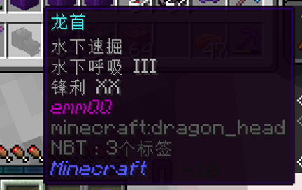  
> 附魔了二十级的龙头。  
> esr 说这个是 hour 专武。  

我猜依旧是欧阳做的。这个意义实在有些不明了，可能把这个大黑调一样的东西套到头上的时候会出现紫色的夜光幻龙一样的光效可能很酷炫吧。  

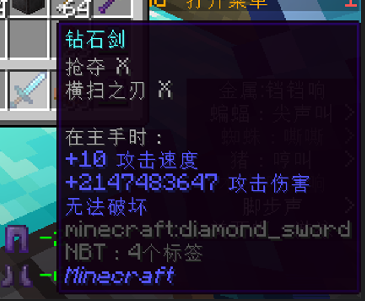  
> ？  

最请输入文字的一个来了，那还说啥了给你操。！算了。  

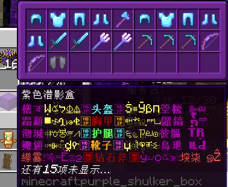  
> esr 的紫色心情储物盒。  

鉴于 esr 和各个管理关系都很不错管理给他一刀 999 的神装倒也无可厚非，久而久之 esr 应该就成为了除了 24k 和 air（什么？你能自己造。？那没事了。！）还有 wer 之外持有神器最多的玩家，可能是之一毕竟笔者没法给自己通过时光倒流因为很可惜的是笔者不玩崩坏无法成为终焉之律者回去看一眼到底有！？弓虽？！。  

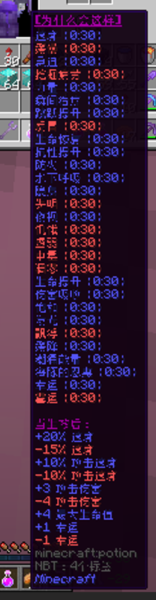  
> 为什么会变成这样呢？  
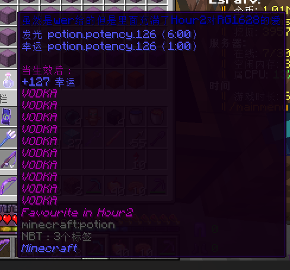  
> 伏特加。  

注意到。  

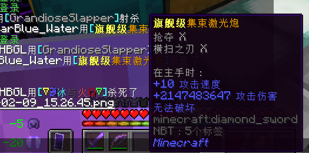  
> 神必一张图上居然出现了三个神器。  

不难注意到[旗舰级集束激光炮](https://eve.huijiwiki.com/wiki/%E5%8F%8C%E8%81%94%E5%8D%83%E5%85%86%E7%BA%A7%E9%9B%86%E6%9D%9F%E6%BF%80%E5%85%89%E5%99%A8_II)是 EVE 中的强力武器，而很明显这里居然变成了对单笔者觉得还是太不符合红白的统合部级别的战力了，不如直接弄一个[统合部双联千兆级集束激光器](https://eve.huijiwiki.com/wiki/%E7%BB%9F%E5%90%88%E9%83%A8%E5%8F%8C%E8%81%94%E5%8D%83%E5%85%86%E7%BA%A7%E9%9B%86%E6%9D%9F%E6%BF%80%E5%85%89%E5%99%A8)来的快，这样被打到了还能触发 CONCORD 的神秘无限摇人帧伤反击。  

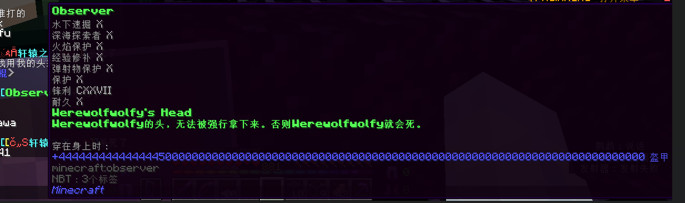  
> ？  

老一辈数值就是没轻没重的，这个数值居然有 81 位置，给笔者刚刚在换蛋期长出来的四颗高玩全部吓爆炸了。  
以及注意到，这张图中实际上还有一个神器，这里就不做解释了。  

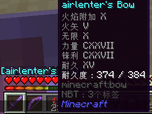
> 句号。  

令人道观。在上述这种数值没轻没重的情况下这种都已经算非常温柔的了。  

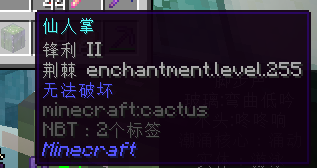  
> 请输入文字。  

在上面那些接近九一暗网的内容冲击下笔者居然认为这已经是最为不极端的内容了，尽管这种东西放到普通玩家群体中不亚于看到了金正恩走过来一样光芒万丈主题思想放光芒一样受到了极大的精神冲击随即立即效忠于红白人民民主主义服务器，虽然这个服务器神权政治的内容居多。  

在这之后令人作哀的是 esr 客户端内的内容就到此为止了，这无疑是老牧师的。  
因此笔者可以稍作补充。笔者所记得的内容就还有 CBW 的两把锋利 12 的镐子和 air 的黑子白子，其中这两把都是武器。  

不难看出一周目对于自定义神权武器的玩法是很有限的基本仅限于对于武器的自定义，但是这也很符合服务器此时的状态，毕竟下面一堆人在用雷霆炫酷武器互相砍杀的时候你拿着一个能给你超级搭路的方块走过去可能有点震撼人心了。  

## 潮涌·天梭

很明显在二周目的时候笔者因为中二过于入脑（你以为现在就不了吗？）导致笔者创建了基于刺客信条与战争之歌世界观的各种武器，包括但不限于潮涌·天梭，波塞冬三叉戟与鱼肠剑等等令人看一眼就想要男的敢靠近一棒子打死的东西。  
（如果你不知道战争之歌是正常的，但是不要说这种让我觉得自己很老的话…）  
在早期笔者还没有塑造各种世界观的意识只知道我操这个 32k 真的好爽啊然后各种属性叠加耍起嘛，只要被早期一把神秘钻石剑砍到的玩家很容易被满屏的 + Integer.MAX_VALUE 给吓到。在笔者发现好像还有个隐藏标签的 tag 之后发现好空啊不如写一点小故事吧，于是各种神秘小故事应运而生。  

此外 ssd 女士也做过不少相应的中二物品包括各种书武器装备什么的，但是就如上文提到的一样，大部分的小故事都是和二次元可爱小萝莉纸片人谈恋爱的内容，比如喜欢星星的可爱小萝莉，喜欢大海的可爱小萝莉，喜欢石头的可爱小萝莉，单纯的可爱小萝莉，腹黑的可爱小萝莉，傲娇的可爱小萝莉（你该退环境了），充分证明 ssd 女士就是一个超级大变态萝莉控。  
这些可爱的小萝莉逐渐沿用到了 ssd 之后的小作品中，像喜欢大海的可爱小萝莉就变成了珊瑚酒系列：  

> 盐海™气\~泡\~酒\~☆隆重上市！  
> 精选优质福岛沿海海盐，使用114514次NMDB-10086蒸馏工艺后的101.0000%光谱纯蒸馏水冲泡，通入日本五星天皇孙笑川呼出的二氧化碳，  
> 造就这一杯噗啾噗啾冒泡的海洋风味饮料！OTTO曾说过：“你铸币的不喝这个气泡酒，你整个人的品味就是白银一样上不去下不来的，就牛魔卡在这了，缺的营养也补不上。”  
> 现在访问 [https://saltysea.com/info] 来获取更多关于该产品的信息！  
> 啊\~♡大哥哥才喝了这一瓶就醉了\~♡还没我一个小女生能喝啊\~♡真是个杂鱼呢\~♡  
> 喝不了酒就不要想和我涩涩啦\~♡杂鱼\~♡杂鱼\~♡  
> 只是夜幕轻拢，她又会看向窗外，看向浩瀚的苍穹  
> 她觉得，那里才是一切的归宿  

顺带一提笔者很喜欢这里的雌小鬼于是就稍微精修了一下这里的文本，不要电我。  
此外还有各种花茶：  

> 将铃兰与白桦树叶混合，便可得到一杯弥散芬芳的铃兰花茶，  
> 小口啜饮，便能品味其中韵味。  

哦不这对于笔者这样一群喜欢少女和小萝莉的人来说只有这些内容太可惜了，为什么不放送一点裸足穿着白色宽大衣物的小萝莉漫步在迎接着清晨第一缕曦光的铃兰森林中呢，只要一俯下身宽松的衣物就能将其中的等等别电我啊啊啊啊啊啊啊啊啊啊啊啊啊啊啊啊啊啊啊啊  
回归正题，在我的电量在一普朗克时间内并入了国家电网的 300KV 特高压直流输电电路之后 ssd 女士应该还创作了一些风味小文本，而这些内容很不幸地集中在三周目，包括那个“干什么。！”桶。  
尽管笔者只需要一普朗克时间就能再造但是笔者觉得没有我们的第一品味萝莉控大人做的韵味。  

哦顺带一提，实际上 enchantments 那个列表不是一个 set，允许你叠一万条 sharpness 从而达到类似于 32k 的效果。笔者仅在叠了 20 多条之后就发现伤害达到了 30 多万，可能比那个还要多吧。  

## 审判

三周目所留下来的东西实在是如滚木一样少导致笔者实在没什么可以展开的空间，况且笔者所有的创意已经变成游戏内实际的武器装备什么的了比如看起来像一个信标实际上 getClass() 会发现它是一个 mythicItems 的叫作极光的连弩，什么新月血月，什么暴雪，杂七杂八一大堆太多记不清忘掉了。  
鸽子倒是非常郑重地弄过一个伤害 1145141919810 的破甲剑号称能够一几把操。！烂所有类型的护甲包括保护一万的神秘护甲，但是事实是这一刀下去给整个服务器干崩溃了因此不得不将伤害降低到 114514，甚至还没上文的锋利剑高，拉完了。  
笔者和鸽子曾经也弄过一把超级无敌霹雳爆炸喷气的 OP 剑叫作审判，效果实际上也是给一个很高的伤害就没什么作用了，后面因为技术原因做不到一刀给人砍成棍母的程度。但是笔者帮助鸽子做了这个剑的动画，看起来就和脚下有八个隐形旋转格调在不断向外喷射金色树叶一样形成一片非常酷炫的白色粒子效果。  
此外这一周目并没有创造太多活。笔者很遗憾的是笔者没有创造一个能够展开操操。！领域的东西。  

## 司南

令人悼观的是乐凝女士的 ItemsAddoner 遭到了笔者的全面重构，让我们为此哀悼一普朗克时间。  
乐凝女士在懂得怎么创造一门人类可读的 DSL 之外还会绘画一些可爱的材质比如从未投入使用的翠璃的材质，尽管笔者有时候被乐凝式命名蒙古，可能是因为乐凝的命名有一些遵循 Annieglish（en_an）吧。  
笔者在为回收数据而夺舍乐凝小姐的号的时候就发现我操。！为什么我变小了一圈，于是经过一番仔细的调查发现是乐凝的头上戴了一个神秘的能够将你的体型减少到 x1.67 的大小的自己的头，~~可能因为乐凝小姐现实里就这么高吧我瞎猜的。~~对此事乐凝大人发出的评价是：

> 不要b脸  
> ———— neko_annieawa  

此外乐凝女士的命令方块技术也非常不错因为：  

> 笑死了，新年小游戏我用的还是纯命令方块写的一个数据包没用  
> ———— neko_annieawa  

让我们为此设敬一分钟。  
乐女士创建的东西包括但不限于“拿起来会飞的下界之星，能够悬浮在空中的钟，能够消除摔落伤害的指南针”等等：

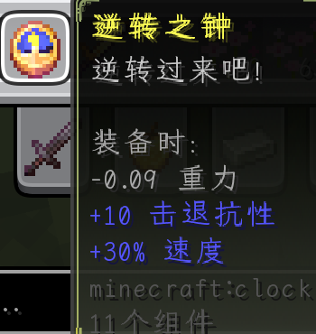  
> 将大橘逆转吧。！  

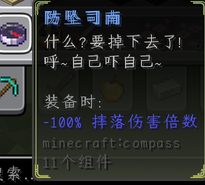  
> 自己吓自己喵  

在有了物品组件的加持下乐凝女士如同拿到了斐济被的白磷一般宛如打开了创意的闸门，创作了一大堆带有特殊 NBT 的物品，充分证明了像素方块的硬核才是王道。  
除此之外乐凝对于自己没有格调有意外的执念于是创造了一根基础伤害 20 还有破甲 20 的超级末地烛。！我操。！  

> 还有捅人很疼的末地烛  
> 被捅一下就呕齁齁齁齁然后昏过去  
> ———— WASP  

不幸的是，WASP 在本次事件中被乐凝的大型末地烛拍到了脸颊昏了过去，让我们为他作哀一秒。  
似乎乐凝女士还挺在意我夺舍她的身体的，笔者就决定不写了吧还是免得被乐凝女士寄刀片。  
笔者觉得虽然不至于占到一半但是新时代对于老旧门的几个 OP 物品还是很有创意的，毕竟你游也存在各种数值膨胀。  

## シーティー  

不得不提到的是空气女士在站中间串两边的同时还创造了一个彩蛋酒叫作 seatea（シーティー）。
令人蒙古的是，这个西提尽管诞生于 NSV Alpha 但是基料居然还是珊瑚酒和一个冰水，没有 NSV 风味的特性比如张雪峰老师我还记得你和喝一口就自动给三十万璆的总之看起来就很不正常但是很操。！的酷炫，笔者认为这太原版了于是西提就真的成为路边一条了，这个西提酒还等待着笔者某一天去补强等着想一个很酷炫的效果让笔者去实装，也有可能是空气先写一个神秘的效果导致堆栈溢出于是整个服务器主世界滴答被卡住 30s 之后被看门狗一脚踹死。  

笔者认为如果把上述物品全部展出的话可能会导致新一轮圣杯战争开打，并且卡爆玩家的客户端。  
但是笔者觉得这很操操。！啊不是吗，这样服务器里所有玩家就有一个操操场所了。！
