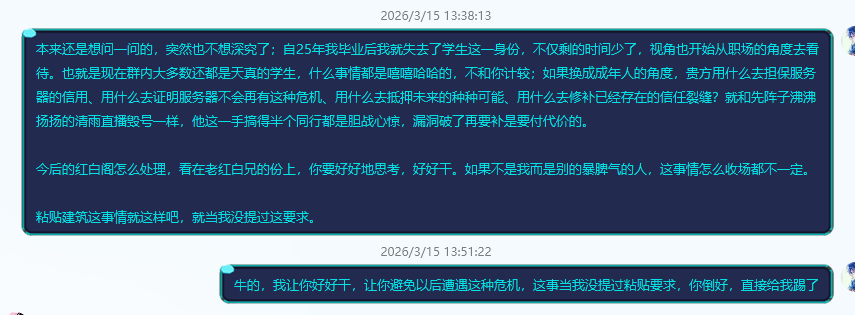
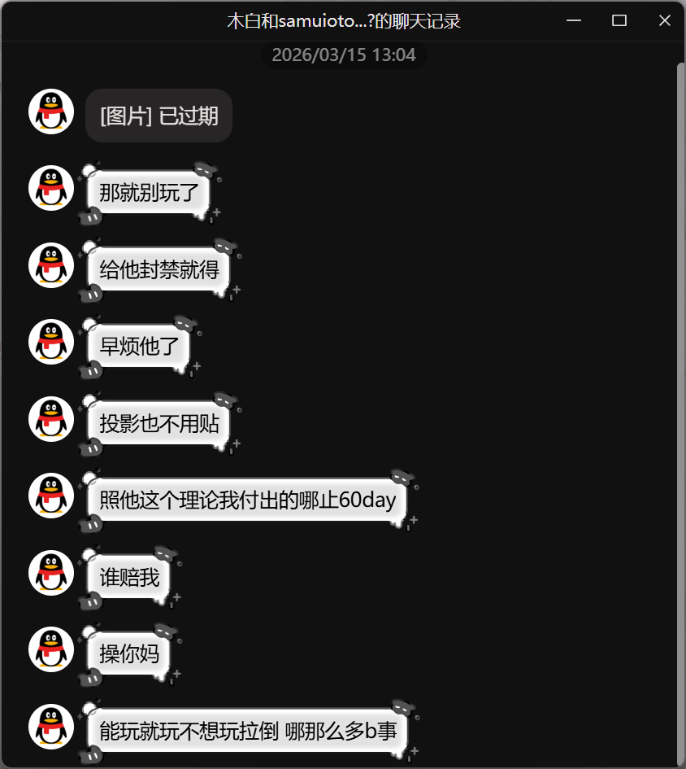
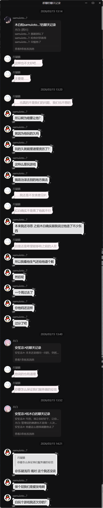
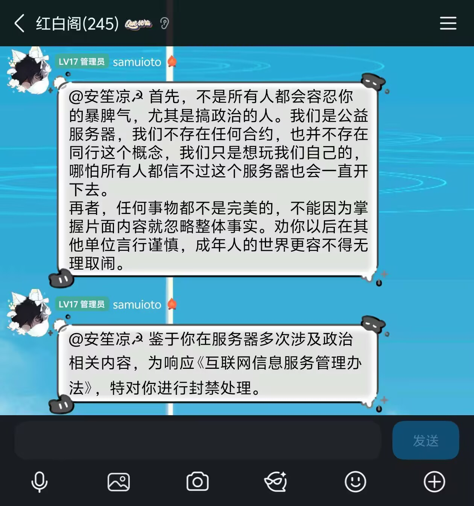
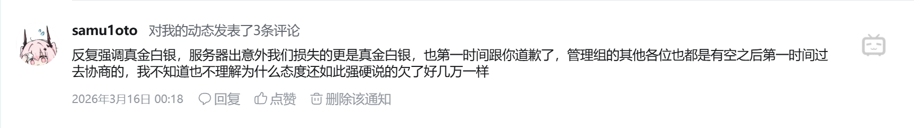
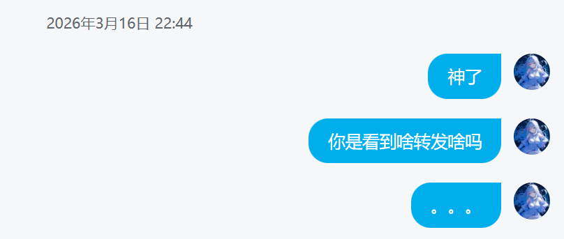
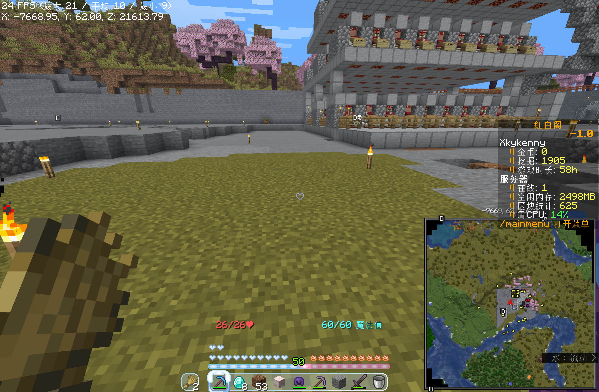
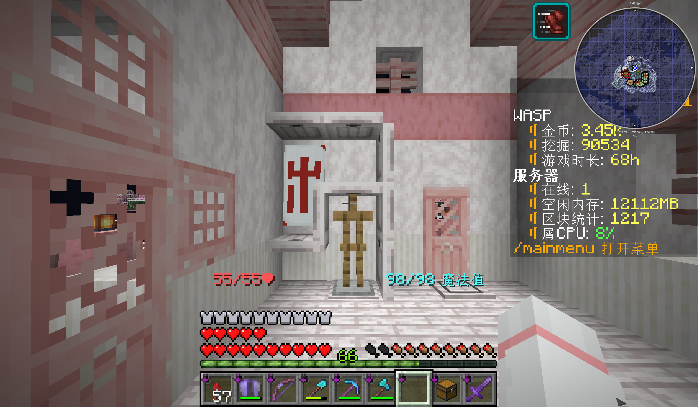
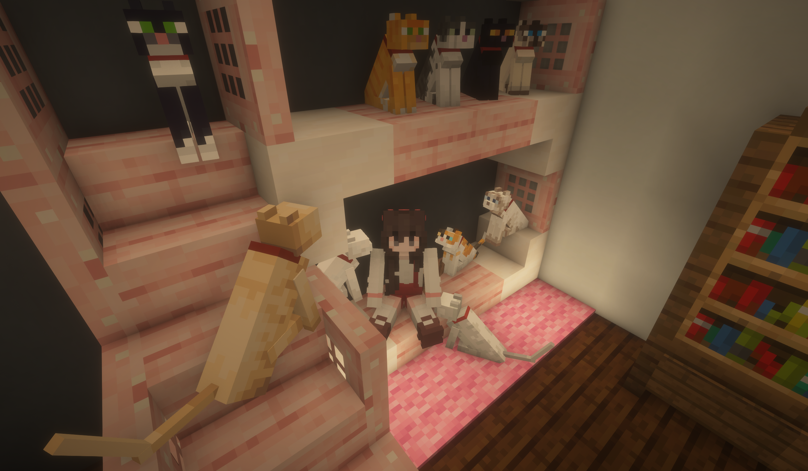

# 招魂

> 魂兮归来！去君之恒干！  
> ————《楚辞》，《招魂》

六周目诞生于一场意外。  
在文件被清空之后，管理组并没有拿出三个月前的存档进行修复与赔偿，而仅仅只是简单地更换了存档。自然玩家间产生了不小的反对声，但是这无济于事。  
但这不影响六周目的前期总是热闹非凡的——所有的前期都是热闹非凡的，一二三四五周目皆如此——尽管它的诞生是踩在被 trim 指令归零的数据虚空的京观，五周目的终结上。  

## 5.5 周目

仅仅只是在三天后，新周目就开了。公告是“群猫猫(≥v≤)”（乐凝）发的，**不是木白**：

> RWP 5.5 周目主题[冒险-升级]，现开启测试。已回退1.21.7服务端。  
> 新增插件[冒险-升级]：  
>
> 1. 玩家可以通过完成冒险进度来获得装备升级/附魔奖励，可以利用/setdirection设置自己各个工具的升级方向  
> 2. 附魔体验优化，告别烦恼村交：消耗经验，可以通过/enshuffle指令对手持装备切换附魔组……通过/enremove去除装备上特定附魔  
> 3. 搬迁计划：我设置了一些新周目群系的参考地标……玩家可以自由选址，然后提交投影文件给管理，审核后可以粘贴。  
>

同一天中午还有两条容易被忽略的消息：

> 12:23 Kora_Yarinaoshi：“『x.5 周目』『测试』『内测』，意思是之后会删档吗”  
> 12:23 群猫猫(≥v≤)：**“你服从来不删档”**  
> 12:32 samuioto：“红白后续每周一晚上23:59停服至周二早8:00”“备份的时候服务器不能开启”  
> 12:36 samuioto：“原先服务器的网络提供者寒艺阁网络科技已依法解散，筹划将网络迁移至新环境……在四月底之前，不保证服务器网络质量绝对良好”  

“你服从来不删档”这句话，在三天前刚删掉全部文件的语境里，形成了一种巨大的反差。  

## 扫地出门

六周目的开始是苏哥被扫地出门。  
在被移出之前的五天，苏哥一直在追问。3 月 13 日中午他控诉：

> “沐白哪去了？我问问建筑的事情”  
> “投影多了去了，东西南北全都有分别的投影，就是直接粘贴还得有规划呢；更何况又得找大规模暖海，又得考虑给海州留一些地方”  
> “沐白上线了喊我，我不想再掏电费重来一遍”  
> “指挥部不都跟着一起起灰飞烟灭了吗”  
> “那他妈跟没了有什么区别”  

这是他在这群里说的最后几句话。  
此外，他找过 hmcl 进行申诉，但 hmcl **一直在以“等待管理层答复”为由消极回应苏哥的赔偿请求**；哪怕在最后苏哥取消了补偿的要求只求服务器稳定运营的情况下仍旧没有任何有效回应出现。而 hmcl 一直在往管理群内实时转发苏哥与其的聊天记录，然而**其身为服主却自己没有任何看法与观点**，只是**一味的往群里转发消息让他人做决定**。于是在苏哥发完下面这段文字之后：  

  

与 hmcl 一直在通讯的 sam 立即暴怒：  

  

并在管理群内发布如下内容：

  

2026 年 3 月 15 日 13:46，samuioto 在群里 @ 他，发了两条消息：  

> “首先，不是所有人都会容忍你的暴脾气，尤其是搞政治的人。我们是公益服务器，我们不存在任何合约……劝你以后在其他单位言行谨慎，成年人的世界更容不得无理取闹。”  
> “鉴于你在服务器多次涉及政治相关内容，为响应《互联网信息服务管理办法》，特对你进行封禁处理。”  

> 我并不好评价这一股子登味和盲目的傲慢是从哪里来的，也没看出来其到底在哪里无理取闹，我看到的只有一个**无能而软弱至极只能拿玩家作出气筒**的管理层。  
> 而且我说真的，你也是成年人吧？你不觉得你这种行为一点也不像成年人吗？甚至在这一切之后连个补偿都没有？  
> ———— Ph0sphorW  

至于这个[《互联网信息服务管理办法》](https://www.cac.gov.cn/2014-08/19/c_1112138363.htm)呢笔者稍微去查了一下，那么请问苏哥在以下内容中违反了什么呢？  

> 第十五条　互联网信息服务提供者不得制作、复制、发布、传播含有下列内容的信息：  
> (一)反对宪法所确定的基本原则的；  
> (二)危害国家安全，泄露国家秘密，颠覆国家政权，破坏国家统一的；  
> (三)损害国家荣誉和利益的；  
> (四)煽动民族仇恨、民族歧视，破坏民族团结的；  
> (五)破坏国家宗教政策，宣扬邪教和封建迷信的；  
> (六)散布谣言，扰乱社会秩序，破坏社会稳定的；  
> (七)散布淫秽、色情、赌博、暴力、凶杀、恐怖或者教唆犯罪的；  
> (八)侮辱或者诽谤他人，侵害他人合法权益的；  
> (九)含有法律、行政法规禁止的其他内容的。  

那么请问，苏哥在服务器内到底违反了上述哪一条呢？**难道你是想说，苏哥在游戏内宣传马克思主义文化是反对宪法所确定的基本原则的，还是扰乱社会秩序，破坏社会稳定的？还是说，你只是想找个幌子去踢掉苏哥？**  
以及更准确的，笔者还有一份[文件](https://www.nppa.gov.cn/xxgk/fdzdgknr/zcfg_210/gfxwj_215/200910/t20091010_4633.html)：  

> ……  
> 未经新闻出版总署前置审批并获得具有网络游戏经营范围的互联网出版许可证，任何机构和个人不得从事网络游戏运营服务。否则新闻出版管理部门将依法予以取缔，同时通知电信管理部门取消其相应增值电信业务经营许可证，通知工商行政管理部门依法变更登记或注销登记。  
> 未经新闻出版总署前置审批的网络游戏，一律不得上网，电信运营企业也不得为其提供互联网接入服务。对经新闻出版总署前置审批过的网络游戏，可以上网使用，任何部门不再重复审查，文化、电信等管理部门应严格按新闻出版总署前置审批的内容管理。  
> 未经新闻出版总署前置审批上网运营或审批后擅自改变内容的网络游戏，新闻出版总署将通知有关地方新闻出版管理部门责令其停止运营服务，并依法予以查处。  
> ……  

那么请问，红白阁是否正在运营**经新闻出版总署前置审批的网络游戏**？如果答案是“是”，那么可否请红白阁方出示一下《互联网信息服务管理办法》内相关的条目以及苏哥发布上述内容的证据以证明自己的相关处置是正确的？如果答案是“否”，那么笔者想请红白阁方出示一下游戏版号。  
群里第一反应是一片问号。WASP、kenny、正太、墨离、纯情安东、无奇，六个人在三十秒内发了六个“？”。  
五分钟后，乐凝发了一段长文，讲的是旧档的生电机器不能直接粘贴到新档：  

> “关于旧档大量生电建筑直接粘贴到开荒新档这件事，我们确实不能这么做……如果直接搬运成品机器，不仅破坏开荒规则，也会让认真玩的玩家失去体验感”  

十三点五十四分，samuioto 给出了一段似是而非的理由：

> “违规被查了”  
> “涉政相关内容有点多”  
> “统一清退一下”  
> “我不愿意为这种东西冒这么大风险”  
> “服务器被查了多少次了”  

**那么可否请 sam 出示一下相关被查的文件呢？**  
孩子们，动动你们聪明的小脑瓜吧，simmc 都没有被彻查过，一个小小的红白阁怎么可能被连着查很多次？难道因为在 QQ 群里发一些成人内容，就能进入你的“被查”的范围吗？  

笔者其实也对此事感到相当愤怒，于是随即在同一天发布了b站动态，随之而来的就是：  

**然而事实真的如此吗？**  
真的是第一时间吗？真的是态度强硬吗？真的是损失了真金白银吗？  
我在这里真的，需要打很多问号。  
就苏哥在服务器中的表现，其所有行为都可以解释为对马克思主义哲学及其衍生文化的喜爱，其也切实遵循方法论在建设，帮助其它玩家进行游戏；将其指定为“政治”无可厚非，但简单粗暴将其归类为“搞政治的人”，颇有模板化盖帽子只为扣罪名的味道；  
其次，苏哥本人，以笔者的人格作担保，其在大部分情况下根本不会表现为“暴脾气的人”，事实上他本人几乎根本与这个词不搭边；相反，他是一位和善、乐于助人且耐心沟通的玩家，而绝非其口中所说“无理取闹”“暴脾气”的人；除非是超出其理解范围且在其它解释下也无法被其理解的情况下，他绝不会出现任何表现暴躁的行为，甚至从回收的数据来看，**是 sam 本人一直在以个人意愿试图将其移出服务器**。  
若笔者此处所言出现错误，各位随时可以带着聊天记录原本来找我质询，或是向我申请修正这一内容；若无意见，我暂时只能将这件事定性为“因为管理团队无能无法对玩家进行有效赔偿且在无理由的情况下硬造出理由将玩家移出服务器”的事件。  
另外实际上，sam 并没有关注本人的 b 站号；于是可以合理推定，hmcl 看到了本人的动态并进行了转发。笔者也在此后第一时间进行了追问：  

  

**直到今天 hmcl 也没有给我任何相关答复。**  

八月二十三日，苏哥被禁五个月后，neko 在群里说：

> “苏的视角就是，服务器炸了，他自己付出了这么多心血内容，没有任何补偿所有都要重来”  
> “运维的视角就是，他倚老卖老，一直犟着”  
> “如果你也和他一样造了一堆东西，还每日24小时几乎不停的在服里……一腔热血的干活”  
> “我更理解苏哥”  

我已无话可说。  

## 结束之后，重建

三十二天；六周目的全部高潮都在这之后一个月里。开服第一天二十一人，三月十五日十八人，三月二十二日十二人。此后再没有超过十五人。  
一切从头开始当然要重新进行建设。`anioto` 用投影把苏哥的指挥部贴到新找到的一片暖海上：至此，苏维埃基地成为唯一一个在红白阁所有正式周目中存在的基地建筑，尽管此时苏哥已经.....；`QAQ121QAQ` 与 `agonicx330ml` 重挖繁樱屿；`zhenenji` 在“建设兵团驻地”连搓刷球机、刷铁机、史莱姆机、64 核熔炉。所有人都在忙着在面目全非的世界上重建曾经的样子。

三月十三日，上午十一点二十二分，`WASP` 在公屏上喊“重建！！！”。  
`Anshonley` 也在。他看了一圈，说：“真的什么也没有了”；这大概是他倒数第二天在线。  
`zhenenji`：“指挥部就剩下大楼了QAQ”。  
`anioto` 那天找了一大片暖海，用投影把中央指挥部贴了上去。可是也没有人会再去基地了。  
末影龙在开服当天被杀。  

三月十四日，`zhenenji` 在建设兵团驻地连搓刷石机、刷铁机、史莱姆机、64 核熔炉。为腾地方，他把 `Potassium_ClO4` 选好的丛林金字塔址划进了工业区，赔了一组钻石。老贾哀嚎：“我的丛林金字塔啊”。  
`Minecrft24K` 入服，第一句话是“求接济”。  

三月十五日，凌晨零点十三分，木白在公屏上说：

> “就是在线时间清零了）”  
> “猜猜为什么是5.5）”

此处的 5.5 指的是周目数。  
同一天他修聊天签名认证、重启一次、让所有人重领前缀。  
下午十三点三十八分，`Anshonley` 最后一次上线。全程九分钟。  

> 13:40:19“来，谁拉我一把，我看看你们都在干什么”  
> 13:41:24“我就随便玩玩了，以后的事再说吧”  
> 13:44:53“你这熔炉这么搞，能用吗”  
> 13:47:23 断开连接  

之后没有记录。  
十三点四十七分四十秒，`agonicx330ml` 在公屏上问：“苏哥干啥了啊”。没有人回答。  
二十一点三十四分，`Polar_Pioneer` 说：“苏哥没了但是”；没人知道他后面想说什么。  

三月十六日，系统商店“开放部分”（实际到三月二十三日才真正完全能用）。`QAQ121QAQ` 用刷怪笼量产村民：“其实可以用刷怪笼刷村民”。`Polar_Pioneer` 的反应是：“刷怪笼过于破坏平衡可能马蜂不想用吧(”。  
三月十七日，`agonicx330ml` 单枪匹马掏海底神殿，建成双维度守卫者农场（“鱼塔”）：“生电小白勇闯双纬度”“哈哈哈，生电小白，挑战双维度成功”。
三月十八日，`QAQ121QAQ` 建成 92 村民交易所（“你服的92村民交易所”）与袭击塔（“印钞机”）。  

  
> 可能是 92 村民交易所。  

三月二十日，木白集中加了一批功能：`/killme`、`/spawn`、修复 `/sit`、每日任务、四字称号（每字可单独指定颜色）。  
这些内容实际上本来 sunlight 都可以做到，但是 hmcl 仍旧没有用明白。  
同一天他第一次自曝身份：高三、徐州人、“还差一个月成年”。  
然后他说了一句话：

> “你服三四年前的主要玩家群体是初二到高一）”“都长大了啊（”  

令人感慨万千。  

三月二十一日，`agonicx330ml` 宣布：“我要脱离繁樱屿了，QAQ”。理由是 `QAQ121QAQ` 长期不上线、规划不定稿。`zhenenji` 起哄“把QAQ踹了”。`agonicx330ml` 说：“说不定哪天我就篡位了”。

  
> WASP 于家中的截图，图文无关。  

三月二十二日，`agonicx330ml` 发起“移山工程3期”，`WASP`、`NewBie_Bu`、`Hydro_Slime`、`zhenenji` 全部下场铲土。新址定名“徽樱谷”（暂定）。  
`agonicx330ml` 在收工时说：“基本竣工了，感谢各位”。

三月二十四日，`zhenenji` 在临时工业区做的红石音乐机（“劳大机”）被整台拆走。他当场宣布工业区“不准备对外开放了”，并点名“菠萝干的”。  
他的原话是：

> “音乐机直接被拆了”“全挖了”  
> “牛场产物直接全拿走不管繁殖的问题，还有其他的一系列问题”“太难管理了”  

下午误会解除，`agonicx330ml` 说“我们错怪你了，对不起”。但工业区权限再未完全开放。  

## 熄灭

三月二十七日，`zhenenji` 说了两句话，大概也是这个阶段的缩影：

> “现在大型聚落貌似就剩下繁樱屿了”“我们得承担起公共工业的责任”
> “我服现状：QQ无比活跃，服务器就咱们几个老同志再玩”

`527` 在同一天评价公会系统：“花里胡哨的功能”。  

三月二十九日，`agonicx330ml` 第一次把繁樱屿的建筑计划完整报出：星陨极轨塔、谧湖樱台、徽派建筑群、公路网、环山栈道、樱月京塔。他自称“我属于奇观”。星陨极轨塔最终用料 4221 根末地烛、2923 磨制凝灰岩、1312 苔石砖、966 安山岩。  
但是它等不到盖完的那一天。

四月七日，`WASP` 一个一个试六周目的地标，只剩下苏哥的基地还能“看一眼”，随即也失效了。
同一天 `zhenenji` 第一次对他人讲述删档原因：“单纯是炸了”“服务器崩溃了”“然后什么也没留下来”。  

四月八日，`QAQ121QAQ` 最后一次发言：“哇”。  

四月十一日，几个老玩家在同一段对话里给服务器判了死刑：  

> zhenenji：“我看管理也不怎么管了”“商城现在还没有修”“上线的就剩下咱们哥几个了”  
> zhenenji：“当初是因为同学都在才来的”“结果现在就剩下我一个人了”  
> StarryOre：“刚开服狠狠肝，现在不常上线了”  

`zhenenji` 是五周目的新玩家。即使是一位新玩家，也能看出来管理也不怎么管了。  
这约等于是死刑。  

四月十三日，`agonicx330ml` 病了，一周多没上线，星塔最终烂尾了，而收完菜之后他就离线了。

> “最近太忙了，我的大工程有点烂尾，在地面看不到塔顶”“伤心了”  
> “走了，拜拜，睡觉啊”  

同一天，木白问：“话说最近人好少哦~”“各位有什么头绪吗）”。  
没有人回答他。  

  
> WASP 客户端的截图。  
