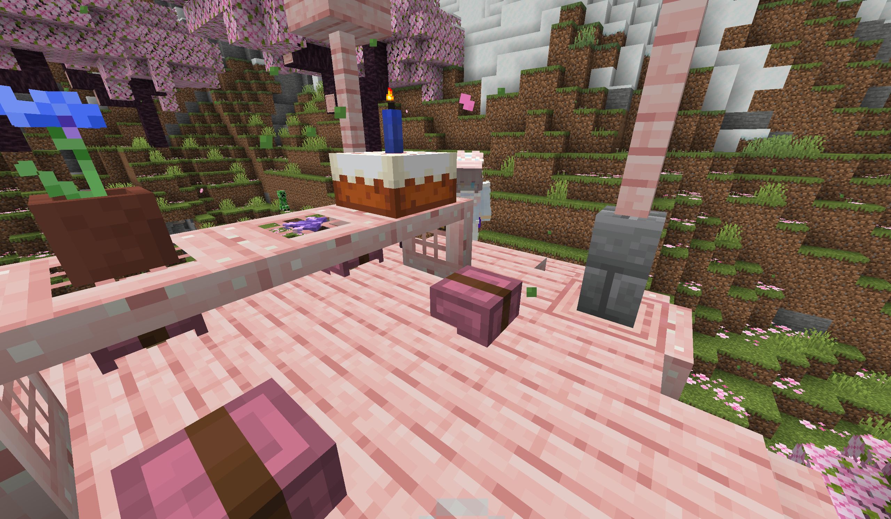
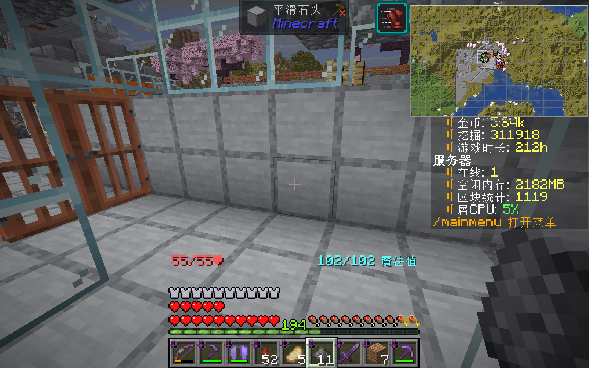

# 空转

> Что в имени тебе моём?  
> Оно умрёт, как шум печальный Волны,  
> плеснувшей в берег дальний,  
> Как звук ночной в лесу глухом.  
>
> 我的名字对你有什么意义？  
> 它会死去，像大海拍击海堤，  
> 发出的忧郁的汩汩涛声，  
> 像密林中幽幽的夜声。  
> ———— 普希金《我的名字对你有什么意义》  

六十八天里日均只有 4 到 5 人进入过服务器。  
这六十八天里有二十多天完全没有聊天，最长的一段空白从四月十八日到四月三十日，十二天。五月一日到五月三十一日，全月只有十九个账号登录过。  

## 纪事

四月一日，samuioto 连发三条“宏摆隔 beta114514rev1”公告，把“红白阁”写成“宏摆隔”，把“放下你们的阿库乃”塞进愚人节更新公告。  
四月十三日，武都黑（agonicx330ml）告别。群里只有一句“我真服了”和后来的沉默。  
六月二十一日晚上二十一点二十二分，木白连发两条公告，相隔七秒：  

> 21:22:23　“RWP **5.5 周目**主题[冒险-升级]，现已开启游戏全版本可进入”  
> 21:22:30　“RWP **6周目**主题[冒险-升级]，现已开启游戏全版本可进入”  

**这就是一个过渡阶段转为正式版本的全部过程。**  

四月十五日 `WASP` 只喊了一声“晗”。四月十八日只剩两个人。  
四月三十日 `WASP` 与欧阳在出生点胡闹：“能做在我肩膀上吗”。  

  
> WASP 客户端的截图。  

其余时间没有任何信息。  
五月一日，Laugh_TheLiving领不劳动节礼包，提示“已领过”。无法可想此 bug 是否被修复。  
五月二日，服务器无响应。`WASP` 说了一句：“木白的话已经不出声很久了”。
五月三日，`527` 回来了：“我出门差不多一个月了”“回来居然啥都没有”。  
同一天，`WASP` 给一个新人写了整整一屏的入服教程：

> ...由于上周目崩盘，现在可用的地标基本上是带有（5.5周目）字样的地标...  

这个服务器上所有还能用的东西，都带着尸骨未寒上一个迭代的名字。  
木白深夜上线道谢：“还在玩服务器就是功）”“服好冷清欸~（”。

  
> WASP 在 hmcl 生日地点进行的拍摄。  

五月五日，Rain_neko 入服。他入服第一句话是：“居然都已经5.5周目了吗”。  
`NewBie_Bu` 一边帮他平地换泥土，一边把删档史讲了一遍：  

> “上周目是突然存档 备份 记录 日志 都没了”“所以大家游玩意愿不高了”

`Rain_neko` 此后成为六周目末期最大的单体建设者。他建了 48 核熔炉、三色蛙鸣灯农场、直径 127 格的纯手挖冰场、地狱上层公共乐魂、跨湖桥塔、月亮小屋。  
五月六日，mock5，`Rain_neko` 现实中的对象入服。两人此后构成六周目末期最稳定的一组玩家。  
五月二十二日，`samuioto` 在聊天栏敲了一条 `give` 指令，`WASP` 随后拿到无限弓并道谢，还调侃“我能看见是不是就是打错了”。  
五月三十一日，`Rain_neko` 完成 127 格冰面。`Hydro_Slime` 带他参观自己的墓室：“这个墓室比我上个存档豪华一万倍！”。  

六月十二日，`dream`、`fox` 两名新人同时入服，`anioto`、`airlenter`、`Hydro_Slime` 全在。`mock5` 感叹：“今天服务器过年了”。  
同一天确认：自定义配方插件已被卸下、主城买卖功能有 bug、新年会场进不去。`Hydro_Slime` 在公屏上喊：“我还记得我收购价两块钱的胡萝卜和土豆！！！我上周木靠这个致富的！现在没啦！！！”  
`anioto` 回：“自定义配方插件给下了主要是”。  

> 你太依赖溜溜梅了，小猫咪学姐。  
> ———— Ph0sphorW  

  
> WASP 客户端的截图。  

六月十五日，木白在“晗宝的领地”（桃花源）挂机看月亮：

> “桃花源（”“在晗宝的领地”  
> “嫂子没电了（”“在不逃跑就要被老丈人剁碎了”  

他在女友家。  
_其与洛颜早在五周目已经分手，令人大惑不解的是彼时两人仍旧是同事。_  

六月十九日，dream 接 5120 号任务挖深板岩必被踢，背包物品消失。木白现场排查：“可能是playertask的问题）”“后台日志是物品损坏”。  

熔铸灰烬为新世的火焰一点一点熄灭，此后剩下的仍旧是未锻成的世界。  
