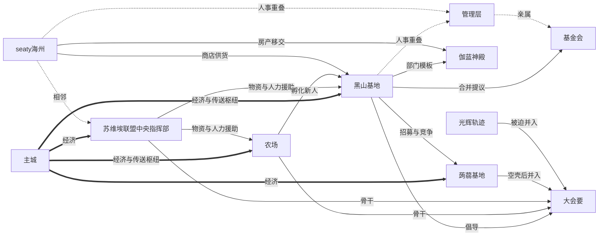

# 一周目组织关系网络

> 本文件是一周目（2020.10.25—2022.6.13，main / pure / rand）玩家组织的总图与关系志。所有节点都是玩家自建基地或官方序列，不含二周目以后的组织。
> 证据分级：`[日志]` = 客户端日志实证（60 天、122,739 行）；`[ICAI]` = 归档文档记载与当事人回忆；`[线上]` = ICArchives 站内页；`[推断]` = 据前两者的判断。

## 一、这个生态是什么形状

一周目没有"公会"。没有加入命令、没有会阶、没有会仓、没有会战，也没有任何一份成员名册存在于服务器端。所有被称为"组织"的东西，实际形态都是**一块地被一群人围着用**——所以档案里 15 个"组织"有 12 个的第一属性是地名，不是团体。

把这个生态捏成这个形状的是**地标系统**。地标（warp）是腐竹手工设的，设了就能被全服传送，不设就只能靠熟人带路。于是：

- 有 warp 的基地自动获得人口：`black_mesa` 在 60 天语料里出现 30 次，`centre` 15 次，`seaty` 5 次；[黑山基地](黑山基地.md) 靠一个 `/warp black_mesa` 完成了从"苏维埃下属小基地"到"全服最大集体"的跃迁。
- 没 warp 的基地自动退出公共视野：[苏维埃联盟中央指挥部](苏维埃联盟中央指挥部.md) 的苏哥 2021-12-04 明说"没有地标""也不打算设置地标"；[蒟蒻基地](蒟蒻基地.md) 直到 2022-03 还在问"没warp他们怎么去的"。
- 地标可以被定价、被锁、被删：黑山 2022-02-26 把自家传送价抬到 8 万，02-27 锁掉全部传送点；[某种树桩](某种树桩.md) 干脆从没设过地标，于是"稳定地消失在所有的统计里"（[ICAI 第 155 段]）。

所以一周目的组织生态是**群岛**，不是社团：人口沿地标分布，地标沿腐竹的手分布。谁掌握了"让人来得方便"这件事，谁就掌握了组织。

第二层结构是**人的重叠**。同一个 ID 常常同时属于两三个组织：yjgdjsy 是黑山核心、也是蒟蒻成员；2830484880 自认"我基金会黑山都有加"[日志 2022-02-20]；ztj0410 的伽蓝神殿把部门开在黑山的编制里。这让"组织间关系"很多时候其实是"同一个人在两边的位置"。

## 二、关系图

实线 = 有实证的实质关系（资助、从属、并入、竞争、供货）；虚线 = 地理或人事上的邻接。

孤岛（不连任何边）：[某种树桩](某种树桩.md)、[Minecrft24K](Minecrft24K.md)、[沙漠小镇](沙漠小镇.md)、[终末基地](终末基地.md)、[极星公社](极星公社.md)。这五个条目不在网内——一周目大部分基地其实都在网外，图上这些线只覆盖了有人反复提起的那一小块。

## 三、关系表

| 组织 A | 组织 B | 关系类型 | 证据 |
| --- | --- | --- | --- |
| [主城](主城.md) | [黑山基地](黑山基地.md) | 上游／交易 | 黑山把自家 warp 定价 8 万，反向证明主城传送免费[日志 2022-02-26] |
| [主城](主城.md) | [农场](农场.md) | 上游／交易 | RedWhite 拍宣传片"先从农场开始吧"[日志 2022-01-22]；农场产出经主城变现[ICAI 第 93 段] |
| [主城](主城.md) | [seaty海州](seaty海州.md) | 并行商业 | "两家商店其实都是亏本生意"[ICAI 第 847 段] |
| [seaty海州](seaty海州.md) | [苏维埃联盟中央指挥部](苏维埃联盟中央指挥部.md) | 邻居 | "与seaty相邻"[ICAI 第 888 段] |
| [seaty海州](seaty海州.md) | [黑山基地](黑山基地.md) | 供货 | 活塞断货，air"完全没货了"[日志 2022-02-25] |
| [seaty海州](seaty海州.md) | [伽蓝神殿](伽蓝神殿.md) | 房产移交 | "海州归他了"[日志 2022-03-25] |
| [苏维埃联盟中央指挥部](苏维埃联盟中央指挥部.md) | [黑山基地](黑山基地.md) | 早期从属＋资助 | huxk 自称"隶属于苏维埃联盟的小基地"[日志 2021-12-05]；苏哥列名资助者[ICAI 第 105 段] |
| [苏维埃联盟中央指挥部](苏维埃联盟中央指挥部.md) | [农场](农场.md) | 并列骨干 | 两者均为大会要骨干[ICAI 第 93、98 段] |
| [农场](农场.md) | [黑山基地](黑山基地.md) | 孵化＋代管维护 | "黑山回来协助农场进行一些基础设施的维护"[ICAI 第 95 段] |
| [黑山基地](黑山基地.md) | [蒟蒻基地](蒟蒻基地.md) | 招募／竞争 | 邀 LRY 去黑山[日志 2022-01-27]；01-28 责任之争 |
| [黑山基地](黑山基地.md) | [基金会](基金会.md) | 合并提议 | "他打算把基金会和黑山合并"[日志 2022-01-27] |
| [黑山基地](黑山基地.md) | [伽蓝神殿](伽蓝神殿.md) | 部门嵌入 | ztj 拿到 `<珈蓝神殿特殊部门-ztj0410>`[日志 2022-02-15] |
| [黑山基地](黑山基地.md) | [大会要](大会要.md) | 倡导 | "大会要倡导者之一"[ICAI 第 105 段] |
| [大会要](大会要.md) | [蒟蒻基地](蒟蒻基地.md) | 强制并入 | "被迫加入大会要维持运行"[ICAI 第 102 段] |
| [大会要](大会要.md) | [光辉轨迹](光辉轨迹.md) | 强制并入 | "软硬兼施下被迫加入"[ICAI 第 118 段] |
| [红白阁管理层](红白阁管理层.md) | [黑山基地](黑山基地.md) | 人事重叠 | huxk2008 既是管理员又是黑山所有者[日志 2022-03-13] |
| [红白阁管理层](红白阁管理层.md) | [seaty海州](seaty海州.md) | 人事重叠 | airlenter 既是管理员又是海州主人[日志 2022-01-19] |
| [红白阁管理层](红白阁管理层.md) | [基金会](基金会.md) | 亲属 | Emotiona 用后台发点券[日志 2022-02-12] |

## 四、组织与人的交叉索引

| 组织 | 核心成员 | 备注 |
| --- | --- | --- |
| [主城](主城.md) | RedWhite、ouyangyuanyi | 官方设施，无成员 |
| [seaty海州](seaty海州.md) | airlenter、ztj0410（后期接手） | 建房者可多，业主常换 |
| [农场](农场.md) | wsts | 一人基地，用户不计 |
| [苏维埃联盟中央指挥部](苏维埃联盟中央指挥部.md) | SovietCommander | 长期一人在线 |
| [黑山基地](黑山基地.md) | huxk2008、15213571、yjgdjsy、2830484880、Emotiona、Hot__doggy、hmcl、Sky_Star_Dust、Gong_Ruize、blueone | 二期以后部门化 |
| [蒟蒻基地](蒟蒻基地.md) | LRY314、XiaoMaome_ya、yjgdjsy | 成员跨黑山 |
| [光辉轨迹](光辉轨迹.md) | BEYOND、madventures、JJIamnotfat | 三人皆 3 月才入服 |
| [大会要](大会要.md) | huxk2008 为核心 | 无独立成员 |
| [沙漠小镇](沙漠小镇.md) | HBGL、2830484880 | 后期为空中基地 |
| [Minecrft24K](Minecrft24K.md) | Minecrft24K | 该 ID 语料 0 发言 |
| [基金会](基金会.md) | QAQ121QAQ、Emotiona、HBGL、2830484880 | 创始人 1 月底后消失 |
| [伽蓝神殿](伽蓝神殿.md) | ztj0410、hmcl（往来最多） | 以称号为会徽 |
| [某种树桩](某种树桩.md) | huxk2008、Hour2、mc__xiaofeng、wenhaoyu | 无组织身份 |
| [极星公社](极星公社.md) | airlenter、mc__xiaofeng | rand 子服 |
| [终末基地](终末基地.md) | linheng_li | 一次事件后弃置 |
| [红白阁管理层](红白阁管理层.md) | RedWhite、ouyangyuanyi、ClearBlue_Water、huxk2008、Werewolfwolfy、airlenter、Black_Cat | 七个具名执法者 |

## 五、为什么它们最后都走向解体

**一、没有目标。** 一周目没有任何"组织目标"这种东西：没有战争、没有领地争夺、没有经济竞赛、没有建设指标。基地能做的事只有"造机器、造房子、拉人"，三件都做完之后就没有下一步。[大会要](大会要.md) 是唯一一次试图给出目标（"把周目续下去"），而这个目标的定义本身就承认了失败——"我没招了。真的没招了"（[ICAI 第 129 段]）。

**二、科技不对等。** 同一场"大基建"里，15213571 在算 MSPT、炸 5×5 区块的空置区、造盾构机与 15 核刷铁机，另一批人刚学会 `/warp` 和"熔炉组"是什么。ICAI 把这条直接列为大会要失败的原因之一（第 126 段）。不对等不是问题，不对等加上"必须一起干"才是问题。

**三、劳动力不足。** 全服单日最高同时在线 29 人（2022-01-22），常态十几人。核心产能集中在三五个 ID 身上：黑山 2022-02-25 被 15213571 一句"5天黑山就只有一个我一个人在活跃"点破；02-26 全服只有 10 人在场。人少时靠热情补，热情退了就没人补。

**四、管理层缺人，且管理者就是基地所有者。** huxk2008 升任管理员后"没空打理基地了"，黑山随即停摆（[ICAI 第 111 段]）；airlenter 在 3 月失去 op；wer 因账号迁移丢权限；RedWhite 2 月 13 日后不再上线。而仅有的几个管理者同时是基地主：huxk 管黑山、air 管海州——执法者与参赛者是同一批人，任何"统一管理"都会立刻变成"某一家做大"。

**五、地标让人口分散。** 每个基地都靠自己的 warp 吸人，warp 越多，人口越碎。主城 `centre`、黑山、农场、海州、24K、pve 场地、春节场地各自成点，没有一处能形成"必须常驻"的中心。地标系统本来是为了方便，结果是每个人都停在自己家传送点旁边——这也是"联合"只能靠喊、不能靠走的原因。

五条叠在一起，结局就是 2022 年 3 月 25 日那句对话：huxk2008 问"三个组织已经覆灭了?x"，airlenter 答"啊，海州一开始就没有组织"[日志 2022-03-25 22:00]。一周目的组织从头到尾都不是"成立—发展—解散"的社团，而是"有人—有地—有人走了—地还在"的聚落。它们没有解散，只是没人了。

---

**史料备注**：本图的关系边里，只有"主城—各基地的交易""苏维埃—黑山的早期从属""黑山—蒟蒻的招募""海州—黑山的供货""管理者—基地主的人事重叠"五组有日志硬证；资助、并入、倡导三类关系全部来自 ICAI 回忆，且"大会要"一词在 122,739 行语料里 0 命中（见 [大会要](大会要.md) 史料备注）。线上 ICArchives 的组织列表有 17 个标题、其中 12 个正文为空，只有 Seaty 一节有内容——**线上档案本身是不完整状态**，这既是一周目组织史的资料缺口，也是一条可以写进档案的史料事实。
