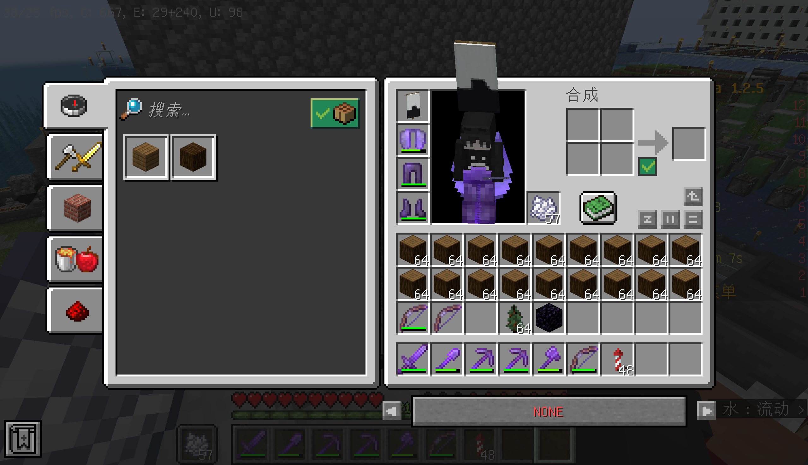
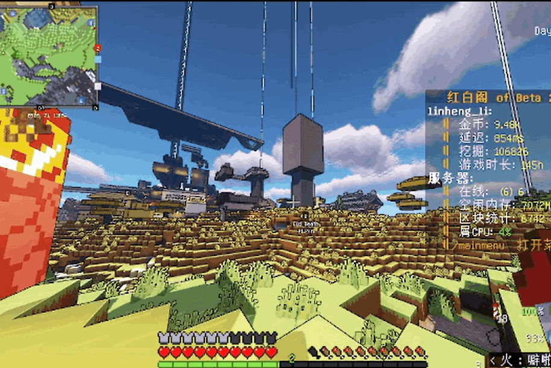
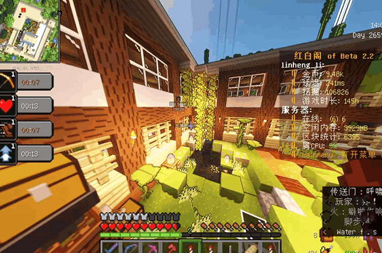

# 黑山基地

一周目最鼎盛时的中心。彼时全服务器最为庞大技术水平也最为先进的基地；后期因为种种因素而衰落。  

## 记事

黑山基地是第一个被当作“集体组织”来经营的基地，靠概念新鲜与马太效应快速积累了众多人力，但由于所有者本人升任管理员以及服务器新鲜血液流入减少，逐渐开始衰败。

  
> 图中纸娃娃头顶旗帜即为黑山旗帜。  

  
> 黑山中心初始建设区域。  

2021-12-05 huxk2008 拉人时自称黑山基地是"我创立的隶属于苏维埃联盟的小基地"。早期是"啥都缺"的招工制，职位包括"仓库管理员""机修工（红石机器制造机）""拓荒者""美工"等等。  

> 啧…我才不会告诉你那几个名字当时是我现场编的。  
> ———— Ph0sphorW  

2022-02-10 起改成级别制，02-11 分级为 ALEPH／ALPHA／BETA 三级，但是没有实现成功。  
2022-02-13 落地为先锋、后勤、建筑、科技、安保五部；02-14 起发"身份标记"，格式 `<α-部门-游戏名>`，但是由于执行力不足也并未实现。  

黑山初期共用仓库不设锁。2022-01-16 Hadinxyl 问"黑山那两个箱子是忘记锁了吗"，huxk2008 回"共用仓库锁个屁qwq"，对方追问"没锁的里面东西可以拿喽？（）"，答"ys"。当天铁砧坏了、铁锭"几乎都被拿了"。  
随服务器内部出现大量蓄意破坏者之后，开始设定一系列规则。2022-02-26 传送价格抬到 8 万；02-27 锁掉全部传送点、钉告示牌（"黑山所有的传送点 都给我锁了"）；03-04 起进空置区要公告；03-05 推出"临时黑山签证""到黑山游览证明"。  

基地原分工业区、居民区、空置区、新区。CBW 建议"居民区离工业区至少距离1000"，理由是"居民区卡爆警告"；但新区的建设并没有成功。  

  
> linheng_li 在黑山基地的家。  

## 日志

- **2021-12-05**：招人开张，"暂时就你和我""下午回来一个新人"。  
- **2021-12-26**：建立生物实验室（实则为仓储设施），落地为 `/warp black_mesa_biology_labotry`。  
- **2022-01-22**：RedWhite 拍宣传片，第一个点名"黑山开拍吧""所有机器都开开"；huxk2008 婉拒"还是别拍吧让他们自己来探索吧"，最后 SovietCommander 说"指挥部能上镜就行"。  
- **2022-02-25**：黑山开始冷寂。  
- **2022-03-13**：huxk2008 拿到管理权限，随后名义上的黑山基地在大会要建设中解散。  

## 衰落

中后期因内部组织结构松散混乱，加之服务器发展略显颓势，随大会要建设逐渐解散，在此不做赘述。  
目前留存下来的设施仅有一周目纪念碑，此外，基地，空置区，新区等设施基本全部丢失。  
