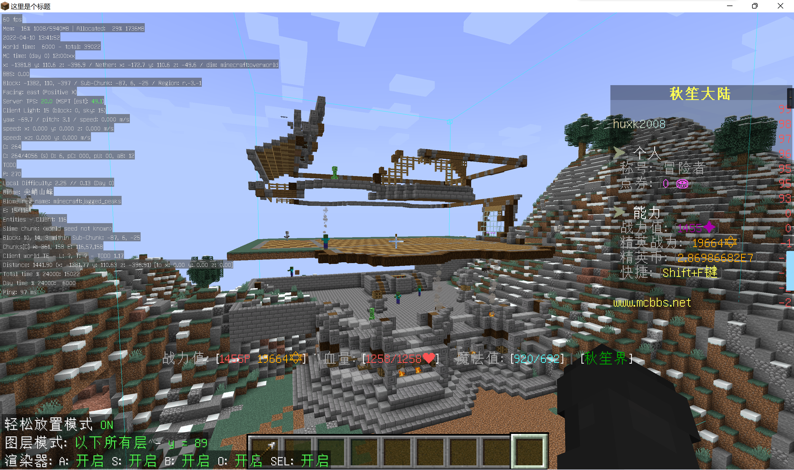

# 极星公社

一周目 rand 内所建立的唯一的聚落。  

## 一周目

> "在我们连滚带爬跑到一个雪原上建立了属于自己的基地之后，便被精英怪袭击了；不得已我们只能把基地从地上架空以防精英怪打上来。"  
> ———— hot_doggy
>
> "实际上那个基地也有自己的名字叫作极星公社，但是因为一些原因这个名字没有沿用下去。"  
> ———— Ph0sphorW  

基地整体抬离地面，以防止精英怪进入。可确认的玩家基本只有 huxk，小风，air 以及 hot_doggy。  
主基地的部分主要为一些仓储设施，而下界部分存放有部分粘液科技机器。  

随 rand 逐渐衰落而逐渐关闭。  

  
> 极星公社后方准备建设的工会大厅。  

## 遗产

档案馆内没有任何极星公社相关的内容，但是作为传承条目的酿酒至今仍在使用。  
