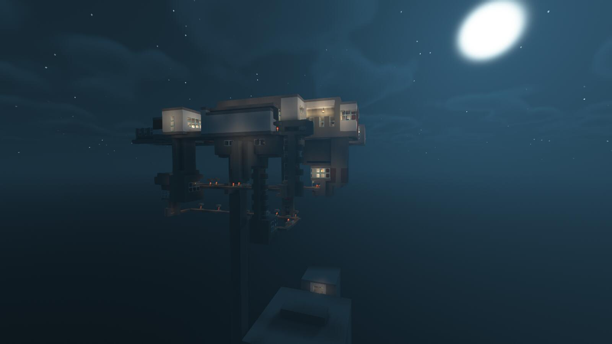
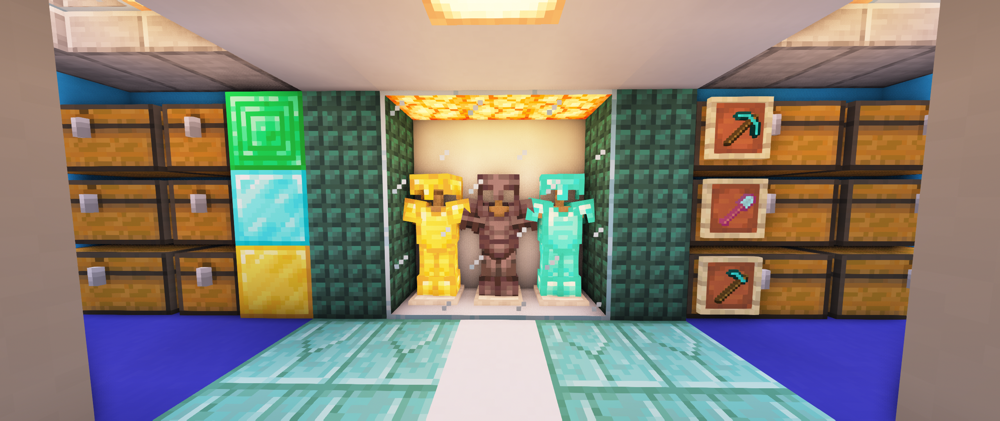
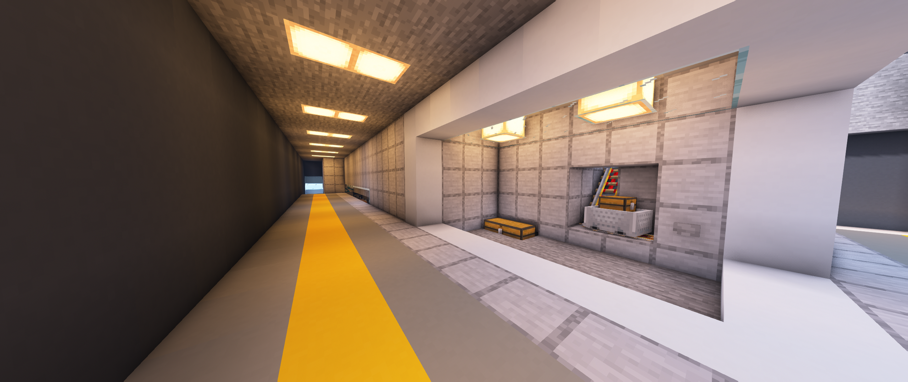

# 反叛者大楼

反叛者大楼是 24K 的基地，建设完成于一周目大前期。  
由于所留下的资料非常少，因此我们只能给出尽可能多的信息与图片。  

## 一周目

Minecrft24K 的基地，也是前期的一个比较大的基地，印象最深的的是它的巨大的刷铁机，以及箱子里面的一堆神奇内测物品。  
这个基地原本应该是有一个响亮的名字叫作“反叛者大楼”（本人确认）的，但随着它的主人长久没有上线，这个名字也随之湮没在了红白阁短暂的历史中。  

> 反叛者大楼一部分的内部设计

  
> 疑似为反叛者大楼的内部房间

> 反叛者大楼的走廊

从笔者日志中能够恢复的信息大概如下：  

- 反叛者大楼的地标名为 `minecrft24k_guesthall`，是被当作参观点开放的。  
- 出现过非常规的物品（255 级附魔书）以及注明的大刷铁机。  
- 熔炉等容器用 LWC 上锁。2021-12-31 与 2022-01-29 共出现四次"注意：这个私有的 熔炉被 Minecrft24K锁起来了"。

尽管对于彼时一周目的玩家相当久远，在服务器玩家心中反叛者大楼仍旧是一个必到之地：  

- **2022-01-29**：LRY314 说："我给24K贴'福'他看不到吧……这人很久没上线了……"。这是"主人已离线"的直接证据。  
- **2022-02-01**：Hour2 带 15213571 参观反叛者大楼。  
- **2022-02-25 / 03-12**：LRY314 说 "warp里面黑山，苏维埃，24K可以参观一下"；"这个好像是24K的"。

## 遗产

目前关于反叛者大楼的留存资料只有 24k 本人的叙述与其提供的若干张照片。  
