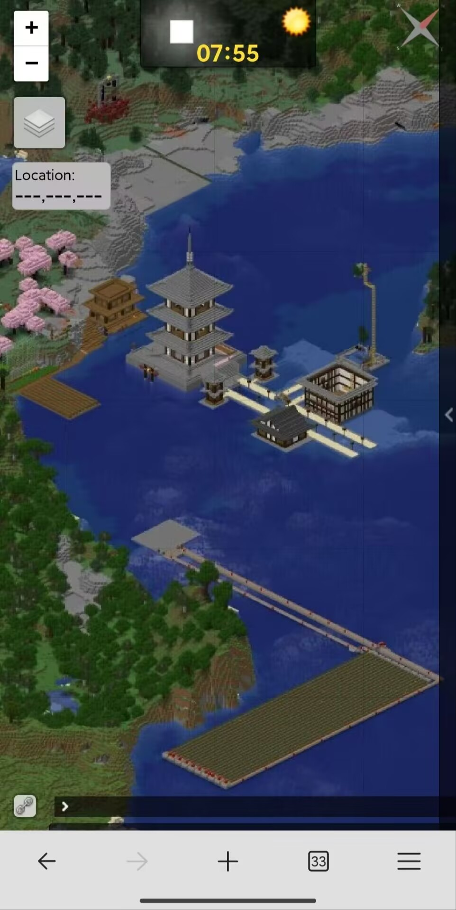
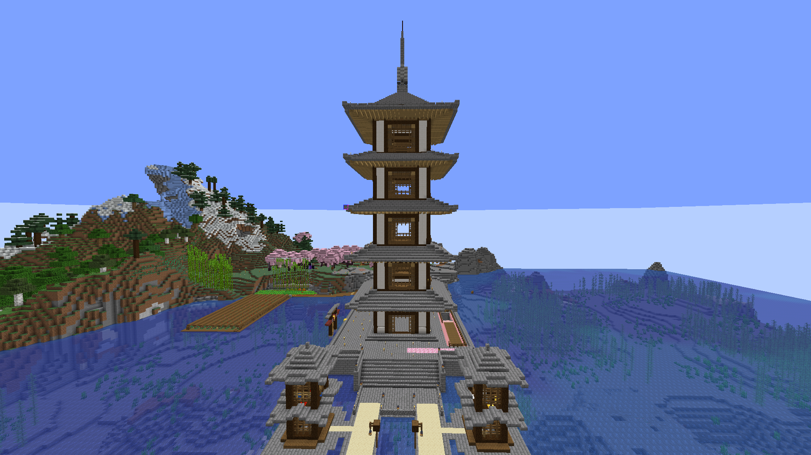
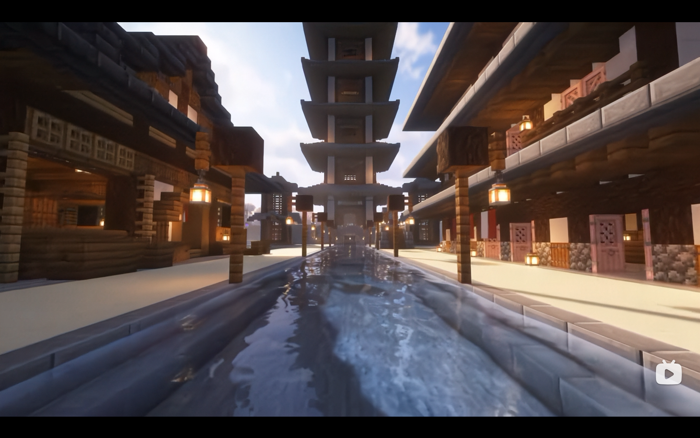
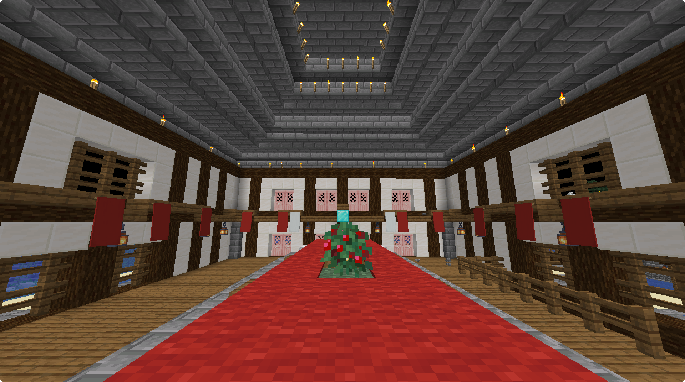

# 红莓省

红莓省由 ybk 建立于五周目。  
根据 ybk 所提供的建立日期（2025年8月24日），其为五周目较为前期的玩家聚落。  

## 五周目

红莓省的主要设施包括一座塔，若干栋附属的房屋，以及一部分的自动农场，包括浆果田与小麦地。  

  
> 红莓省的 bluemap 截图。  

红莓省的工程包括一期和二期，其中二期主要工作是将中央的塔从三层修建到五层。  

  
> 塔经过修建之后的状态。  

上图中的塔是中空的，有水路可以通入塔中央。  
此外，红莓省的所有的水路都是贯通的。  

> 充分体现了ybk这个逼对没用的交通方式的追求。  
> ———— ybk10124  

红莓省与 wasp 等人的出生点建筑群中间修建了一条铁路与冰道的轨道交通，这是五周目内为数不多的一个集体性项目。  
这个项目的主要参与者有 ybk 本人，WASP，以及小猫麋鹿。  

  
> 红莓省在宣传片中的状态。  

红莓省下方的浆果田主要是处于经济作用，因为在五周目中农作物是可以兑换为红白币的。  
这一度遭到乐凝的宏观调控，但是最后没有成功，因为最终浆果收购价过低。  

  
> 红莓省大会堂中央的浆果，其中大会堂为最开始俯瞰图中未封顶建筑。  

## 遗产

红莓省最终因为五周目删档而丢失。  
保存下来的内容仅有部分建筑截图。  
