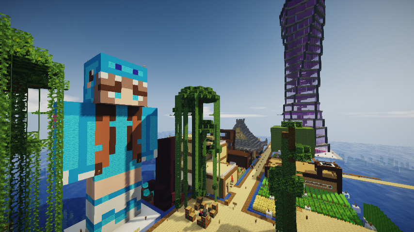
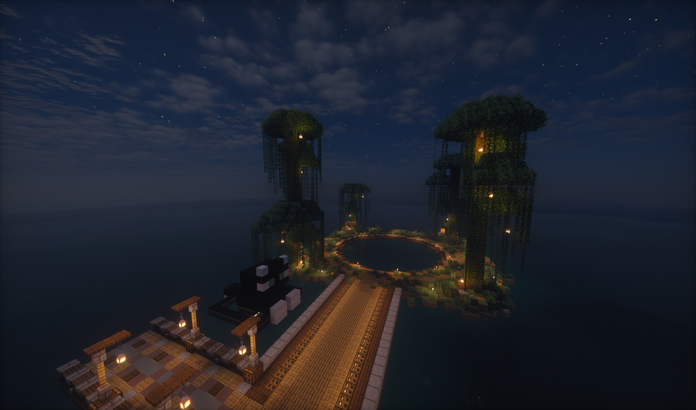
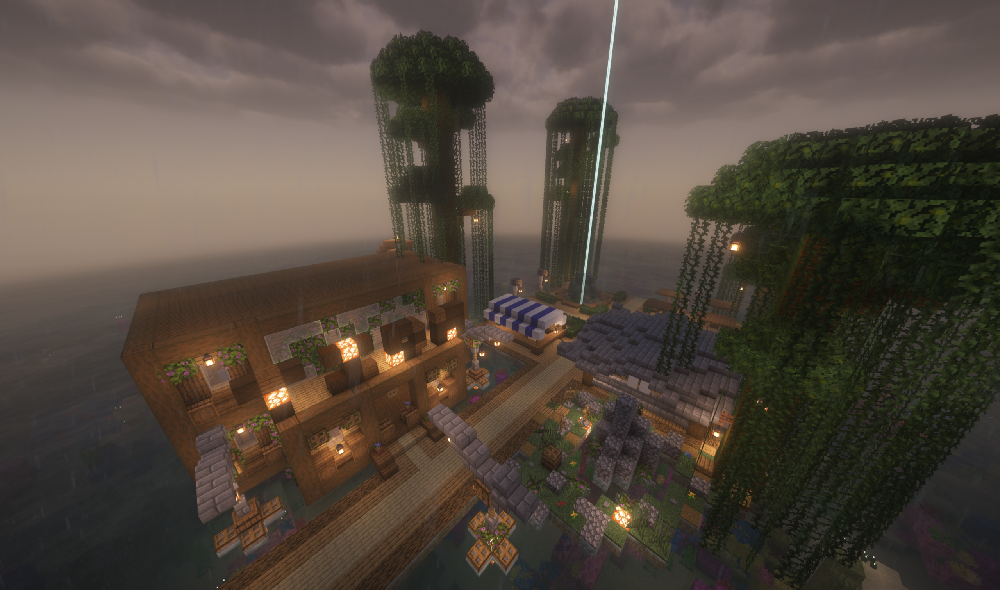
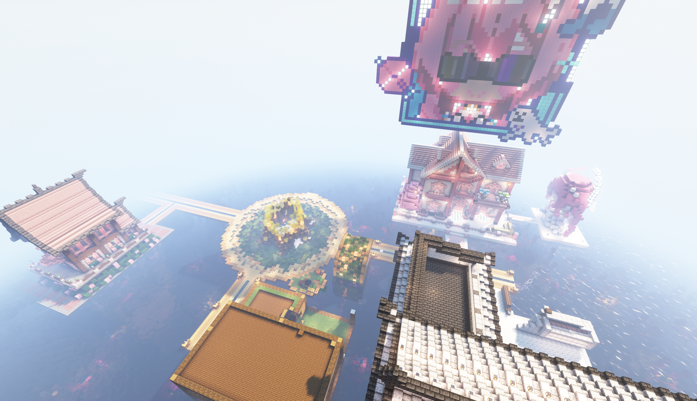

# seaty

Seaty 可谓是在这个服务器中活的最为长久的一个基地，其无论在什么地方必定都建立在一片开阔的暖水海洋上，建立者核心都为 Airlenter。  

## 一周目

Seaty 是早期 airlenter 与一众玩家的建筑与商店聚落。  
> 海州从来不是air一个人的工程，air的建筑最多只占三分之一，余下的部分都是众多玩家一起建造的；  
> seaty是大家的，大家都不在了，工程自然便停了。  
> ———— airlenter  

Seaty 的布局主要呈现区块式摆放的区域，如商店、住宅、冰船赛道、巨型杜鹃花丛；房屋与店铺可私下转让，例如 2021-12-25 日 ztj0410 公屏上说明 "seaty的铁占商店转让，有人要么"；又如 2022-02-07 又"出售seaty的房子一套，有没要的"。  
Seaty 没有成员、没有部门、没有考核，也没有明确的账目。  
> 海洲一开始就没有组织。  
> ———— airlenter  

> 一周目海洲的中心区。  

Seaty 的功能以低价转卖为主，如果玩家有想要买的东西到seaty看一眼大概率能找到；但是 air 不常补货，很多店长期缺货。除此之外 Seaty 在末地也有一个分店与一个甘蔗农场。

仅只是在可恢复的记录中海洲就非常多灾多难：  

- **2021-12-04**：Xuan_xi 问"seaty的腐竹雕像又被炸了？"，yjgdjsy 紧接着"为啥seaty两个苦力怕？"。  
- **2022-01-25**：yjgdjsy"seaty又有苦力怕炸地了"。  
- **2022-02-13**：hmcl "还有个烧了seaty的也没了"。  
- **2022-03-04**：huxk2008"有人拆了seaty的信标"。  
- **2022-03-12**：airlenter"现在seaty基本一周被摸两次那样"。  
- **2022-03-19**：airlenter 清点全服永封只有两个，"一个偷东西四次不改，一个把seaty炸了x"；huxk2008 补"czp和araish"，又说"好在东西已经回了"；air 下一句是"现在的seaty，炸了也无所谓"。wer 在私聊里连起三个名字："SeatyWereAir""SeatyAreDying""SeatyAreDrowing"。  

Seaty 至始至终没有解散，只是没人维护。  
> seaty曾被烧毁一次，炸毁一次，拆毁两次，被盗数不清多少次，可能是红白阁历史中最多灾的基地；  
> setay被炸毁时coreprotect好巧不巧的出现了bug，导致无法完全回档只能手动重建（错字原文如此）  
> ———— airlenter  
RWP、RedT、云霭、Re:RWP、NSV Alpha、NSV 都有大小不等的 Seaty 版本，但档案馆目前所保存的仅有RedT，NSV Alpha两个版本。  

## 二周目

二周目的 Seaty 在大约八月初建成之后就基本处于无人状态，设施与建筑无人维护，私人储物箱基本被顺空。  

2023 年 7 月 31 日 20:50，`ybk10124` 把人带到海州（"这边是海州"），`white_phosphor` 接了一句：

> ＜white_phosphor＞ seaty 还是老样子啊（（  

同一晚 21:35，`airlenter` 说了：

> ＜airlenter＞ seaty 怎么拆呢，有点想炸，但是感觉材料好浪费  
> ＜airlenter＞ 挖又太慢  

在这句话之前，对话是这样的：

> ＜airlenter＞ 你们现在都在哪定居  
> ＜white_phosphor＞ 哼嗯很散  
> ＜Jade_Emerge＞ 四海为家（雾  
> ＜neko__LY＞ 真男人从不定居【雾  
> ＜white_phosphor＞ 我们基本上都是主基地!*嗝*  
> ＜white_phosphor＞ 我房子在主基地  
> ＜Jade_Emerge＞ 我们基本都住全物品（雾  
> ＜white_phosphor＞ 我是*嗝*到处建房子（!*嗝*  
> ＜airlenter＞ 那这样我就不觉得我待在海上奇怪了（）  
> ＜Jade_Emerge＞ 有一说一基地打算造个镇子  
> ＜neko__LY＞ 我决定以后住酒馆【雾  
> ＜airlenter＞ 我觉得守着我的海州假装我是个世外高人挺好的  

不难推断的是，海洲在二周目中基本处于生态边缘位，基本无人会在闲暇时分去往海洲。  

苏维埃指挥部与海州相邻。根据日志，`SovietCommander` 在 2023-07-27 说"离海洲也不算远 很容易到这里 不错"（他在说新全物品的空置域）。

2023 年 8 月 21 日，`NOWiFiON` 带新人 `lbd` 参观。他的介绍只有一句：

> ＜NOWiFiON＞ 这块建在海上的叫 seaty  
> ＜NOWiFiON＞ sea city  

可以说二周目能够称之为有自主特色的两个大型聚落只有 Seaty 和苏维埃指挥部。  

在 2023 年 7 月 30 日 RedT 一号线开通，将主基地和 Seaty 连接起来，详情请见[地铁工程](/docs/2-second-iteration/intervallo-subway.md)；但是地铁工程并没有给人烟本就稀少的海洲带来任何实质性变化。  

## 三周目

海洲在三周目并没有实质性建立过，air 只是圈了一块地之后又迅速删掉了它。

## 跨代之间

在 RWP，RedT，云霭，Re:RWP，NSV Alpha，NSV 均存在 Seaty，目前档案馆藏有两个 Seaty 城市原本，其余尚无法得知其具体建筑内容。

  
> 位于五周目（Re:RWP）的海洲。  

  
> 位于 NSV 内测服的海洲。  

  
> 位于 NSV 的海洲。  
