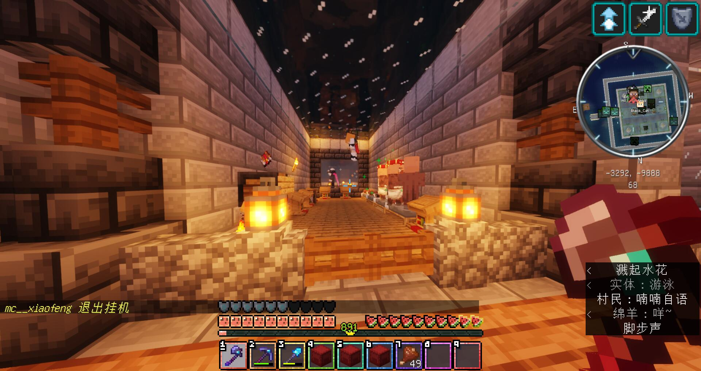
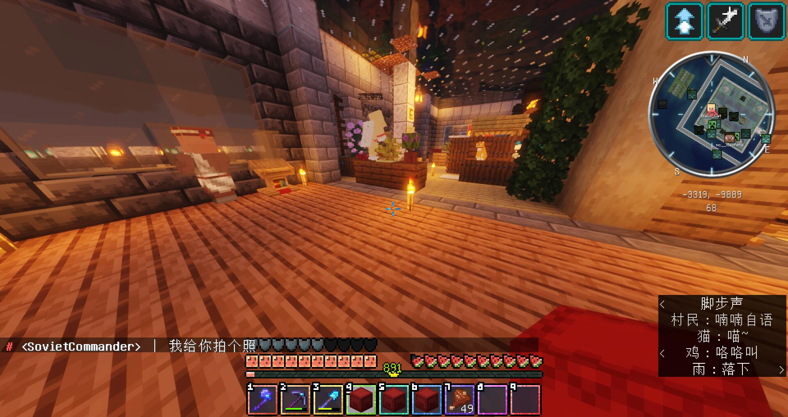

# 苏维埃联盟中央指挥部

指挥部是除 Seaty 之外存活最久的基地，其在 RWP，RedT，云霭，Re:RWP 都有建造有相似的版本。

## 一周目

苏维埃指挥部常驻的成员有苏哥以及 lenin，但是后者长期不在线。  

> "苏哥应该是为数不多能一直保持到现在的玩家，同时也非常乐于助人。"  
> "很多小基地，新玩家一开始都是在苏维埃联盟的物资或是人力帮助之下顺利度过前期的。"  
> ———— Ph0sphorW  

  
> 指挥部外墙截图  

苏维埃指挥部由于公开设置了地标，经常被传送到此地的破坏者进行破坏；这导致苏哥经常与一周目管理层发生接触。  

  
  
> air（存疑）正在观察苏维埃指挥部损毁情况  

苏哥在之后由于工作原因逐渐淡出游戏，此后苏维埃基地基本衰落。  

## 二周目

在二周目开启，苏哥假期开始之后，苏维埃基地就正式开始了其在二周目的建设；  
二周目的苏维埃基地相较于一周目额外扩大了一周，且在外围增加了新的环形步道与直道以连接各种附属设施与海洲。  

在此后由于墓碑事件（见第二迭代第三节），苏哥逐渐淡出服务器。  

## 结局

档案馆并没有记录一周目的投影。  
二周目投影现存放于档案馆。  
