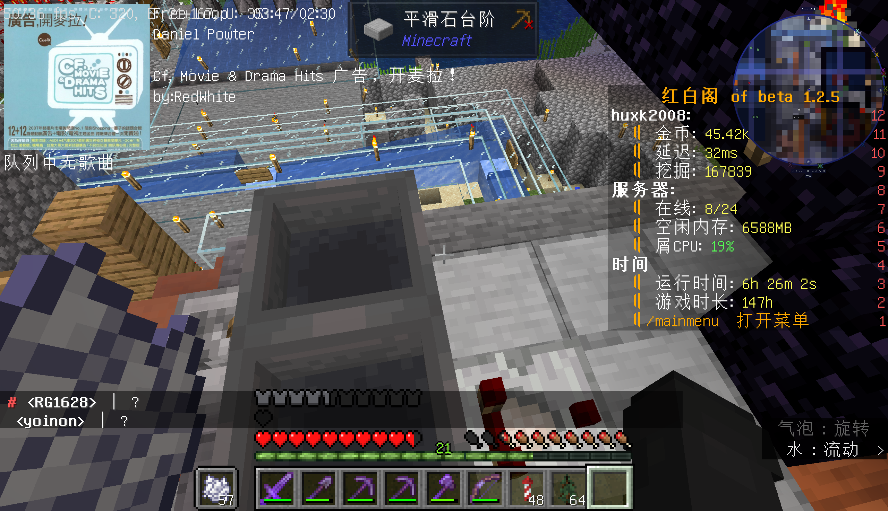

# 农场

一周目由 wsts，gao_jian_guo233，werewolfwolfy 等人公用建立的机器齐全的农场。

## 一周目

地标名称为 `7`，服务器里绝大部分新老玩家都在这里被养过。  
农场为 wsts 早期建立的设施，本意是为了方便各类农业生产建立的。但随后在 wsts 暂时离开服务器之后农场基本交由 gaojianguo 进行打理，在之后由黑山进行代管；wsts 在后期回归之后选择在沼泽地区另行建立新的基地，农场基本无人看管。  

  
> 农场工业区的一角。  

农场旁边有一副 wer 没有建设完成的地图画。  

2022-01-22 RedWhite 拍摄基地宣传片时选择 "先从农场开始吧""农场的机器开下吧"，但是宣传片的资料随后并没有公开放出，此后农场基本陷入无人问津的状态。  

## 衰落

档案馆内保存了农场与 wsts 基地的完整投影。
