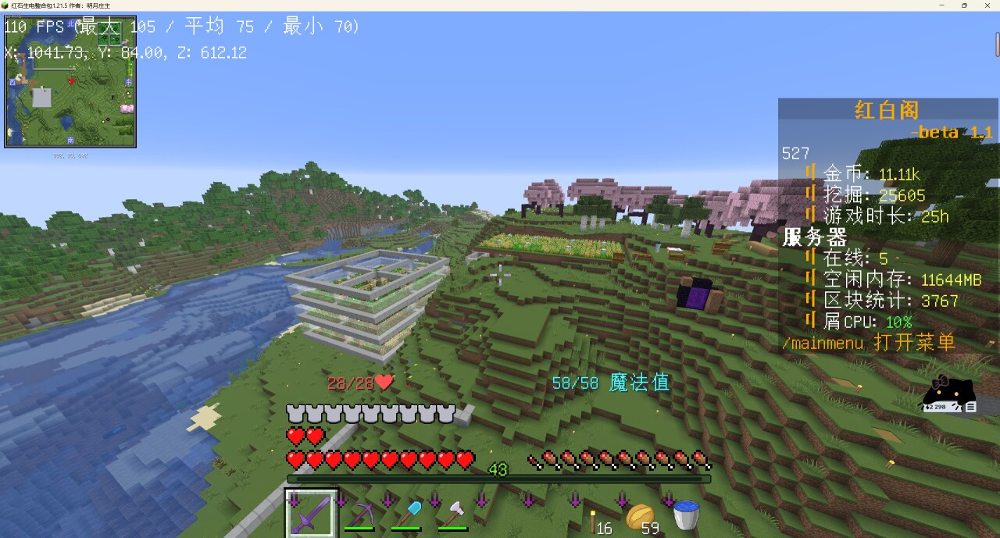

# 无奇的农场

与[农场](./the-farm.md)区分。  
无奇（527）的农场是在无六周目所建立的小型私人基地。  

## 五 / 六周目

五周目内 527 的基地主要建筑在海上，自述“建了个港区”，可能为较大的观赏性兼居住性建筑。  
六周目由于五周目的删档打击过大，这导致 527 一直处于“属于流浪玩法”的状态。其农场的建筑主要是一些基础机器与自动化农场。  

  
> 六周目 527 农场的一角。  

## 衰落

档案馆内保存了六周目 527 农场的投影（不包括通天柱）。
