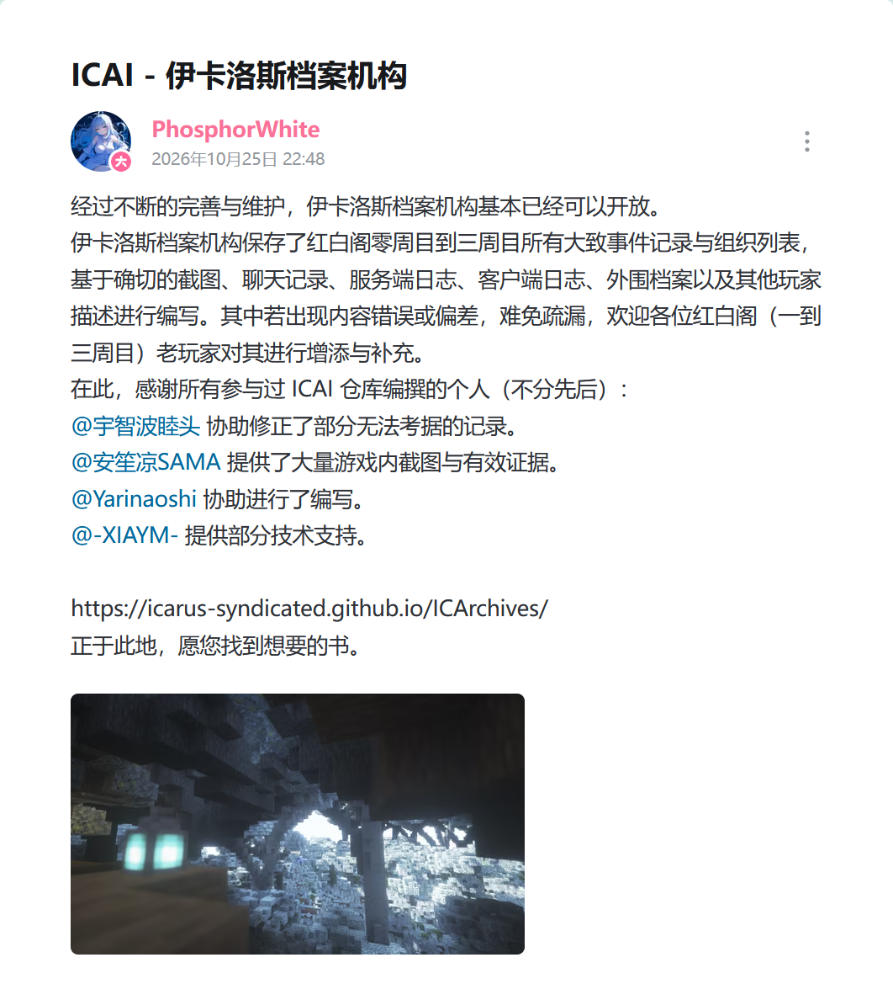

# B - 闯入者的笔记

[你](https://github.com/) 是一个闯入者。

你从 ***点进这个文档站时*** 就知道自己是一个闯入者了，或者用一个好听点的话来说、你完全不知道主页上的任何东西的任何含义。

ICAI是什么？ RWP又是是什么？ RMS是啥？？ 伊卡洛斯又是啥？？？你完全搞不清楚。

但你很有可能在此时此刻有很多空余时间，又或者是三个奇怪的logo真的吸引住了你，于是你决定 [点击查阅按钮](https://icarus-syndicated.github.io/ICArchives/intro) 来看看到底是怎么回事。

***

***在阅读完两篇序言后*** ，你仍然是一头雾水。

似乎是在什么时间之前，什么东西有过什么辉煌，最后又落成了一地鸡毛？

你不敢说自己比刚点进来的时候多明白了多少东西。

...不过，关于你最有可能的来到这里的方式，你逐渐有了点猜测。

你不知道自己什么时候关注了这个人——你去查了一下，大概是因为 [CICADA](https://github.com/enjarai/cicada-lib) 的事——不过现在已经不重要了。

这个人在 2026年10月25日 [在B站发表了一个说说：](https://www.bilibili.com/opus/1263155585501626368)

...没错，“你”就是这样知道这个文档站的。

很可惜的是，这对于理解这个文档站并没有什么帮助。

唯一的办法，大概，只能是回去再看看文档站本身的内容了。

你向左看了看目录。绝大多数目录条目都是以“第 X 迭代”的方式命名的，再加上 再续 中的一些用词，你猜这个文档站记录的目标是某个服务器。

抱着这样的想法，你打开了 [第零迭代](https://icarus-syndicated.github.io/ICArchives/zero-iteration) 。

***

***在阅读完第零迭代的所有文章后*** ，你不由自主的开始感到怀旧。

这个文档站所讲述故事的开端发生在2020年，几个好友一起在自己的服务器里享受时光。

一切都看起来那么美好。

...总之，你确实对这个文档站有了一定的认识。

这确实是一个MC服务器的文档站，左侧的 “第 X 迭代” 指的是 “第 X 周目”。

从第零周目文档的用词来看，似乎在未来这个服务器会有所发展。

...从序言来看，似乎在未来这个服务器会曲终人散，人走茶凉。或者更差。

总之，你打开了 [第一迭代](https://icarus-syndicated.github.io/ICArchives/first-iteration) 。

...呃，这可比第零迭代多了不少啊

***

***在阅读完第一迭代的所有文章后***

TODO

***

就算是我已经阅读过了档案馆的所有内容，我也不认为我就有资格去在当事人面前表达惋惜或者什么别的；毕竟“你”是一个外人，幸运的没有经历过那些不幸的外人，他们大概不会理解也不会需要“你”的多余感情。
但“你”确实是通过一些机缘巧合