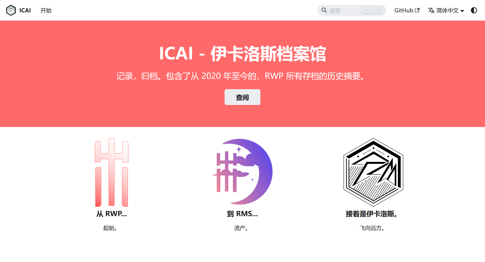

# B - 闯入者的笔记

:::warning

本篇的笔者 **不是** 文档站的主笔者。

本篇含有部分图片。

:::

[你](https://github.com/) 是一个闯入者。

你从 ***点进这个文档站时*** 就知道自己是一个闯入者了，或者用一个好听点的话来说、你完全不知道主页上的任何东西的任何含义。

ICAI是什么？ RWP又是是什么？ RMS是啥？？ 伊卡洛斯又是啥？？？你完全搞不清楚。

但你很有可能在此时此刻有很多空余时间，又或者是三个奇怪的logo真的吸引住了你，于是你决定 [点击查阅按钮](https://icarus-syndicated.github.io/ICArchives/intro) 来看看到底是怎么回事。

***

***在阅读完 两篇序言 后*** ，你仍然是一头雾水。

似乎是在什么时间之前，什么东西有过什么辉煌，最后又落成了一地鸡毛？

你不敢说自己比刚点进来的时候多明白了多少东西。

...不过，关于你最有可能的来到这里的方式，你逐渐有了点猜测。

你不知道自己什么时候关注了这个人——你去查了一下，大概是因为 [CICADA](https://github.com/enjarai/cicada-lib) 的事——不过现在已经不重要了。

这个人在 2026年10月25日 [在B站发表了一个说说：](https://www.bilibili.com/opus/1263155585501626368)

...没错，“你”就是这样知道这个文档站的。

很可惜的是，这对于理解这个文档站并没有什么帮助。

唯一的办法，大概，只能是回去再看看文档站本身的内容了。

你向左看了看目录。绝大多数目录条目都是以“第 X 迭代”的方式命名的，再加上 再续 中的一些用词，你猜这个文档站记录的目标是某个服务器。

抱着这样的想法，你打开了 [第零迭代](https://icarus-syndicated.github.io/ICArchives/zero-iteration) 。

***

***在阅读完 第零迭代 的 所有主线文章 后*** ，你不由自主的开始感到怀旧。

这个文档站所讲述故事的开端发生在2020年，几个好友一起在自己的服务器里享受时光。

一切都看起来那么美好。

...总之，你确实对这个文档站有了一定的认识。

这确实是一个MC服务器的文档站，左侧的 “第 X 迭代” 指的是 “第 X 周目”。

从第零周目文档的用词来看，似乎在未来这个服务器会有所发展。

...从序言来看，似乎在未来这个服务器会曲终人散，人走茶凉。或者更差。

总之，你打开了 [第一迭代](https://icarus-syndicated.github.io/ICArchives/first-iteration) 。

...呃，这可比第零迭代多了不少啊

***

***在阅读完 第一迭代 的 所有主线文章（除附录） 后*** ，你有些感伤。

第一迭代讲述了一个MC服务器从开服到关服的全部经历： [从零](https://icarus-syndicated.github.io/ICArchives/first-iteration/$1-from-zero-to-one) 开服，逐渐 [上升](https://icarus-syndicated.github.io/ICArchives/first-iteration/$2-uprising) ， 出现 [裂隙](https://icarus-syndicated.github.io/ICArchives/first-iteration/$3-fracture) ，[狂飙突进](https://icarus-syndicated.github.io/ICArchives/first-iteration/$4-sturm-and-drang) ， 递 [交接棒](https://icarus-syndicated.github.io/ICArchives/first-iteration/$5-handoff) ， 创 [乌托邦](https://icarus-syndicated.github.io/ICArchives/first-iteration/$6-utopia) ，人 [终曲](https://icarus-syndicated.github.io/ICArchives/first-iteration/$7-finale) 散。

看着 [终曲](https://icarus-syndicated.github.io/ICArchives/first-iteration/$7-finale) 下方的时间表，你有些惆怅。

从零周目到一周目结束，总共大约一年半的时间。

对玩家来说，这是一个逐渐认识新朋友与新机制的故事。这是一个各大基地逐渐成长的故事。这是一个老玩家逐渐离开的故事。

对服务器来说，这是一个三五好友的服务器逐渐走向所谓的“公益养老服”的故事。这是一个三五好友的联系逐渐走向陌生的故事。

... 你向左侧的目录看去。你不由得希望这个故事不会上演整整六遍。

你打开了 [第二迭代](https://icarus-syndicated.github.io/ICArchives/second-iteration) 和 [第二迭代的第一个页面](https://icarus-syndicated.github.io/ICArchives/second-iteration/$1-ruins-in-the-dust) ，然后发现到了一个问题。

***

***在阅读完 第二迭代 的 第一个页面 后*** ，你发现了一个严肃的问题。

这名字是不是太多了点！

到目前为止，你只记住了 “红白” 和 “笔者” ，前者是服务器的服主 `RedWhite` ，而你甚至没看到后者的游戏内ID是什么；然后 [尘中废墟的影中部分](https://icarus-syndicated.github.io/ICArchives/second-iteration/$1-ruins-in-the-dust#%E5%BD%B1%E4%B8%AD) 就扔出了整整 *十个* 游戏内id，更别说紧接着提到的`cbw`，`欧阳`，`huxk`和`苏哥`都完全不在名单以内！

写这个文档站的人到底在想什么？？一时间抛出来这么多人名不会把人弄晕吗？？这是给别人读的吗？？？

...你突然意识到一件事情。

这个文档站所记录的一切，并不是抱着让一个外人——你——浏览的想法写下的。

**你 是一个闯入者。**

你意识到自己还有两个选择：其一是 [关掉这个奇怪的文档站，然后回到b站刷会视频](https://www.bilibili.com/) ；

其二，也是最痛苦的：自己重新读一遍 [第一迭代](https://icarus-syndicated.github.io/ICArchives/first-iteration) 的所有内容，然后借助网页内搜索 (Ctrl + F) 和全文档搜索 (Ctrl + K) ，能弄清楚多少人名是多少。

...或者，[就这么往下读](https://icarus-syndicated.github.io/ICArchives/second-iteration/$2-cooldown)？即使没弄明白可能也不要紧？

***

***无论如何，“你”设法弄清楚了下面的人名***

| 外号 | 常见英文名 | 当前（第二周目）的身份 | 备注 |
| --- | --- | --- | --- |
| 红白 | `RedWhite` |  | 一周目服主 |
| “笔者” | `huxk`，`white_phosphor` | 物理机服主 | 你已经知道笔者是WhitePhosphor（白磷）了 |
| 菠萝 | `littleboluo` | 管理 |  |
| CBW | `CBW` | 管理？服主？ | 在[红白走后](https://icarus-syndicated.github.io/ICArchives/first-iteration/-handoff)，曾为“代理服主” |
| hmcl | `Jade_Emerge` | 管理 |  |
| 苏哥 | `SovietCommander` | 管理 |  |
| 欧阳 | `ouyangyuanyi` | 管理 |  |
| air | `airlenter` | 管理 |  |

...看着上面的人名表，你不得不承认 [尘中废墟](https://icarus-syndicated.github.io/ICArchives/second-iteration/-ruins-in-the-dust#%E5%BD%B1%E4%B8%AD) 中提到的 “混乱的世界” 的确有道理。

总之，现在你认为自己可以 [阅读第二迭代的剩余内容](https://icarus-syndicated.github.io/ICArchives/second-iteration/$2-cooldown) 了。

***

***在阅读完 第二迭代 的 所有主线文章 后*** ...

你不得不承认事情比你以为的更加绝望。

如果把第一周目比作 “一个人从出生到成年再到老去” 的整个过程，那么第二周目可以说是 “[老去](https://icarus-syndicated.github.io/ICArchives/second-iteration/$1-ruins-in-the-dust) 到 [重病](https://icarus-syndicated.github.io/ICArchives/second-iteration/$2-cooldown) 到 [回光返照](https://icarus-syndicated.github.io/ICArchives/second-iteration/$3-recast-sunlight) 到 [卧床不起](https://icarus-syndicated.github.io/ICArchives/second-iteration/$4-downfall) 最终 [死亡](https://icarus-syndicated.github.io/ICArchives/second-iteration/$5-ember) ” 的过程了。

...

你意识到整个档案馆的文章都由“笔者”编写，而笔者此时——本周目——的身份是物理服务器的服主。和服务器里可能的唯一的技术支持。

你还意识到“笔者”的行文方式在疯狂暗示接下来会有更绝望的事情发生。

...

你不知道接下来会发生什么。

或者说，接下来还会再发生什么。

...你注意到 第二迭代 [似乎还有一篇支线](https://icarus-syndicated.github.io/ICArchives/second-iteration/intervallo-subway) 。

***

***在阅读完 第二迭代 的 支线 - 地铁工程 后***

牛魔的，wdnmd

这是人啊？？？

tmd还有人类吗

骂骂咧咧，点开 [第三迭代](https://icarus-syndicated.github.io/ICArchives/third-iteration)

***

***在阅读完 第三迭代 的 所有主线文章 后***...

你不知道该说什么好。

白磷——服主——最后搏命似的冲了一把，把整个服务器变成了RPG服。

然而，无论投入多少精力，最后都没能让这个已经死去的服务器复活。

...

你之前听到过“言有尽而意无穷”的话。似乎用在这个文档站的内容里很合适。

...

无论如何，也就是说，从第四周目开始，笔者——白磷——就已经退出这个服务器了。

接下来的故事，是所谓的“原红白阁管理组”的故事。

这样想着，你打开了 [第四迭代](https://icarus-syndicated.github.io/ICArchives/fourth-iteration) 。

***

***在阅读完 第四迭代 的 所有主线文章 后***

...

大约是此时笔者已经不在所谓的“红白阁”服务器里了吧，你能感觉到笔者讲述故事的口吻极其清净、冷静、冰冷。

就跟第四周目的服务器一样。

已经没有什么人还在这里了。

...

第四周目的希望是，去重现第二周目，以此复刻第一周目的辉煌。

可能他们真的做到了去重现第二周目吧。

也真的成功做到了重现第二周目的服务器人数。甚至更少。

黄金时代确实一去不复返了。

...

可能情况会在 [第五周目](https://icarus-syndicated.github.io/ICArchives/fifth-iteration) 和 [第六周目](https://icarus-syndicated.github.io/ICArchives/sixth-iteration) 有所转机吧。

至少你希望如此。

***

***在阅读完 第五迭代 和 第六迭代 的 所有主线文章 后***

...

你说不出话。

你看到了第五周目开局的落寞和沉默，生电玩家与服务器管理的冲突。你看到了服务器虽然只在寒暑假有人，但人数也在逐渐回升，一切逐渐欣欣向荣。然后就是服务器丢失全部数据。

你看到了第六周目开头苏哥就被管理“请”出群外，服务器内人数越来越少，木白似乎在尽力去维护服务器但技术实在有限，然后就是在全体管理对六周年的庆贺准备之时服务器物理层面上的关闭。

...

你在第六周目的最后一篇文章的结尾看到了人物对照表。

你发现了，贯穿第六周目全文的服主，“木白”，就是之前的 hmcl。

你不禁感叹。

在第二周目的时候，白磷一个人负责了绝大多数技术工作，直至筋疲力尽，然后在结尾被“分离”出管理组。

在第六周目的时候，木白一个人负责了绝大多数技术工作，直至筋疲力尽，然后在结尾被“分离”出管理组。

历史真的是个圈啊。

...

你意识到，你已经阅读了档案馆的绝大部分内容。

还剩两个。 [跋](https://icarus-syndicated.github.io/ICArchives/fin) ， 和 [A - 续](https://icarus-syndicated.github.io/ICArchives/A-after) 。

***

***在阅读完 除去组织列表的 所有主线文章 后***，你的内心五味杂陈。

一方面讲，你想办法弄懂了整个文档站的几乎所有内容，而这个文档站奖励了你一场反复的悲剧。

另一方面讲，即使你弄明白了每个人的外号，梳理出了每个人在什么时候做了什么，整理了服务器的大事时间表，最后也没能帮到多少。

你去看了 [A - 续](https://icarus-syndicated.github.io/ICArchives/A-after) ，然而你仍然不知道上下文是什么，更不知道 wsts 是谁。

这是一座为已死之回忆写就的档案馆，而你以一个闯入者的身份，旁观了一场历史的悲剧，重复了五次。

...

你又回去看了一下第一迭代的故事。

笔者笔下的第一周目的所有人——无论是玩家还是服主——都是快乐的。或许这就是为什么那时候被称为黄金时代。

相比之下，后面的五个周目简直是灾难。

虽然在大灾难之间也会有些微弱的闪光，但总还是最后以悲剧收场。

“你”自私的想，如果红白阁只有第一周目，而没有后面的一切，该有多好。

但过去无法改变。有人推了一把山顶上的巨石，于是再也没人能停下脚步。

...

或许最好的方法是抛弃掉整个“红白阁”的名称，自立一个山头过自己的生活。

这真的是出路吗？“你”不知道。但“你”确实希望离现在的“红白阁”越远越好。

然而“你”又有什么资格去指手画脚呢？你哑然失笑。

就算是“你”已经阅读过了档案馆的所有内容，“你”也不认为“你”就有资格去在当事人面前表达惋惜或者什么别的；毕竟“你”是一个外人，幸运的没有经历过那些不幸的外人，他们大概不会理解也不会需要“你”的多余感情。

但“你”确实是通过一些机缘巧合闯入了这里。一座为抒发已死之回忆而写就的档案馆。

正如当时的“笔者”一样。

“你”看了看屏幕角落的时间。已经过去了一个小时，甚至更久。

“你”不禁猜测当时的“笔者”是不是也如同“你”一样，因为一堆偶然闯入了一个不知名的服务器，然后为此投入了远超设想的时间与精力，从而收获了某些无可复刻的体验。

...

你发现自己好像漏了什么东西。

[第五迭代还有一个支线。](https://icarus-syndicated.github.io/ICArchives/fifth-iteration/intervallo-artifact)

***

***在阅读完 第五迭代 的 支线 - 别拿着你那个大逼 OP 武器在那乱晃了 后***

哦牛逼

那tm还说啥了，雄鹰一样的语言能力！！！

行吧那都这b样了你也悲情不下去了

大约除了大灾难之外的日子都是这样的吧，一帮人打打闹闹胡乱整活

然后还有几个抽象b天天操。！

...

你意识到，你已经完全阅读了整个文档站的所有内容。

你有些满足。

你有些空虚。

...

你最终还是回到了B站，看着之前的 [B站说说](https://www.bilibili.com/opus/1263155585501626368) 。

出于好奇，你点开了“笔者”的B站投稿。

...你发现了什么。

这似乎不是你第一次看到 “NSV” 的名字了。

四处寻找，你发现了“笔者”[在B站发布的一条长文](https://www.bilibili.com/opus/1216788140790906936)。

***

***在阅读完 B - 闯入者的笔记 后***

整个文档站已经没有什么东西需要探明了。

在你的视野角落，屏幕下方，你看到了黑色的页脚。

或许你可以通过点击“交流”下方的QQ群，加入一个叫做“NSV”的，由“笔者”开发的，全新的MC服务器；

又或者你也可以转身离开，带着闯入这个文档站所给你的所有体验，关闭这个网页。

...“你”想了想。或许你和“你”已经不算是一个闯入者了。

或者至少，在这个全新的世界里，没有“闯入者”的概念。